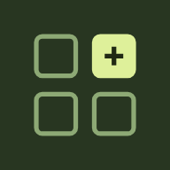
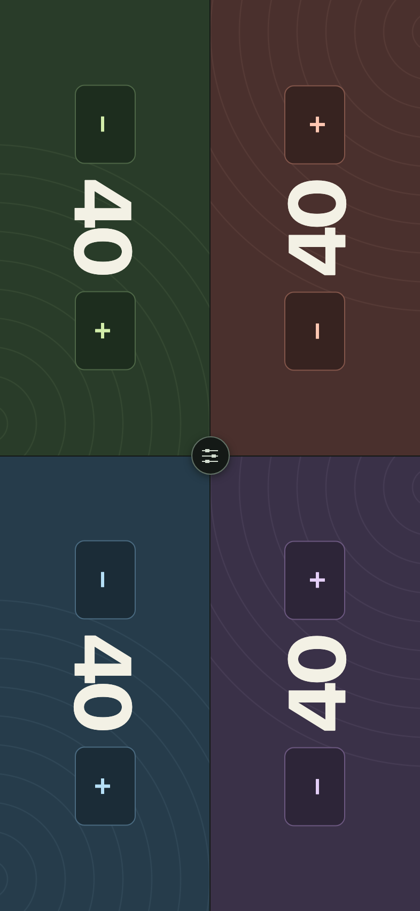

# LifePod

**An ad-free, offline life counter for tabletop games.**

A fresh install opens with four players at 40 life. Tap **−** or **+** to adjust a total by one, or hold to make a larger change. Each button's touch area covers its half of the tile, so a tap anywhere on the left half of your tile subtracts and anywhere on the right half adds. A tap counts as soon as your finger touches the screen, and several players can tap or hold at the same time. A total at 0 or below turns red.

## Screenshots

 
Four players · Six players

 
Three players · Five players

[Dice](screenshots/dice.png) · [Game setup](screenshots/setup.png) · [Custom seat rotation](screenshots/rotate-seats.png)

## At the table

Set the phone in the middle of the table in landscape. The seats stay fixed to the device: if the screen turns to portrait or upside down, the board turns back so every total stays in front of its player. Each new game treats the current landscape as upright. The app itself turns with the phone, so the system bars and the swipe-home gesture stay at the bottom edge as you hold it. With two players, the seats face opposite short ends. With four or six, two or three seats face each long side. With three or five, one or two seats face each long side and one larger seat faces the right end. Each player reads **−** on the left and **+** on the right from their seat.

Tap the die in the center to roll a d4, d6, d8, d10, d12 or d20. Each die is drawn in its own shape, and every roll comes from the device's cryptographic random number generator, so no face is favoured.

Tap the sliders beside it to choose 2–6 players, set the starting life, restart, or toggle **Keep awake**. Changing the player count or starting life starts a new game. **Keep awake** is on by default. Scores and settings are saved between launches.

Choose **Rotate seats** in Setup, then tap a tile to turn it 90° clockwise. Tap the center check mark or press back when finished. Rotation choices carry over when restarting with the same player count.

Turn on **Commander** or **Poison** under Counters in Setup to track commander tax, colour identity and poison. Both are off by default and stay as you set them across launches and new games. With either on, a counters button joins the center controls. Tap it and each tile shows poison as **−** count **+** and commander tax as **−** +2 per cast **+**, facing its player; hold **−** or **+** to repeat. Each tile's palette button opens that player's tile colour and, with Commander on, their colour identity (white, blue, black, red, green, or colourless), turned to face them. While counters are open, the center shows Undo, a check mark and ✕: Undo steps back one change at a time, the check mark saves, and ✕ discards every change made since opening, asking first if there are any. Android back works like ✕. At rest, a row along each player's own edge shows their colour identity, poison and tax, each only when set. Starting a new game resets the counts and keeps the switches, colours and identities.

With **Commander** on, a sword joins the center controls too. Tap it and every tile becomes a map of the table: each opponent's seat sits where that player sits, in their tile colour, and shows the commander damage their commander has dealt you. Tap an opponent's seat to add 1 commander damage and take 1 life in the same step. Hold a seat to take 1 away, repeating while you hold. Your own seat shows your life and the change, such as "28 −6". Undo, the check mark and ✕ work as they do for counters. At rest, a row along each tile's far edge shows the commander damage taken from each opponent, largest first, with a dot in that opponent's colour. Amber text warns at 15 commander damage from one commander or 7 poison. At 21 or 10 the badge turns red with a thin ring, and the life total turns red.

Choose **Colours** in Setup to change tile colours. Every tile shows nine swatches facing its player, so everyone can pick at once. No two players can have the same colour: a swatch another player has is struck through and can't be picked. Tap the center check mark or press back when finished. Colours carry over to new games and player-count changes.

## Install on Android

  
  

LifePod supports **Android 11 and later**. The Obtainium badge imports `dev.maceiras.lifepod` with **Include prereleases** enabled. You can also add `https://github.com/geota/lifepod` manually in [Obtainium](https://github.com/ImranR98/Obtainium/releases) with the same setting. Obtainium can install LifePod once a GitHub prerelease contains the signed `lifepod.apk`.

Before the first prerelease, download the `lifepod-android` artifact from a successful [CI run](https://github.com/geota/lifepod/actions/workflows/ci.yml), unzip it, and open `lifepod-debug.apk` on your phone. Debug builds are signed with the committed, non-secret `android/debug.keystore`, so each newer debug build installs over the last one and keeps the saved game.

### Build locally

The debug APK is built at `android/build/lifepod-debug.apk`. Copy it to an Android 11 or newer phone and open it to install. With a device connected and USB debugging enabled, you can also install it using `adb install -r android/build/lifepod-debug.apk`.

To rebuild, install JDK 21, Kotlin 2.2.x (`kotlinc`), Android SDK Platform 36, and Android SDK Build-Tools 36.1.0. Set `ANDROID_HOME` to the SDK directory and run `./android/build.sh` from this directory. To also build the App Bundle that Google Play requires, download [bundletool](https://github.com/google/bundletool/releases) and set `LIFE_POD_BUNDLETOOL` to its jar.

## iOS

Open `ios/LifePod.xcodeproj` in Xcode and run the **LifePod** target on a simulator or device running iOS 16 or later. Version tags upload to TestFlight once the App Store Connect key is set; see [RELEASING.md](RELEASING.md). For a physical device, select your development team under **Signing & Capabilities** first. Both apps bundle the UI in `web/` and use their platform’s screen-awake and local storage APIs.

## Browser preview

Open `web/index.html` to try the tracker on your computer. The preview uses browser storage and requests a screen wake lock where supported.

## Lint

Install ktlint, Kotlin (`kotlinc`), Android SDK Command-line Tools 23.0 (for Android Lint), and full Xcode for `swift-format`. Then run `npm ci` and `npm run lint` from the project root. Android Lint runs without Gradle through `android/lint.sh`, which describes the app in a lint project file; `android/lint.xml` lists the checks LifePod deliberately ignores and why. Run `npm run lint:web`, `npm run lint:android`, or `npm run lint:ios` to check one platform.

Run `npx playwright-core install chromium webkit` and `npm test` to check seat placement and facing as the screen turns each way, and simultaneous taps and holds by several players.

## Shared code

`web/` contains the interface, seat layouts, rotations, scoring, and saved-game format. Android and iOS bundle those files directly. Their Kotlin and Swift wrappers handle native screen-awake behavior, local storage, and fullscreen presentation. Browser preview uses the equivalent browser APIs. App icons, build settings, and package metadata live in the platform projects.

## GitHub Actions

[CI](.github/workflows/ci.yml) runs lint, browser seating tests, and builds for pull requests and pushes to `main`. Each successful run produces a static web ZIP, a debug-signed Android APK and App Bundle, and an iOS Simulator ZIP. CI also compiles the iPhone target with signing disabled.

A version tag such as `v0.1.0-alpha.1` publishes a GitHub prerelease with the signed APK, and uploads the App Bundle to Google Play once its secrets are set. [RELEASING.md](RELEASING.md) has the commands for creating the keys and secrets.

## Privacy

LifePod collects no data. See the [privacy policy](PRIVACY.md).
