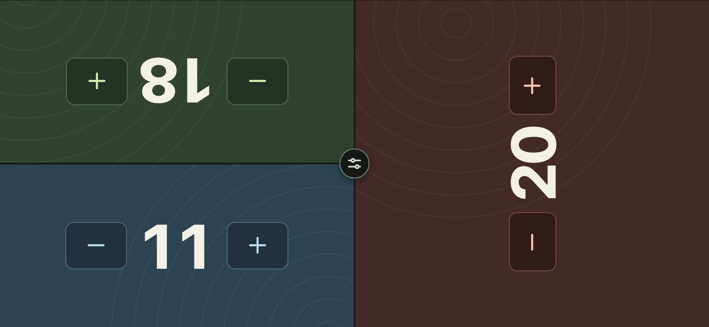
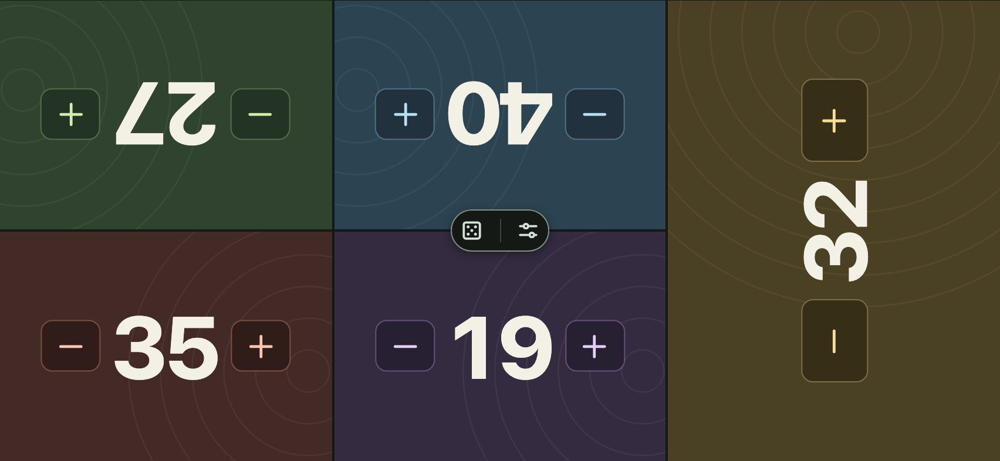

# LifePod

**An ad-free, offline life counter for tabletop games.**

A fresh install opens with four players at 40 life. Tap **−** or **+** to adjust a total by one, or hold to make a larger change. Each sign marks its half of the tile, so a tap anywhere on the left half of your tile subtracts and anywhere on the right half adds; the half you press lights up in your colour while your finger is down. A tap counts as soon as your finger touches the screen, and several players can tap or hold at the same time. A total at 0 or below turns red. Every tile draws its total, signs and badges at the same size, the largest that fits the smallest tile, so a three-digit total shrinks every total together.

## Screenshots

 
Four players · Six players

 
Three players · Five players

[Dice](screenshots/dice.png) · [Settings](screenshots/setup.png) · [Custom seat rotation](screenshots/rotate-seats.png)

## At the table

Set the phone in the middle of the table in landscape. The seats stay fixed to the device: if the screen turns to portrait or upside down, the board turns back so every total stays in front of its player. Each new game treats the current landscape as upright. The app itself turns with the phone, so the system bars and the swipe-home gesture stay at the bottom edge as you hold it. With two players, the seats face opposite short ends. With four or six, two or three seats face each long side. With three or five, one or two seats face each long side and one larger seat faces the right end. Each player reads **−** on the left and **+** on the right from their seat.

Tap the die in the center to roll a d4, d6, d8, d10, d12 or d20. Each die is drawn in its own shape, and every roll comes from the device's cryptographic random number generator, so no face is favoured.

Tap the sliders beside it to open **Settings**, a full-screen page in sections: **Game**, **Track**, **Identity**, **Table**, **Reminders** and **About**, in two columns on a landscape phone and one on narrow screens. It faces the phone rather than the board; the turn button in its header flips it round for a player across the table. **Players** is a slider from 2 to 6 and **Starting life** a slider from 10 to 60 with stops at 20, 30 and 40: tap a number or drag, and arrow keys work too. Tap the life total beside it to type any whole number from 1 to 999. Changing players or starting life doesn't take effect until you leave: **Done** becomes **Start new game**, and a line says what will happen. ✕ or Android back leaves without starting it. **New game** restarts with the same players and life, asking first. **Keep awake** is on by default. Everything else in Settings saves the moment you change it, and scores and settings are saved between launches. **About** has the privacy summary and credits.

Choose **Rotate seats** in Settings → **Table**, then tap a tile to turn it 90° clockwise. Tap the center check mark or press back when finished. Rotation choices carry over when restarting with the same player count.

Turn on **Commander**, **Poison**, **Energy**, **Experience** or **Rad** in Settings → **Track** to track commander damage and tax, poison, energy, experience or rad counters. All are off by default, save the moment you switch them, and stay as you set them across launches and new games. With any of them on, a counters button joins the center controls. Tap it and each tile shows a circle for each counter that's on, in the order poison, commander tax (+2 per cast, under Mana's commander symbol), energy, experience and rad, three to a row, each with its icon over the count, facing its player. Tap a circle to add one; hold it to take one away, repeating while you hold. While counters are open, the center shows Undo, a check mark and ✕: Undo steps back one change at a time, the check mark saves, and ✕ discards every change made since opening, asking first if there are any. Android back works like ✕. At rest, a row along each player's own edge shows their colour identity chip, then poison, tax, energy, experience and rad, each only when set. Starting a new game resets the counts and keeps the switches, colours and identities.

With **Commander** on, a sword joins the center controls too. Tap it and every tile becomes a map of the table: each opponent's seat sits where that player sits, in their tile colour, and shows the commander damage their commander has dealt you. A seat at 0 is outlined in that player's colour, and it fills with their colour once they have hit you. Tap an opponent's seat to add 1 commander damage and take 1 life in the same step. Hold a seat to take 1 away, repeating while you hold. Your own seat shows your life and the change, such as "28 −6". Undo, the check mark and ✕ work as they do for counters. At rest, a row along each tile's far edge starts with a sword and shows the commander damage taken from each opponent, largest first, with a dot in that opponent's colour. Amber text warns at 15 commander damage from one commander or 7 poison. At 21 or 10 the badge turns red with a thin ring, and the life total turns red. If a badge row ever runs out of room, the same thing gives way on every tile. Along the far edge the sword goes first; along the near edge the identity names and the word "Turn" go first, then the identity symbol if the colour indicator also shows. Then the row takes a second line, and only then does its type shrink, to a 9px floor; where a second line would cover a life total, the type shrinks first and the row wraps last. Counts, the crown, the castle, the identity chip and its colour indicator are never hidden, and anything that gave way comes back only when there's room to spare.

Set **Turns** in Settings → **Track** to follow the game's turns: **Off** (the default), **Rounds** or **Turn by turn**. Each new game while Turns is on, and switching Turns on in a game with nobody first, opens "Who goes first?": tap **Me first** on your tile, tap the center shuffle to pick at random, or ✕ to skip. Play goes clockwise on screen, which is passing to the left, whatever the seat rotations. With **Rounds**, the first player's flag shows the round: tap it as each round starts, or hold it to go back one. With **Turn by turn**, the active player's tile lifts toward their colour inside a ring, and their row leads with the untap symbol and "Turn 3": tap it when your turn ends and play passes to the next player who isn't out, with the round going up when play comes back round to the first player, who keeps a small flag. Hold it to step back one turn. If nobody went first, every tile has a turn chip until someone starts theirs. Either way, the round leads the center controls, printed twice so both sides of the table can read it, and works like the chip, so anyone can step the game on. Turn steps save at once. Off hides everything about turns and keeps it for when you switch back on.

Turn on **Monarch** or **Initiative** in Settings → **Track** to follow the monarch (a crown) and the initiative (a castle). Both are off by default and save the moment they change. Nobody holds either until an effect says so: in counters mode each tile gets a crown cell and a castle cell after the counters (seven cells go four to a row). Tap one to give it to that player, which takes it from whoever had it, or tap the holder's own cell to clear it; Undo, the check mark and ✕ work as for counters. At rest the holder's own edge shows the crown or the castle; these never give way when a row runs out of room. Commander damage is combat damage, so adding it to the monarch makes the attacker the monarch, and the same for the initiative, in the same step: Undo or ✕ takes both back. When a holder goes out with **Turn by turn** on and somebody's turn started, the rules hand it on (CR 726.4 and 727.4): the active player takes it, or, if the active player is the one going out or is already out, the next player in turn order who is still in. If nobody else is in, the game goes on with no monarch, and the initiative stays put. Otherwise an out holder's tile shows **Pass it on**, which opens counters mode, until someone takes it there. A new game clears both.

Settings → **Reminders** has three switches, all on by default. **Turn reminders**, shown while the monarch or the initiative is on and Turns is Turn by turn, puts "Monarch: draw a card" on the monarch's tile as they pass the turn, and "Initiative: venture into Undercity" on the initiative holder's tile as their turn starts or when they take it mid-turn, facing them, for 3 seconds or until tapped. Where a tile is too short to show it above its own edge clear of the total, the reminder takes that edge for those seconds. **Pass-it-on hints**, shown while either is on, controls the Pass it on chip. **Gesture hints** controls the "Tap +1 · hold −1" and "Tap your colours" lines in counters, mana, commander damage and identity modes.

Turn on **Mana pool** in Settings → **Track** to keep floating mana. The center controls gain the tap symbol, with a dot while any pool has mana. Tap it and every tile shows six circles, white, blue, black, red, green and colourless, each with its mana symbol over the amount: tap to add one, hold to take one away, with Undo, the check mark and ✕ as for counters. At rest, a tile with mana shows a strip at its far edge, just under commander damage, with just the colours it holds: tap a symbol to spend one, or the eraser to empty the pool, which leaves **Undo clear** for 5 seconds. Both rows of badges stay. The strip never covers a life total or its − and +: where it runs out of room it moves to the end of the commander damage row, then its type shrinks, and a pool that still can't fit folds into one button that shows it and opens mana mode. With Turns on, **Empty mana pools when the turn passes** (on by default) empties every pool on each round or turn step, and stepping back restores what it emptied. A new game empties every pool.

Choose **Colours** in Settings → **Table** to change tile colours. Every tile shows twelve swatches facing its player, so everyone can pick at once. No two players can have the same colour: a swatch another player has shows who has it, such as P2, in place of its dot, and can't be picked. Tap the center check mark or press back when finished. Colours carry over to new games and player-count changes. **Tile colours** in Settings → **Table** picks the set the twelve colours come from: **Classic** (the original twelve), **Soft**, **Jewel** or **Clear**, the default, chosen to keep every pair of tiles apart for red-green colour-blind players too. Each player keeps their colour when the set changes, and the setting saves at once. **Badge size** in Settings → **Table**, **Default**, **Large** or **Larger**, makes the badge rows along both edges and the mana strip bigger: their chips, counts, icons and colour indicator. A row grows only as far as fits between its edge and the life total, so on a small board it may stay at the default size, and it saves at once.

**Style** in Settings → **Table** sets the look of every control in the app: **Material**, filled tonal controls in Android's current style, or **Glass**, in the style of iOS 26, with frosted glass on the centre controls, the Settings header and dialogs over solid grouped lists, iOS switches and segmented controls. The tiles and their − and + look the same in both, and Tile colours is separate. The iPhone and iPad app starts on Glass, and Android and the browser preview on Material, until you pick one; your pick is saved and stays. Glass draws solid surfaces instead of glass when the system asks for reduced transparency (Reduce Transparency on iOS) or the device can't blur, and solid surfaces with an outline when it asks for more contrast. Glass's presses shrink with a spring, and nothing moves when the device asks for reduced motion.

Use **Identity** in Settings for colour identity, in any game, with or without Commander. **Show on tiles** has a switch each for the card-style colour **Indicator**, the identity's **Symbol** and its **Name**, in any mix, for the chip that leads each player's own edge; the default is indicator and name. The symbol is the colour's mana symbol, the Ravnica guild, the Khans clan, the Streets of New Capenna family for a shard, the colour pie for all five colours, or for four colours the colour pie with the missing colour faded. Names are the guild, clan and shard names, Mono-white to Mono-green, the Nephilim names for four colours (Glint-Eye, Dune-Brood, Ink-Treader, Witch-Maw and Yore-Tiller) and WUBRG. **Background** is **Symbol** (the default), which puts the identity's symbol faintly behind the life total of each tile with an identity and leaves the rings on the rest; **Default**, the rings on every tile; or **Off**, no background at all. Turning everything off hides identity without clearing anyone's choice. These save the moment they change. **Choose identities** turns every tile into five mana-symbol toggles facing its player, under a preview of the identity's indicator, symbol and name: any mix of white, blue, black, red and green, left empty for a colourless commander. Each choice saves at once; tap the center check mark or press back when finished. Colours, Rotate seats and Choose identities close Settings and start straight away, starting a pending new game first. Identities carry over to new games.

## Install on Android

  
  

LifePod supports **Android 11 and later** with Android System WebView 129 or later, which Google Play keeps updated; on an older WebView the app asks you to update it. The Obtainium badge imports `dev.maceiras.lifepod` with **Include prereleases** enabled. You can also add `https://github.com/geota/lifepod` manually in [Obtainium](https://github.com/ImranR98/Obtainium/releases) with the same setting. Obtainium can install LifePod once a GitHub prerelease contains the signed `lifepod.apk`.

Before the first prerelease, download the `lifepod-android` artifact from a successful [CI run](https://github.com/geota/lifepod/actions/workflows/ci.yml), unzip it, and open `lifepod-debug.apk` on your phone. Debug builds are signed with the committed, non-secret `android/debug.keystore`, so each newer debug build installs over the last one and keeps the saved game.

### Build locally

The debug APK is built at `android/build/lifepod-debug.apk`. Copy it to an Android 11 or newer phone and open it to install. With a device connected and USB debugging enabled, you can also install it using `adb install -r android/build/lifepod-debug.apk`.

To rebuild, install JDK 21, Kotlin 2.2.x (`kotlinc`), Android SDK Platform 36, and Android SDK Build-Tools 36.1.0. Set `ANDROID_HOME` to the SDK directory and run `./android/build.sh` from this directory. To also build the App Bundle that Google Play requires, download [bundletool](https://github.com/google/bundletool/releases) and set `LIFE_POD_BUNDLETOOL` to its jar.

The build shrinks the Kotlin code with R8, using `android/proguard-rules.pro`, and then `android/check-bridge.sh` makes sure the page's bridge methods survived. Builds signed with the debug key are debuggable, so you can inspect the page from `chrome://inspect` on a connected computer. Release-signed builds aren't.

## iOS

Open `ios/LifePod.xcodeproj` in Xcode and run the **LifePod** target on a simulator or device running iOS 18 or later. Version tags upload to TestFlight once the App Store Connect key is set; see [RELEASING.md](RELEASING.md). For a physical device, select your development team under **Signing & Capabilities** first. In the Debug configuration, Safari's **Develop** menu can inspect the page; Release builds can't be inspected. Both apps bundle the UI in `web/` and use their platform’s screen-awake and local storage APIs.

## Browser preview

Open `web/index.html` to try the tracker on your computer. The preview uses browser storage and requests a screen wake lock where supported.

## Lint

Run `npm run check` before committing. It runs, in order: `lint:web` (ESLint), `lint:compat`, `lint:kotlin` (ktlint, through mise when it isn't on the path), `lint:ios` (swift-format) and `npm test`, and needs the tools below plus the Playwright browsers. It leaves out Android Lint, which needs the Android SDK; run `npm run lint:android` for that.

`npm run lint:compat` checks `web/` against the oldest browsers LifePod supports, listed in `browserslist` in `package.json`: iOS 18 (WKWebView) and the Android System WebView, as Chrome 129 and later. `eslint.compat.config.mjs` uses `eslint-plugin-compat` and a list of newer JavaScript APIs the plugin misses. `stylelint.config.mjs` uses `stylelint-no-unsupported-browser-features`. Both list the findings that are only warnings for now.

Install ktlint, Kotlin (`kotlinc`), Android SDK Command-line Tools 23.0 (for Android Lint), and full Xcode for `swift-format`. Then run `npm ci` and `npm run lint` from the project root. Android Lint runs without Gradle through `android/lint.sh`, which describes the app in a lint project file; `android/lint.xml` lists the checks LifePod deliberately ignores and why. Run `npm run lint:web`, `npm run lint:android`, or `npm run lint:ios` to check one platform.

Run `npx playwright-core install chromium webkit` and `npm test` to check seat placement and facing as the screen turns each way, simultaneous taps and holds by several players, and that the board fits and scales from a 320 × 568 phone through foldables to a 13-inch iPad. The smallest real phone the design targets is 360 × 640; 320 × 568 is kept as a stress test.

## Shared code

`web/` contains the interface, seat layouts, rotations, scoring, and saved-game format. Android and iOS bundle the whole folder and serve it to their web view from inside the app: Android at `https://appassets.androidplatform.net/` and iOS at `lifepod://app/`, with no network access. Either app serves any file in `web/` with an allowed extension (html, css, js or mjs, json, png, svg, woff2 or txt), so a new file needs no native change. Their Kotlin and Swift wrappers handle native screen-awake behavior, local storage, and fullscreen presentation. Browser preview uses the equivalent browser APIs. App icons, build settings, and package metadata live in the platform projects.

## GitHub Actions

[CI](.github/workflows/ci.yml) runs lint, browser seating tests, and builds for pull requests and pushes to `main`. Each successful run produces a static web ZIP of all of `web/`, a debug-signed Android APK and App Bundle, and an iOS Simulator ZIP. CI also compiles the iPhone target with signing disabled.

A version tag such as `v0.1.0-alpha.1` publishes a GitHub prerelease with the signed APK, and uploads the App Bundle to Google Play once its secrets are set. [RELEASING.md](RELEASING.md) has the commands for creating the keys and secrets.

## Privacy

LifePod collects no data. See the [privacy policy](PRIVACY.md).

## License

LifePod's own code is under the [MIT License](LICENSE). That covers the code only: the Mana font keeps its own SIL Open Font License ([`web/fonts/OFL.txt`](web/fonts/OFL.txt)), and the mana, colour indicator, guild, clan and family symbols belong to Wizards of the Coast.

## Credits

LifePod is unofficial Fan Content permitted under the Fan Content Policy. Not approved/endorsed by Wizards. Portions of the materials used are property of Wizards of the Coast. ©Wizards of the Coast LLC.

The mana and colour indicator symbols come from the [Mana font](https://github.com/andrewgioia/mana) by Andrew Gioia, bundled under the SIL Open Font License 1.1 ([`web/fonts/OFL.txt`](web/fonts/OFL.txt)). `web/fonts/mana.woff2` is a subset of Mana 1.18 with only the symbols LifePod draws, made by [`scripts/subset-mana.mjs`](scripts/subset-mana.mjs) from the original release in `design/fonts/`.
