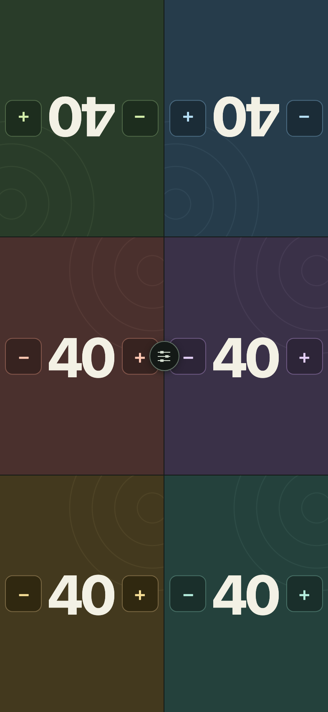
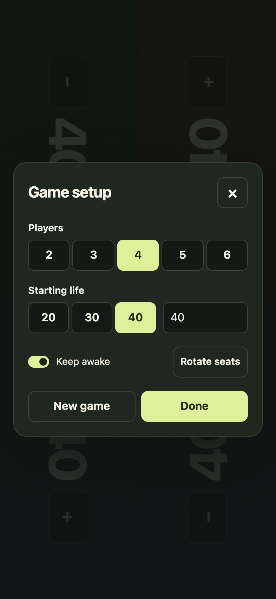
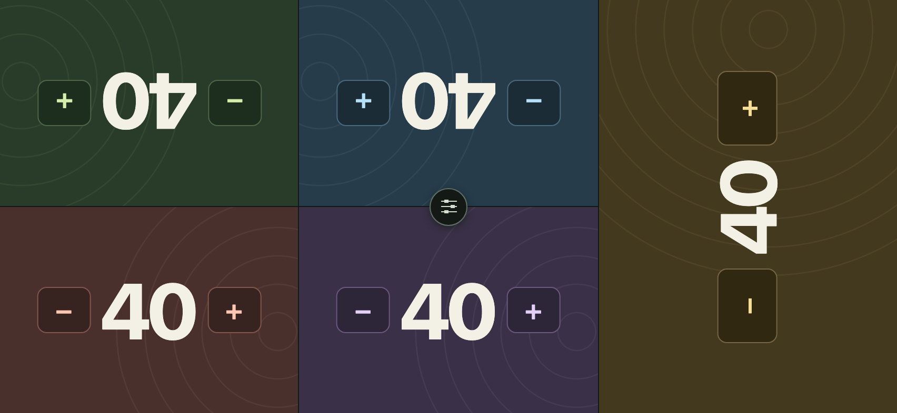

<div align="center">


# LifePod

**An ad-free, offline life counter for tabletop games.**

[](https://github.com/geota/lifepod/actions/workflows/ci.yml)
[](android/)
[](ios/)
[](web/)

</div>

A fresh install opens with four players at 40 life. Tap **−** or **+** to adjust a total by one, or hold to make a larger change.

## Screenshots

<div align="center">
<a href="screenshots/board.png"></a>
<a href="screenshots/six-players.png"></a>
<a href="screenshots/setup.png"></a>
<br />
<sub>Four players · Six players · Setup</sub>
</div>

<div align="center">
<a href="screenshots/five-players-landscape.png"></a>
<br />
<sub>Five players in landscape</sub>
</div>

[Five-player portrait](screenshots/five-players.png) · [Custom seat rotation](screenshots/rotate-seats.png)

## At the table

Set the phone in the middle of the table. With four players, seats face the phone’s two long sides, with **−** and **+** on either side of each total. With three or five players, one seat spans two slots so the board still fills the screen.

Tap the sliders in the center to choose 2–6 players, set the starting life, restart, or toggle **Keep awake**. Changing the player count or starting life starts a new game. **Keep awake** is on by default. Scores and settings are saved between launches.

Choose **Rotate seats** in Setup, then tap a tile to turn it 90° clockwise. Tap the center check mark when finished. Rotation choices carry over when restarting with the same player count.

## Install on Android

<p align="center">
  <a href="https://apps.obtainium.imranr.dev/redirect?r=obtainium://app/%7B%22id%22%3A%22dev.maceiras.lifepod%22%2C%22url%22%3A%22https%3A%2F%2Fgithub.com%2Fgeota%2Flifepod%22%2C%22author%22%3A%22geota%22%2C%22name%22%3A%22LifePod%22%2C%22additionalSettings%22%3A%22%7B%5C%22includePrereleases%5C%22%3Atrue%7D%22%7D"></a>
  <a href="https://github.com/geota/lifepod/releases"></a>
</p>

LifePod supports **Android 11 and later**. The Obtainium badge imports `dev.maceiras.lifepod` with **Include prereleases** enabled. You can also add `https://github.com/geota/lifepod` manually in [Obtainium](https://github.com/ImranR98/Obtainium/releases) and enable **Include prereleases**. Install `lifepod.apk` from a signed prerelease, then follow updates in Obtainium.

### Build locally

The debug APK is built at `android/build/lifepod-debug.apk`. Copy it to an Android 11 or newer phone and open it to install. With a device connected and USB debugging enabled, you can also install it using `adb install -r android/build/lifepod-debug.apk`.

To rebuild, install JDK 21, Kotlin 2.2.x (`kotlinc`), Android SDK Platform 36, and Android SDK Build-Tools 36.1.0. Set `ANDROID_HOME` to the SDK directory and run `./android/build-apk.sh` from this directory.

## iOS

Open `ios/LifePod.xcodeproj` in Xcode and run the **LifePod** target on a simulator or device running iOS 16 or later. For a physical device, select your development team under **Signing & Capabilities** first. Both apps bundle the UI in `web/` and use their platform’s screen-awake and local storage APIs.

## Browser preview

Open `web/index.html` to try the tracker on your computer. The preview uses browser storage and requests a screen wake lock where supported.

## Lint

Install ktlint and select full Xcode for `swift-format`. Then run `npm ci` and `npm run lint` from the project root. Run `npm run lint:web`, `npm run lint:android`, or `npm run lint:ios` to check one platform.

## Shared code

`web/` contains the interface, seat layouts, rotations, scoring, and saved-game format. Android and iOS bundle those files directly. Their Kotlin and Swift wrappers handle native screen-awake behavior, local storage, and fullscreen presentation. Browser preview uses the equivalent browser APIs. App icons, build settings, and package metadata live in the platform projects.

## GitHub Actions

[CI](.github/workflows/ci.yml) runs lint and builds for pull requests and pushes to `main`. Each successful run produces a static web ZIP, a debug-signed Android APK, and an iOS Simulator ZIP. CI also compiles the iPhone target with signing disabled.

### Publish a signed alpha

Create a PKCS#12 signing keystore once and back it up. Use the same keystore for every release so Android can install upgrades in place.

```sh
mkdir -p "$HOME/.config/lifepod"
keytool -genkeypair -storetype PKCS12 -keystore "$HOME/.config/lifepod/lifepod-release.p12" \
  -alias lifepod -keyalg RSA -keysize 3072 -validity 10000 -dname 'CN=LifePod'
base64 < "$HOME/.config/lifepod/lifepod-release.p12" | gh secret set ANDROID_KEYSTORE_BASE64 --repo geota/lifepod
gh secret set ANDROID_KEYSTORE_PASSWORD --repo geota/lifepod
```

Enter the keystore password when `gh secret set ANDROID_KEYSTORE_PASSWORD` prompts for it. Push a version tag from a tested commit to publish the signed APK, iOS Simulator ZIP, and offline web ZIP as a GitHub prerelease.

```sh
git tag v0.1.0-alpha.1
git push origin v0.1.0-alpha.1
```

Each tagged APK uses the tag for its Android version name and the workflow run number for its version code. A first signed alpha requires a fresh install if you previously used a debug build. The iOS ZIP is for Simulator, and physical devices require an Xcode build with your development team selected.
