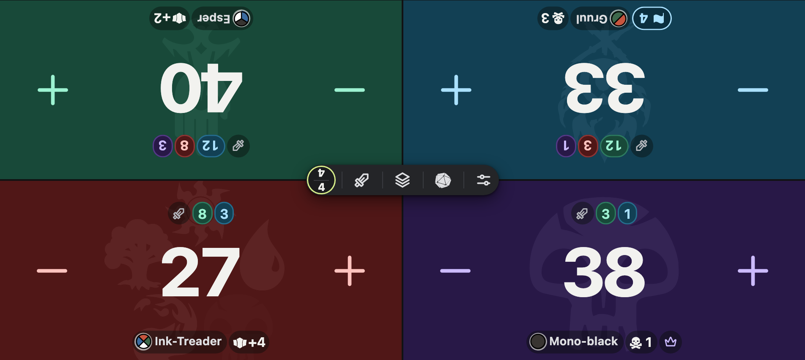
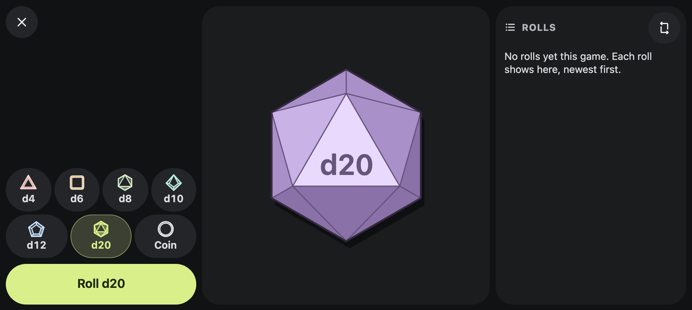
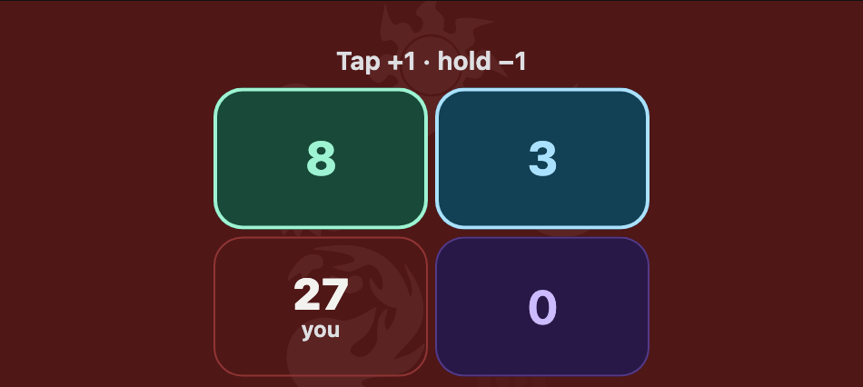
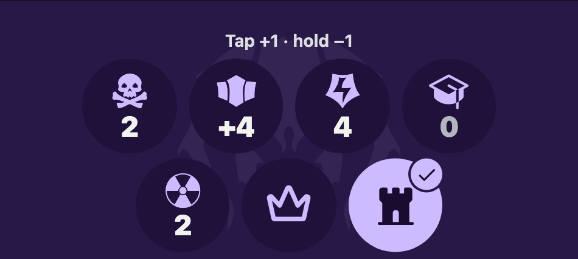
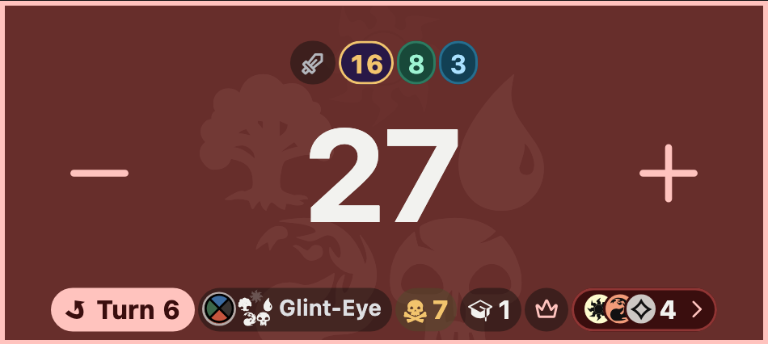
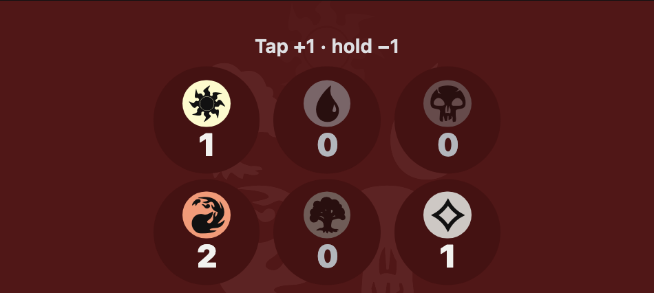
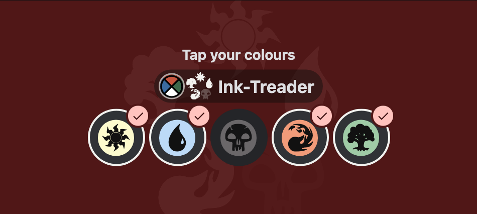
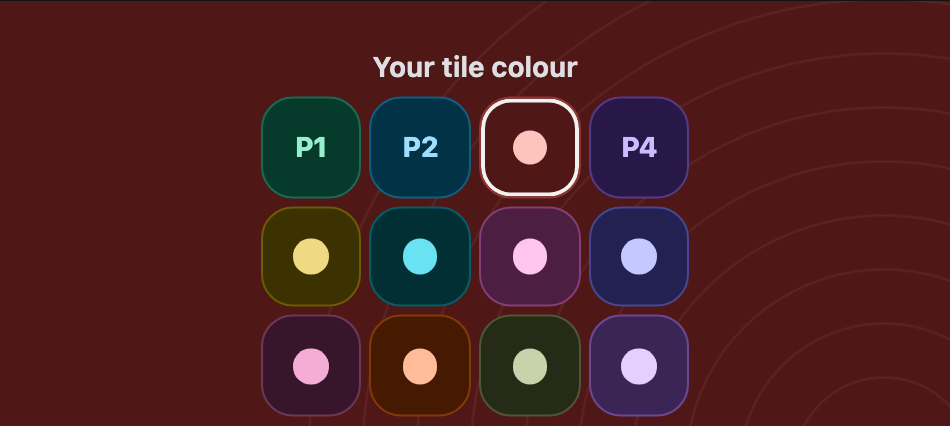
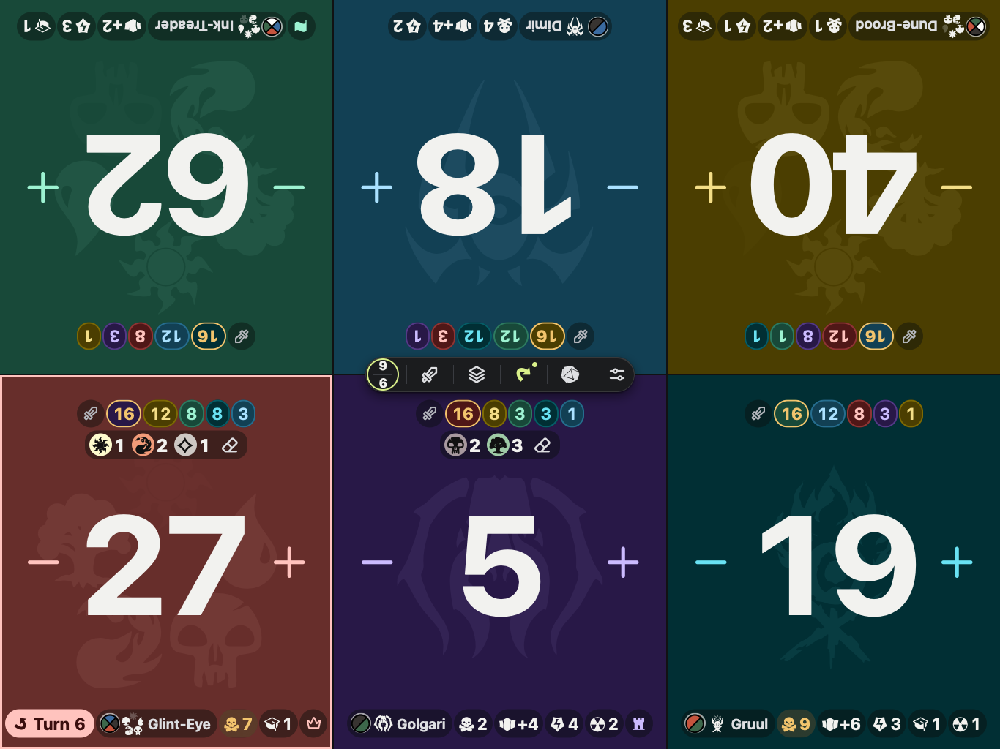

<div align="center">


# LifePod

**An offline, ad-free life counter for Magic: The Gathering on Android, iPhone and iPad.**

[](https://github.com/geota/lifepod/actions/workflows/ci.yml)
[](LICENSE)

<a href="https://apps.obtainium.imranr.dev/redirect?r=obtainium://app/%7B%22id%22%3A%22dev.maceiras.lifepod%22%2C%22url%22%3A%22https%3A%2F%2Fgithub.com%2Fgeota%2Flifepod%22%2C%22author%22%3A%22geota%22%2C%22name%22%3A%22LifePod%22%2C%22additionalSettings%22%3A%22%7B%5C%22includePrereleases%5C%22%3Atrue%7D%22%7D"></a>
<a href="https://github.com/geota/lifepod/releases"></a>

<a href="screenshots/readme/hero.png"></a>

</div>

## Features

### Life and table

- 2 to 6 players, starting at any life total from 1 to 999.
- Tap either half of your tile for −1 or +1, or hold for bigger steps. Several players can tap at once.
- Every seat faces its player, and the board stays put when the phone turns.
- Rotate any seat to fit your table.
- Roll a d4, d6, d8, d10, d12 or d20, or flip a coin, from the device's secure random number generator, with a ledger of the last 50 rolls.
- Look up any card offline: every paper Magic card's rules text, with mana symbols, both faces of double-faced cards, the colour identity and the official rulings. Search names as you type, or rules text too.
- **New game**, in the Settings header, resets life, counters, commander damage, mana and Treasure, turns, the monarch and the initiative, identities and dice rolls. Settings and seats stay.
- Keeps the screen awake and saves the game between launches.

<p align="center">
  
</p>

### Commander and counters

- Commander damage on a map of the table: one tap adds the damage and takes the life.
- Commander tax, poison, energy, experience and rad counters. Turn on only the ones you use.
- Amber warnings at 15 commander damage or 7 poison, red at 21 or 10.
- Undo and redo for the whole game, with a history of every action; quick taps merge into one step.

<p align="center">
  
  
</p>

### Turns and the monarch

- Track turns by round or turn by turn, with the active player's tile lit up.
- "Who goes first?": tap your tile, or shuffle to pick at random.
- The monarch and the initiative, passed on by the rules when the holder is out.
- Reminders to draw for the monarch and venture into the Undercity.

<p align="center">
  
</p>

### Mana and identity

- A floating mana pool per player, spent from a badge-height strip on the tile. On small tiles it folds into one chip that opens the pool. It can empty as each turn passes, unless that player keeps it.
- Treasure tokens per player, which last until used: a chip on the tile uses one a tap.
- Colour identity for each player, shown as the card indicator, the guild, clan or shard symbol, and its name.

<p align="center">
  
  
</p>

### Look and accessibility

- Two styles: Material, or Glass in the style of iOS 26.
- Four tile colour sets, shown as colour bands; optional shuffle each game. No two players share a colour.
- Three badge sizes for the rows along each tile's edges.
- Settings and dialogs follow the system text size and can be zoomed.
- Nothing moves with reduced motion. Glass turns solid for reduced transparency, and adds outlines for more contrast.
- Every touch target is at least 44 px.

<p align="center">
  
  
</p>

The full guide to every control is in [docs/GUIDE.md](docs/GUIDE.md).

## Install

- **Android 11 or later**, with Android System WebView 129 or later: the Obtainium badge above adds LifePod with **Include prereleases** on. Or download `lifepod.apk` from [GitHub releases](https://github.com/geota/lifepod/releases).
- **iPhone and iPad, iOS 18 or later:** build it from Xcode (below). Tagged versions go to TestFlight as a private beta.
- **Browser:** run it locally with `npm run preview` (below).

## Build and test

```sh
npm ci
npx playwright-core install chromium webkit
npm run check     # lint, type check and every test
npm run preview   # http://127.0.0.1:8080/
```

- **Android:** `./android/build.sh` writes `android/build/lifepod-debug.apk` (JDK 21, Kotlin 2.2, Android SDK 36).
- **iOS:** open `ios/LifePod.xcodeproj` in Xcode and run the **LifePod** target.

Setup, linting, tests and CI are in [docs/DEVELOPING.md](docs/DEVELOPING.md), signing and store uploads in [RELEASING.md](RELEASING.md), and code conventions in [AGENTS.md](AGENTS.md).

## Privacy

LifePod works offline. The Android app has no internet permission, and neither app makes network requests. There are no accounts, ads, analytics or tracking, and the game is saved only on your device. See the [privacy policy](PRIVACY.md).

## License and credits

LifePod's code is under the [MIT License](LICENSE).

The mana and colour indicator symbols come from the [Mana font](https://github.com/andrewgioia/mana) by Andrew Gioia, under the SIL Open Font License 1.1 ([`web/fonts/OFL.txt`](web/fonts/OFL.txt)). The mana, colour indicator, guild, clan and family symbols belong to Wizards of the Coast.

Card data and rulings from [Scryfall](https://scryfall.com), which gathers Wizards of the Coast's rulings, updated <span data-cards-date>26 November 2026</span>. LifePod isn't produced by or endorsed by Scryfall. Card names, mana costs and rules text belong to Wizards of the Coast.

LifePod is unofficial Fan Content permitted under the Fan Content Policy. Not approved/endorsed by Wizards. Portions of the materials used are property of Wizards of the Coast. ©Wizards of the Coast LLC.
