# Counters: options to choose from

**Status:** design session, 20 November 2026. These are mock-ups only; nothing in `web/` has changed. This file goes with [PROPOSAL.md](PROPOSAL.md) and [RESEARCH.md](RESEARCH.md).

Each frame is drawn on the real `web/styles.css`, using the app's own tile, pill and dialog markup and only the extra rules in `mock.css`. White rings with labels show where a finger lands and the running tap count. They are notes for the reader, not part of the design.

- **Browse:** serve the repo root over HTTP and open `design/counters/preview.html`. It has a state picker, the strips and the swatch page.
- **Re-render:** `node design/counters/render.mjs`, or name the scenes and strips to redo. Frames go to `renders/frames/`, and the comparison strips below go to `renders/`.
- **Colours:** `node design/counters/palette.mjs` rebuilds the swatches and their contrast table.
- **Small-phone frames:** 320 × 568 frames are portrait screenshots. The app turns the board 90° to keep it landscape, so the strips show those frames turned back for reading.

Every count here is for **6 commander damage to one player**. The scene is the same throughout: P2's commander (blue) hits P3 (coral), who goes from 34 to 28 life.

---

## 1. Commander damage entry

RESEARCH.md settles one rule question that changes how to judge these alternatives. One commander deals combat damage to **at most one player per combat** (CR 802.3, 508.1b). Partners are out of scope, so every combat produces exactly one attacker–defender pair. That takes away A's "several defenders in one combat" advantage. A stepper on every opponent's tile becomes mostly extra surface for mis-taps.

### A. Attacker first, every opponent becomes a stepper (the proposal)

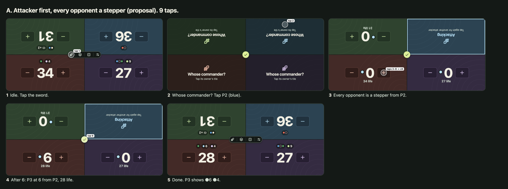

- **Taps: 9.** Sword, attacker, + six times, ✓. A hold can replace the six taps.
- **Mis-tap risk: medium.** 3 opponents (or 5 at six players) each have a live stepper that also takes life, and only one of them is meant to be used. A stray tap on the wrong tile costs that player life.
- **Reading across the table: good.** The defender's large number faces them, and "34 life" sits underneath. The attacker's dot is small, though. On a busy board, a large 0 on three tiles reads like life totals that have gone to zero.
- It is the easiest to explain. Every prompt shows in its player's own orientation.

### B. Defender first, then attacker, then one stepper

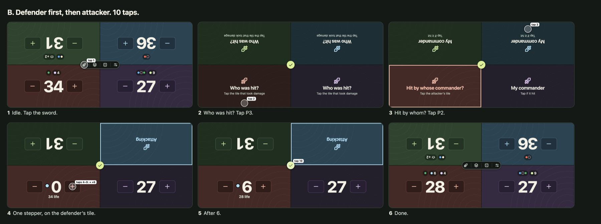

- **Taps: 10.** Sword, defender, attacker, + six times, ✓.
- **Mis-tap risk: lowest.** Only the defender's tile is live, and every other tile is dimmed and inert.
- **Reading across the table: good.** One stepper, facing the defender, with the attacker's tile lit.
- It has the most setup taps. It also asks two questions in turn, and the second prompt ("Hit by whose commander?") has to name the step clearly.

### C. Drag from a handle on the attacker's tile

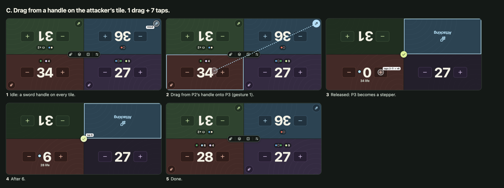

- **Taps: 1 drag + 7 taps.** Drag, + six times, ✓.
- **A handle is required.** A drag can't start on the tile itself, because − and + count the moment a finger lands. A drag starting there would first change life. That means a 44px sword handle on every tile whenever Commander is on, which breaks "nothing shows when unused".
- **Mis-tap risk: medium.** The drag in the 6-player frame crosses the pill and other players' tiles. Reaching to a far seat is awkward, and WCAG 2.5.7 needs a tap route anyway. So C can only ever be an accelerator added to A, B or D.
- **Reading across the table: good while dragging**, because everyone sees the line. Afterwards it reads the same as B.

### D. Table map on every tile (new)

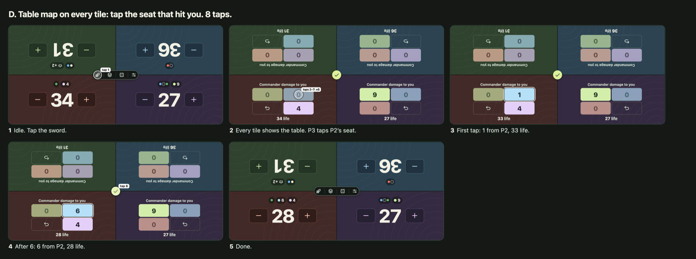

The sword turns every tile into a small map of the table. Each opponent's seat sits where that player actually sits, filled with their tile colour, and shows the damage their commander has dealt you. The defender taps the attacker's seat, once per point. Each tap adds 1 commander damage and takes 1 life, all in one save. Your own seat becomes **Undo**, which takes back the last point. Lifetap shows a similar seat map at rest, according to RESEARCH.md. Here it appears only in the mode.

- **Taps: 8.** Sword, attacker's seat six times, ✓. Choosing the attacker and adding damage happen in the same tap, so the only setup is the sword.
- **Mis-tap risk: low to medium.** Cells are at least 44px. A wrong cell is a wrong attacker, and Undo fixes it with one tap. The − and + halves are gone in this mode, so a life tap can't be taken for damage.
- **Reading across the table: very good for colour, smaller for numbers.** The map is laid out in board coordinates, so it matches the table from every seat. Cell numbers face the tile's owner and are 17–26px, smaller than A's big number. The whole board doubles as a commander damage overview while the mode is open.
- **It fits everywhere.** At 6 players on a 320 × 568 phone the 3 × 2 map keeps 44px cells and drops its title. The map leaves room for the ✓ on its far side.

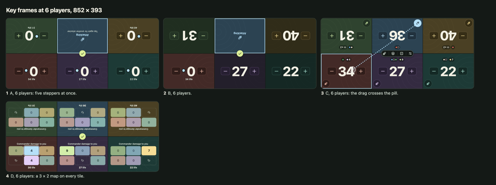
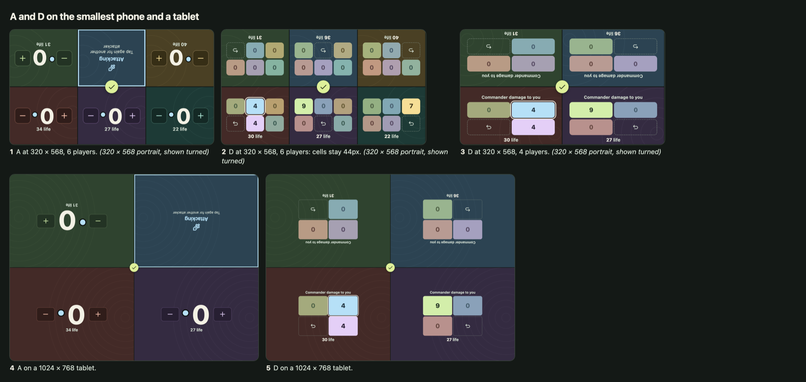

| | Taps | Setup taps | Live targets | Faces the defender | Shows at rest |
|---|---|---|---|---|---|
| A | 9 | 3 | every opponent | yes | nothing |
| B | 10 | 4 | defender only | yes | nothing |
| C | 1 drag + 7 | 1 drag + ✓ | defender only | yes | a handle on every tile |
| D | 8 | 2 | every seat cell | yes | nothing |

**Recommendation: D, with B as the fallback.**

- D is the fewest taps with nothing at rest. The tap that names the attacker is the same tap that adds damage. No tile changes meaning in a way that could confuse life with damage.
- If the map is too unfamiliar at the table, ship B rather than A. Since one commander hits one player per combat, B's single stepper gives up one tap to remove A's 3–5 unused live steppers.
- Leave C out. It could be added later as an accelerator.

**Open questions**

1. D has no − button per cell, only Undo for the last point. Is that enough? Life Trinket uses long-press for −1 as a hidden extra.
2. Should the life line in D (or B) show the change, such as "28 life (−6)", as RESEARCH.md suggests?
3. Should the mode end on its own after a quiet period, so it isn't left on by mistake?

---

## 2. Badges at rest

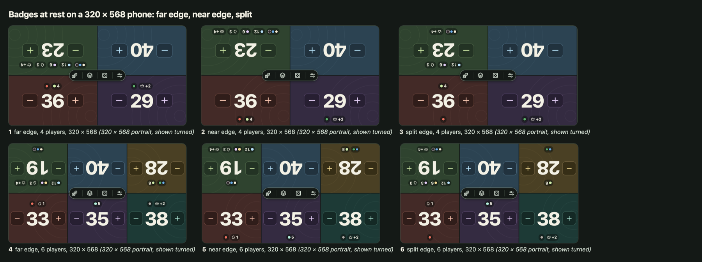
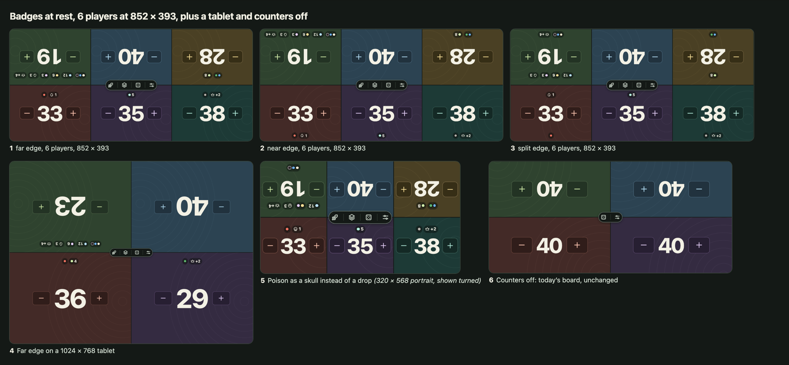

The chips show identity pips, commander damage (the attacker's dot and the amount, largest first), poison and tax (+4). The empty P2 tile next to the busy P1 tile shows that an unused feature takes no space. The last frame, with counters off, is today's board, unchanged.

**One rule applies to every layout: one line per row.** If a row would wrap, the smallest commander damage chips fold into a single chip of plain dots, showing their colours without amounts. The largest amount always stays. If the row is still too wide, the identity pips move to the opposite edge. Without this rule, the busiest 6-player tile on a 320 × 568 phone wraps into the life total. Commander damage mode always shows every amount.

**Far edge** (toward the middle of the table):

- It is never covered by the owner's hand. It sits nearer the other players, who check whether you're close to dead.
- It has to sit 22px in from the seam to clear the pill, which reaches 18px into the tiles next to it, so there's less room.
- On the busiest 6-player tile it folds 6 and 3 into dots.

**Near edge** (the player's own edge):

- It is closest to the owner's eyes and has more room, with no pill to avoid.
- It's under the wrist while the player taps − and +. On phones it also runs along the screen edge and the home indicator.
- It folds the same way on the busiest tile.

**Split:**

- Damage and poison go on the far edge: what others did to you, facing the table.
- Identity and tax go on the near edge: facts about your own commander.
- Doubling the space means nothing folds, even on the busiest 6-player tile at 320 × 568.
- It's two rows instead of one, but each row only appears when it has something in it.

**Recommendation: split.** If you want a single row, use the far edge. Players ask for commander damage they can always see, and only the far edge stays visible while the owner taps.

**Poison icon:** a drop (most frames) or a skull (the "skull" frame). The drop reads as poison without suggesting death, but it might read as water or blue. The skull is unmistakable at 13px. Your call.

**Open questions**

- Split or far edge?
- Drop or skull?
- Is folding small amounts into dots acceptable, or should the chips shrink instead?

---

## 3. Lethal and near-lethal

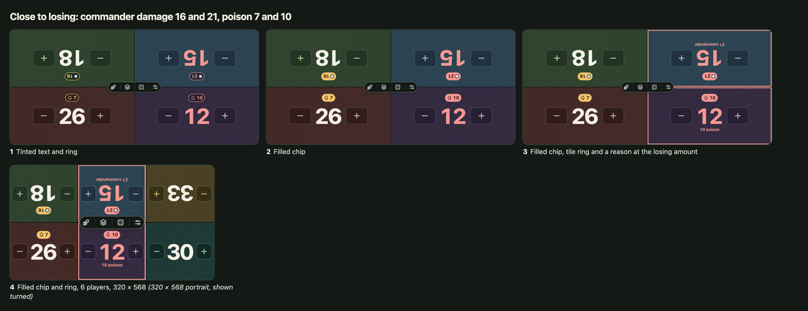

The board shows commander damage at 16 (amber) and 21 (out), and poison at 7 (amber) and 10 (out).

| | Treatment | Reads from across the table | Notes |
|---|---|---|---|
| 1 | Tinted text and a 1.5px ring | weak | It's quiet, but amber text at 13px is easy to miss. |
| 2 | Filled chip, with dark ink on amber (9.9:1) or on coral (7.7:1) | good | At 21, the life total turns red even though it's 15, and nothing says why. |
| 3 | Filled chip, a 3px coral ring round the tile, and a reason under the life total ("21 commander" or "10 poison") | best | It explains a red 15. The ring and reason appear only at the losing amount. |

**Recommendation: 3.** Use filled chips from 15 commander damage and 7 poison. At the losing amount, add the tile ring and the reason line. Nothing pops up.

---

## 4. Counters access (poison, tax, tile colour, identity)

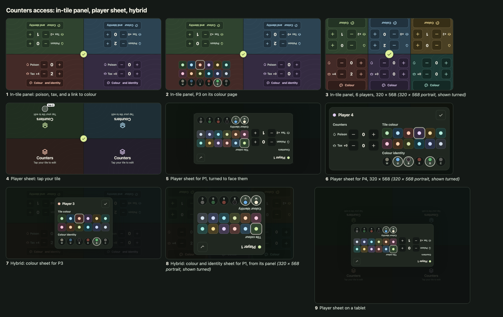

**4A. In-tile flip panel (the proposal).**

- Poison and tax steppers sit in the tile, facing the player. **Poison takes 3 taps.**
- A "Colour and identity" link opens a second page in the tile, with 12 swatches and 6 identity toggles.
- The colour page fits a 4-player tile at 852 × 393 but **not** a 6-player tile on a 320 × 568 phone. 12 swatches at 44px plus 6 toggles need about 188px of height, and the tile has 159.
- Even the counters page needs icon-only labels and tight spacing to clear the ✓ there.

**4B. A player sheet facing the player.**

- The counters button prompts "Tap your tile". The tile you tap opens a sheet turned to face you, with counters, colour and identity.
- There's plenty of room on every size. But **poison takes 4 taps**, and the sheet covers the board.

**4C. Hybrid (recommended).**

- Counts stay in the tile, as in 4A, at 3 taps for poison.
- The tile's palette button opens the player sheet from 4B with only colour and identity, which are set once a game.
- It fits every size checked (frames 7 and 8).

**Recommendation: 4C.** Counts that change during play stay on the tile, and set-once choices get a roomy sheet that still faces the player.

**Open question:** should commander tax also be editable from the badge (tap the crown chip)? The proposal says chips are information only, so the mock keeps them that way.

---

## 5. Tile colour picker and identity pips

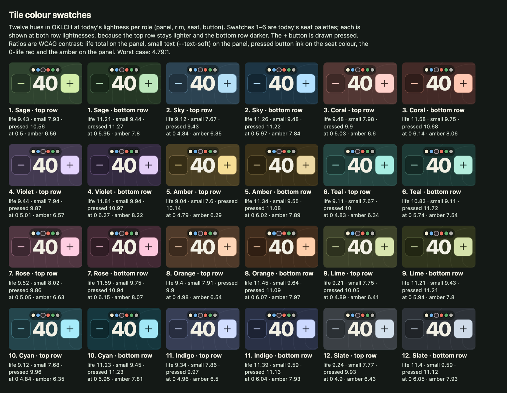
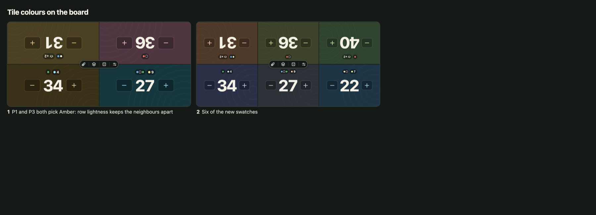

**Swatches**

- There are 12 swatches in OKLCH. Lightness and chroma per role (panel, rim, seat, button) are averaged from today's palettes, separately for each row.
- Swatches 1–6 are today's palettes: Sage, Sky, Coral, Violet, Amber, Teal. 7–12 fill the hue gaps: Rose, Orange, Lime, Cyan, Indigo, and a near-neutral Slate.
- Each swatch has a top-row and a bottom-row version. When two neighbours pick the same colour, the rows still differ by lightness (frame "P1 and P3 both pick Amber").

**Contrast**

Every swatch passes 4.5:1, at both row lightnesses:

| Check | Range |
|---|---|
| Life total on the panel | 9.0–11.8 |
| Small text (`--text-soft`) | 7.6–9.9 |
| Pressed button ink on the seat colour | 9.4–11.7 |
| The 0-life red | 4.79–6.27 (the worst is Amber, top row) |
| The amber warning | 6.3–8.2 |

The full table is in `palette.js`, and `palette.mjs` regenerates it.

**Weakness:** the panels are low-chroma, so neighbouring hues on the wheel look alike as panels: Sky, Cyan and Indigo, or Coral, Rose and Orange. The seat colours (buttons, the swatch dot) tell them apart more clearly. If that's not enough, the fix is fewer than 12 swatches, not more chroma, because more chroma would shift the contrast.

**Identity pips**

- Pips are plain filled discs, never mana symbols. Each has a thin dark rim, and black gets a light rim.
- In the panel and sheet, each toggle carries its letter (W U B R G C) for colour-blind players, and every pip has an accessible label.
- At chip size the black pip reads almost as a hollow ring, and colourless grey sits close to white. A dark-grey fill for black would help.

**Open questions**

- Are 12 swatches right, or would 8–10 more distinct ones be better?
- Is a neutral Slate wanted?
- Should two players be allowed the same colour? The mock allows it.

---

## 6. Setup sheet

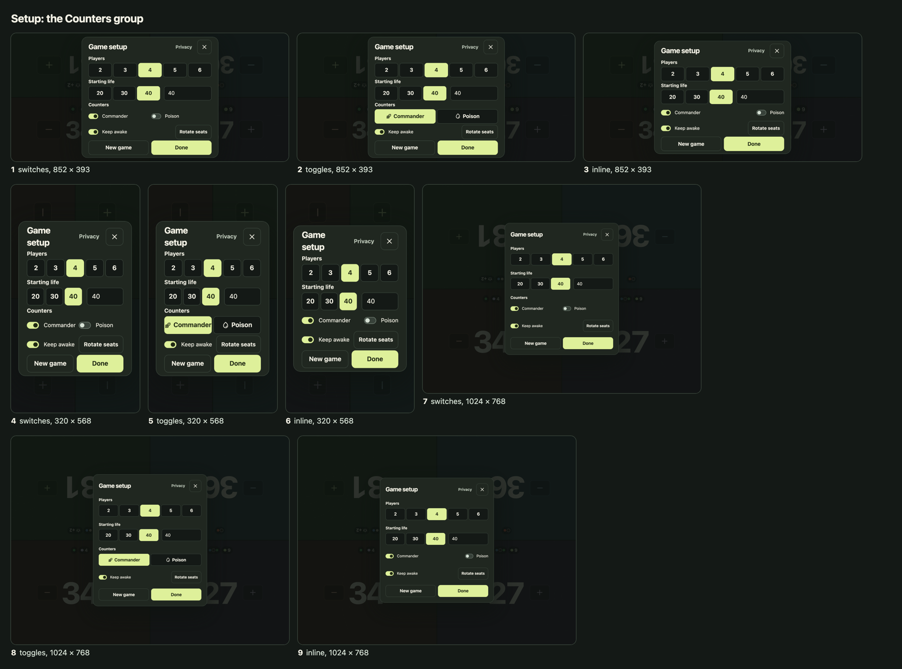

All three variants fit at 852 × 393 without scrolling.

- **Switches:** a "Counters" legend over two switches. They match Keep awake, and a switch reads as a saved setting, which these are.
- **Toggles:** pressed buttons in the style of the player-count buttons. They're bolder, but they read like per-game choices such as players or life, which these aren't.
- **Inline:** two switches with no legend. It's the most compact, but loses the group name.

**Recommendation: switches.**

**Note:** at 320 × 568 the sheet title "Game setup" wraps to two lines. The mock copies the real header, so this probably happens in today's app too. Worth checking.

---

## The pill

With Commander and Poison both on, the pill holds four 48px buttons: sword, counters, dice and setup. That makes it 192px wide.

- On a 320 × 568 phone with 6 players, that's wider than the middle tiles (188px). It covers their far edge, which is why far-edge badges sit 22px in.
- During any mode the pill shrinks to the single ✓ disc, as rotation mode does.

**Open question:** is four buttons acceptable? The alternative is one "Counters" button whose mode offers the commander damage map and the counters panel. That costs an extra tap for every commander damage entry, so I'd keep four.

---

# Round 2

**Status:** 20 November 2026, after the user's picks.

**Already settled, not mocked again:**
- the D table map
- "28 life (−6)" while entering damage
- the mode stays open until ✓
- damage is always linked to life
- split badges, which are display-only at rest
- the Counters group with two switches
- the four-button pill

**New in this round:**
- Strips: `renders/r2-*.png`. Each frame is also in `renders/frames/`.
- `phosphor-extra.js`: real Phosphor Bold paths, copied verbatim from `@phosphor-icons/core`.
- `measure.mjs`: prints badge row widths.
- `palette.mjs` now also writes the round 2 swatch set and its contrast table.

## R2.1 Map cells: own − and +, or tap and hold

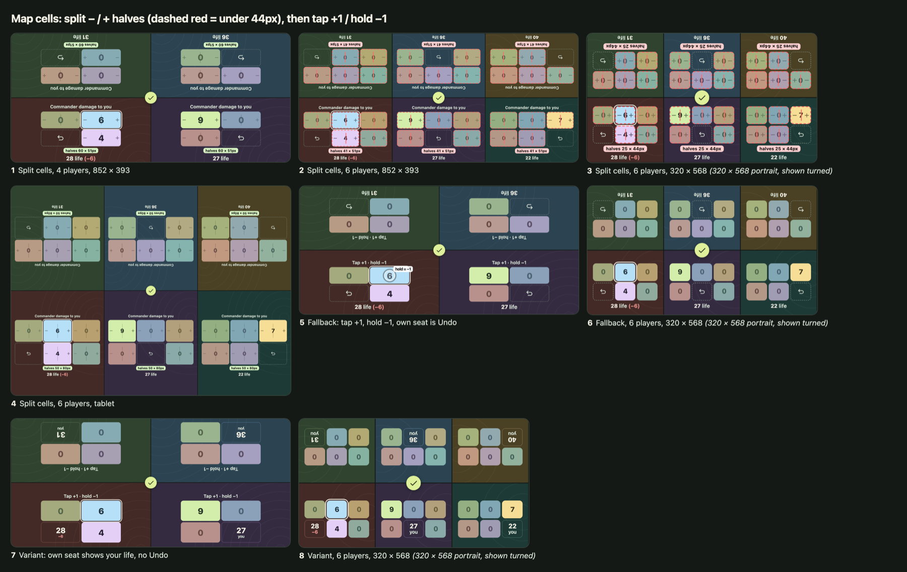

**Split cells** (frames 1–4) put a − half and a + half in each cell. Halves narrower than 44px are outlined in dashed red, and the tag gives the exact size:

| Board | Half size | 44px minimum |
|---|---|---|
| 4 players, 852 × 393 | 60 × 51 | passes |
| 4 players, tablet | 60 × 80 | passes |
| 6 players, tablet | 50 × 80 | passes |
| 6 players, 852 × 393 | **41 × 51** | fails |
| 6 players, 320 × 568 | **25 × 44** | fails |

So split cells fail at 6 players on every phone. Varying behaviour by size would mean the same game works differently on different devices, and isn't worth it.

**Tap +1, hold −1** (frames 5–8) works everywhere, and the cells stay whole: at least 50 × 44 at 6 players on the smallest phone.
- The map's title becomes the hint "Tap +1 · hold −1". Narrow tiles drop the title, as before.
- Taps are unchanged: 8 for 6 damage.

**Own seat:**
- **Undo** (frames 5–6) gives a visible, one-tap fix for the commonest mistake, a tap on the wrong seat.
- **Your life in your seat** (frames 7–8) puts "28 −6" where you sit, frees the line under the map, and makes cells taller. But it leaves hold as the only fix, and hold can't be discovered.

**Recommendation:** tap +1, hold −1, and keep the own seat as **Undo**.

**Hold means different things:**
- On the − and + life buttons today, holding repeats the step.
- On a map cell (and on the counter buttons in R2.5), hold takes one away.
- A player who holds a cell expecting a repeat gets −1. With the hint and Undo it's recoverable, but it is a real inconsistency.

**Option:** hold −1, then keep repeating −1 while held. That keeps "hold repeats" true, just in the other direction.

**Screen readers:**
- Give each cell `role="slider"` with `aria-valuenow` and `aria-valuetext` ("Player 2's commander, 6 damage. Player 3, 28 life").
- VoiceOver adjusts it by swiping up and down, and arrow keys work on a keyboard. TalkBack adjusts sliders in a WebView too, but test it on a device.
- If either one misbehaves, fall back to visually hidden "Add one" and "Remove one" buttons for each cell.

## R2.2 Poison icon

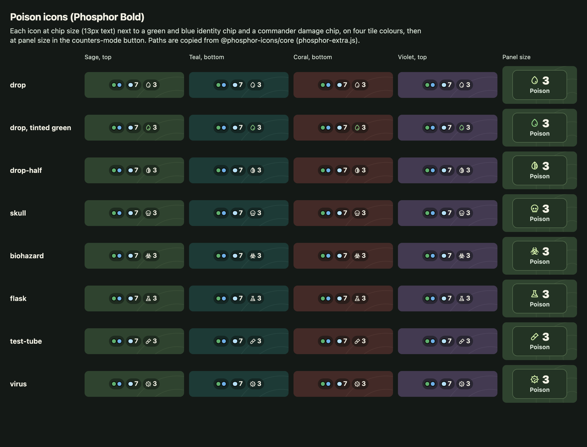

All eight variants use real Phosphor Bold paths. Each is shown at chip size, next to a green-and-blue identity chip and a commander damage chip, on Sage, Teal, Coral and Violet tiles, and at panel size.

| Icon | At chip size |
|---|---|
| drop | Clean, and distinct from the identity pips, which are filled discs while the drop is an outline. |
| drop, tinted green | Clashes with the green identity pip and nearly disappears on Sage and Teal tiles. |
| drop-half | Reads as "half full". |
| skull | Clear, but says "death" rather than poison. |
| biohazard | Too busy at 13px. |
| virus | Too busy at 13px; reads like a gear. |
| flask | Reads as science. |
| test-tube | Reads as a pencil. |

**Recommendation:** the plain **drop**, in the chip's text colour with no tint. The skull is the fallback.

The panel-size column takes the tile's seat colour, so a green tint would only ever show in chips.

## R2.3 Overflow: a row that never runs out of room

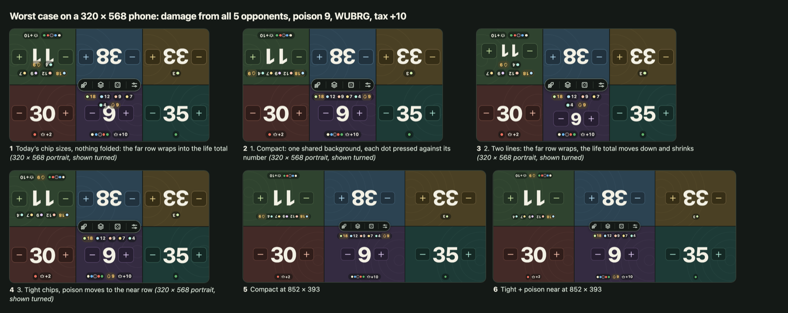

**The worst case:** 6 players on a 320 × 568 phone. P1 sits at an outer seat and P4 at a middle seat under the pill. Each has:
- far row: damage from all five opponents (18, 12, 9, 7, 4) and poison 9
- near row: identity WUBRG and tax +10

The 18 and the 9 are amber, following R2.4. Each tile has **180px** of room. Widths were measured with `measure.mjs`.

| | Layout | Far row | Near row | Fits? |
|---|---|---|---|---|
| Today | Today's chip sizes, nothing folded | 211px, wraps into the life total | 114px | no |
| 1 | **Compact:** one shared background for the row, and each dot pressed against its number. | 165px plus padding, about 176px | 96px | just: 4px spare |
| 2 | **Two lines:** the far row wraps onto a second line, and the life total moves toward the player and shrinks from 61 to 48px. | 2 lines | 114px | yes |
| 3 | **Poison moves to the near row:** commander damage alone on the far row, with slightly tighter chips; poison, identity and tax on the near row. | 155px | 134px | yes, 25px spare on the far row |

**Why the second line goes inward, not toward the pill:** on the smallest phone the four-button pill is wider than the middle tiles (192px against 188), so a line toward the pill would go under it.

**Recommendation: 3.** It keeps today's chip style and leaves room to spare, even if all five amounts had two digits (about 176px). It also gives the rows a plain meaning:
- far row: commander damage only, toward the table
- near row: your own counters

Layout 1 has no headroom. Layout 2 shrinks the life total, which is the most important number on the tile.

## R2.4 Lethal: tinted text and a thin ring

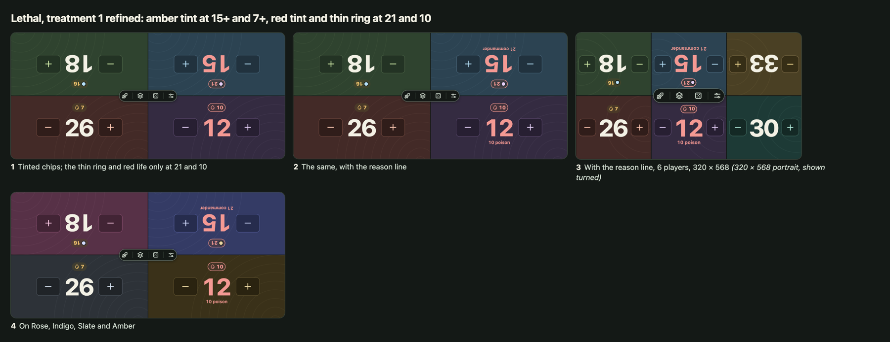

**The treatment:**
- **From 15 commander damage and 7 poison:** amber text in a heavier weight, with a 16% amber tint behind it.
- **At 21 and 10:** red text, a 16% red tint, a 1.5px red ring, and the life total turns red.
- **Reason line:** frames 2–4 add a small red line ("21 commander" or "10 poison") under the life total. It's the same size as the "28 life" line, so it stays quiet.

**Contrast:** every round 2 swatch passes, on both rows.

| Text | Where | Range |
|---|---|---|
| Amber | on its tinted chip | 6.0–6.9 |
| Red | on its tinted chip | 4.89–5.58 (the lowest is Amber, top row) |
| Life total at 0 | on the panel | 4.79 or more |

**Recommendation:** use the tinted treatment **with the reason line**. Without the line, a red 15 on a tile has no visible cause.

## R2.5 Counters: tap the poison or tax button

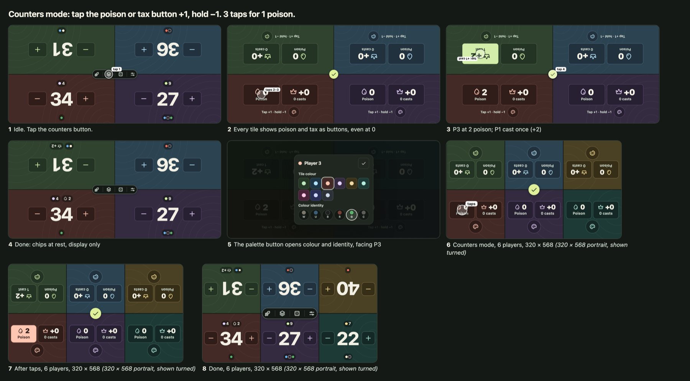

**How it works:**
- The counters pill button turns every tile into two large buttons, even at 0, facing that player: poison (drop and count) and tax ("+4" over "2 casts").
- Tap adds 1 poison or one cast (+2 tax). Hold takes one back, the same vocabulary as the map.
- On tiles with room, a "Tap +1 · hold −1" hint sits beside a 44px palette button. The palette button opens the colour and identity sheet, facing that player (frame 5).
- ✓ ends the mode, and the chips go back to display-only.
- At 6 players on the smallest phone, the buttons are about 88 × 58px and clear the ✓.

**Taps:**

| Change | Taps |
|---|---|
| 1 poison | 3 (counters, poison, ✓) |
| 2 poison | 4 |
| A cast | 3 |
| Tile colour | 5 (counters, palette, swatch, close sheet, ✓) |

**Screen readers:** both buttons are `role="slider"` with `aria-valuetext`, such as "2 poison" or "2 casts, plus 4". The same approach and fallback as the map cells apply.

**Recommendation:** build it as drawn.

## R2.6 Nine swatches

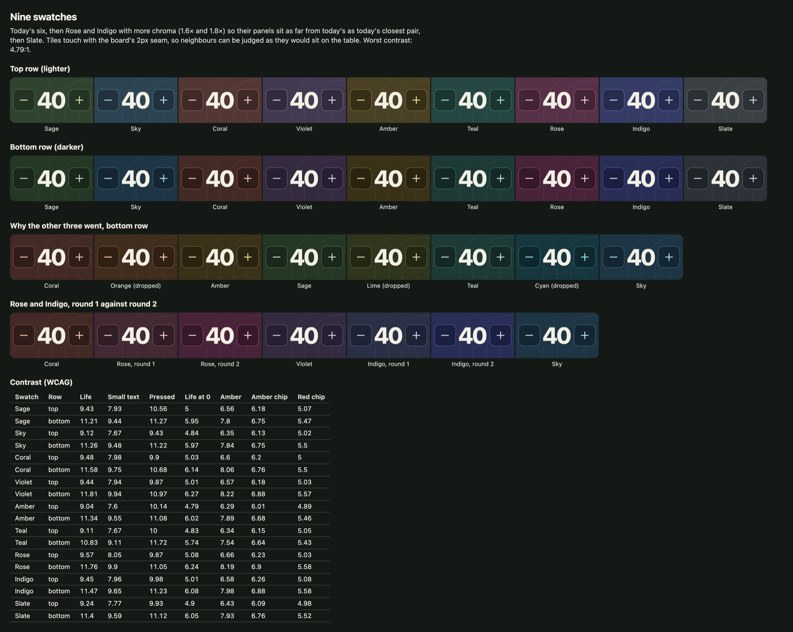
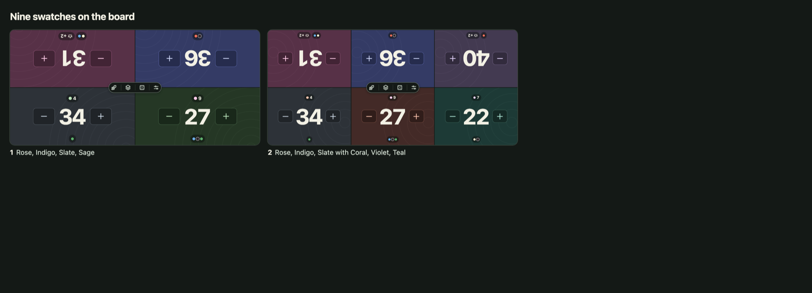

**The set:** today's six, plus Rose, Indigo and Slate.
- **Rose (hue 345) and Indigo (275)** have more chroma (1.6× and 1.8×). Their panels now sit at least 0.041 apart in OKLab from today's. Today's own closest pair, Sage and Teal, is 0.027.
- **Orange, Lime and Cyan are dropped.** Each was 0.017–0.021 from a neighbour, and the "why" strip shows it.
- **Slate stays.**

**Contrast:** every swatch passes on both rows. The worst case is **4.79:1**, the life-out red on Amber, top row.

| Check | Range |
|---|---|
| Life total | 9.0–11.8 |
| Small text | 7.6–9.9 |
| Pressed button | 9.4–11.7 |
| Life-out red | 4.79–6.27 |
| Amber | 6.3–8.2 |
| Amber chip | 6.0–6.9 |
| Red chip | 4.89–5.58 |

**Watch:** Indigo's seat colour is still close to Sky's, but their panels are clearly apart.

**Recommendation:** these nine.

---

# Round 3

**Status:** 20 November 2026.

**Decided in round 2:**
- your own map seat shows your life ("28 −6")
- poison uses the Phosphor flask, untinted
- badge layout 3: the far row is commander damage only
- no reason line
- the nine swatches

All round 3 frames use these.

## R3.1 Centre controls during a mode: Undo, ✓ and ✕

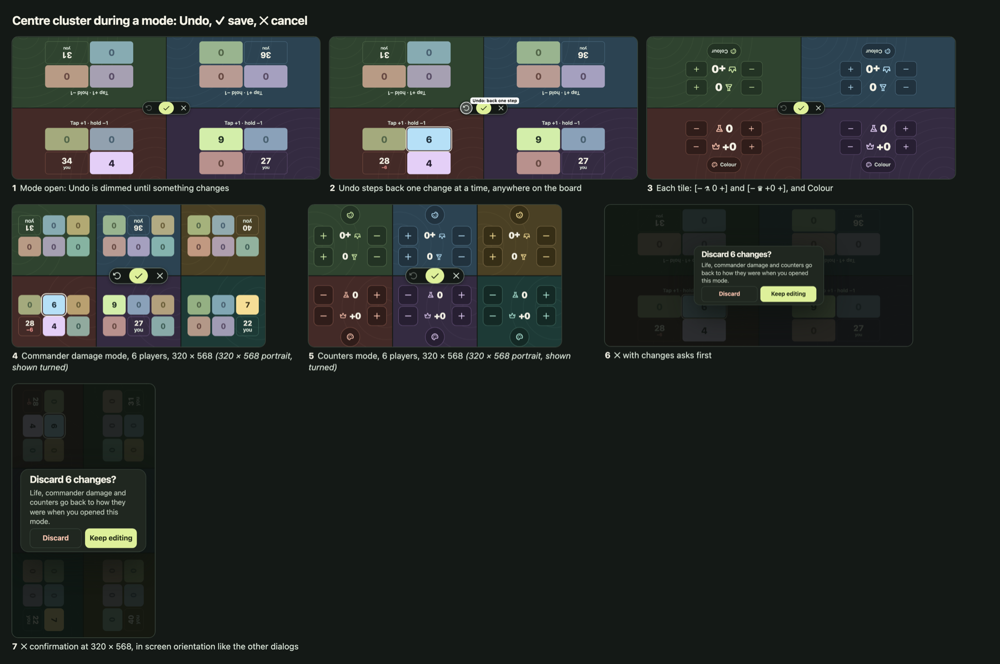

**The cluster:** during commander damage and counters modes, the single ✓ disc becomes three 48px buttons: **Undo · ✓ · ✕**.
- ✓ stays in the middle, filled with the accent, exactly where the single ✓ was.
- Seat rotation keeps its single ✓.

**How each button works:**
- **Undo** steps back one change at a time, anywhere on the board, all the way to when the mode opened. It's dimmed when there is nothing to undo (frame 1).
- **✓** saves with no confirmation.
- **✕** closes straight away if nothing has changed. Otherwise it opens "Discard 6 changes?" with **Discard** and **Keep editing**.
  - Keep editing is the primary button and has focus.
  - Discard uses the danger text colour.
  - Like the setup and New game dialogs, it faces the screen's own orientation.

**Clearance:**
- The cluster is 144 × 36px visible and reaches 18px into the tiles next to it. Map cells, counter rows and swatches all keep 20–22px clear on that side.
- At 6 players on a 320 × 568 phone, the cluster (144px) is narrower than the middle tiles (188px), so it never reaches the outer tiles. Frames 4 and 5 show it clear of every target.

**Undo's icon:**
- I use Phosphor's **arrow-counter-clockwise**. Turning a circular arrow 180° doesn't change its direction, so it still reads as "back" for players on the far side.
- The U-turn arrow (arrow-u-up-left) would flip into something that reads as "forward" or redo from across the table, so I'd avoid it.
- ✕ is symmetric, and ✓ is recognisable by its filled disc.

**Recommendation:** build the cluster as drawn.

## R3.2 Map: tap +1, hold −1 and repeat

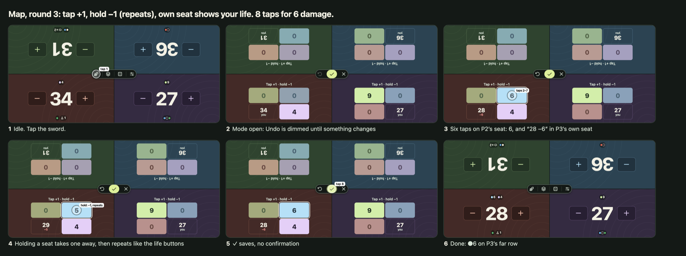

**How it works:**
- Tap a seat: +1.
- Hold a seat: −1 once the hold registers, then −1 repeatedly while held. It's the same timing as the life buttons: 500 ms, then every 100 ms.
- Your own seat shows your life and the change ("28 −6"). Undo lives in the centre now.
- The map's title is the hint "Tap +1 · hold −1". Narrow tiles drop it.

**Taps for 6 damage: 8.** Sword, six taps on the attacker's seat, ✓.

## R3.3 Counters mode: stepper rows

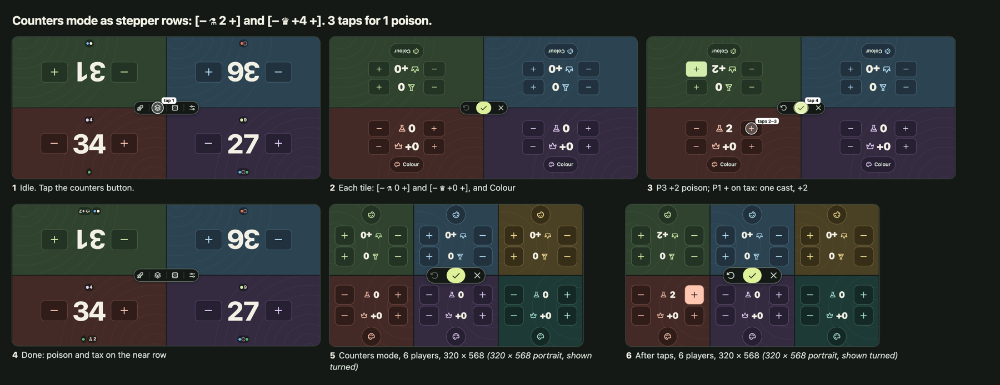

**Layout:**
- Each tile shows **[− ⚗ 2 +]** for poison and **[− ♛ +4 +]** for tax, in the same pattern as the life controls, facing the player.
- Tax + adds one cast, which adds 2 to the tax shown.
- A palette button opens the colour and identity sheet, facing that player. It reads "Colour" where there's room and is icon-only on narrow tiles.
- A row only appears if its switch is on.

**Fit at 6 players on a 320 × 568 phone:**
- Two 44px rows and a 44px palette button, with 3px gaps, below 20px of clearance for the cluster: 158 of the tile's 159px.
- Every target is at least 44px.

**Taps:** 1 poison is 3 (counters, +, ✓). 2 poison is 4.

**Hold:** recommend that − and + **repeat on hold**, just like the life buttons. Every − and + in the app then behaves the same way, and taps aren't affected, because repeating starts after 500 ms.

## R3.4 Tile colour when Commander and Poison are both off

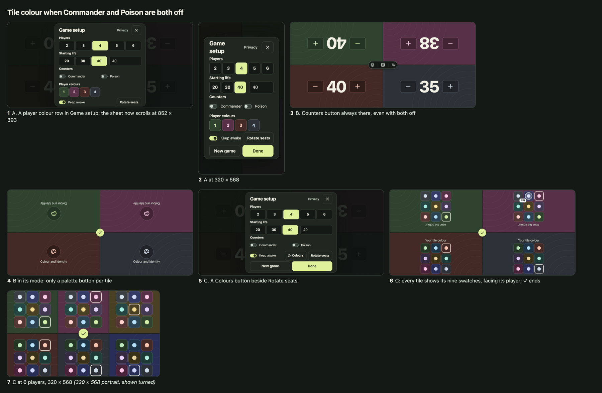

**A. A player colour row in Game setup** (frames 1–2)
- Simple, and nothing shows on the board.
- At 852 × 393 the setup sheet no longer fits and has to scroll.
- It faces one side of the table, so one person sets everyone's colour.

**B. The counters button always present** (frames 3–4)
- Gives one entry point everywhere.
- But it puts a button on the board for a feature nobody turned on, which breaks "nothing shows when unused".
- With both switches off, its mode would hold only a palette button.

**C. A "Colours" mode from Game setup** (frames 5–7)
- A Colours button sits beside Rotate seats and works the same way. Setup closes, every tile shows its nine swatches facing its player, and everyone picks at the same time. ✓ ends it.
- Nothing shows on the board.
- It reuses a pattern players already know.
- It fits at 6 players on a 320 × 568 phone: a 3 × 3 grid of 44px swatches with 3px gaps, clear of the ✓. The chosen swatch's ring sits inside it, so the tile edge doesn't clip it.
- **Taps: 4** (setup, Colours, swatch, ✓), and players can pick in parallel.

**Recommendation: C.**
- Colour identity only matters in Commander, so it stays in the player sheet behind the counters-mode palette button. That button is only there when Commander or Poison is on.
- The Colours button can stay in setup even when counters are on, so tile colour always has the same home.
