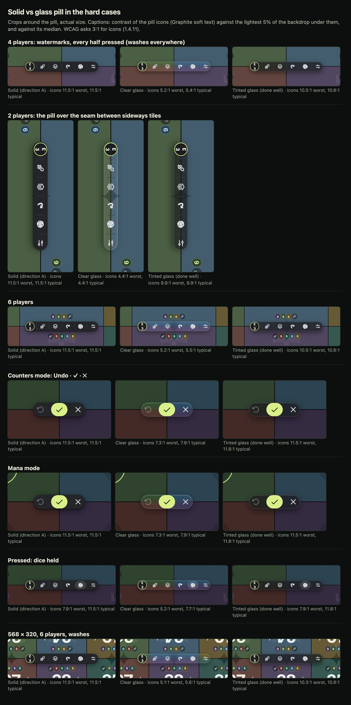
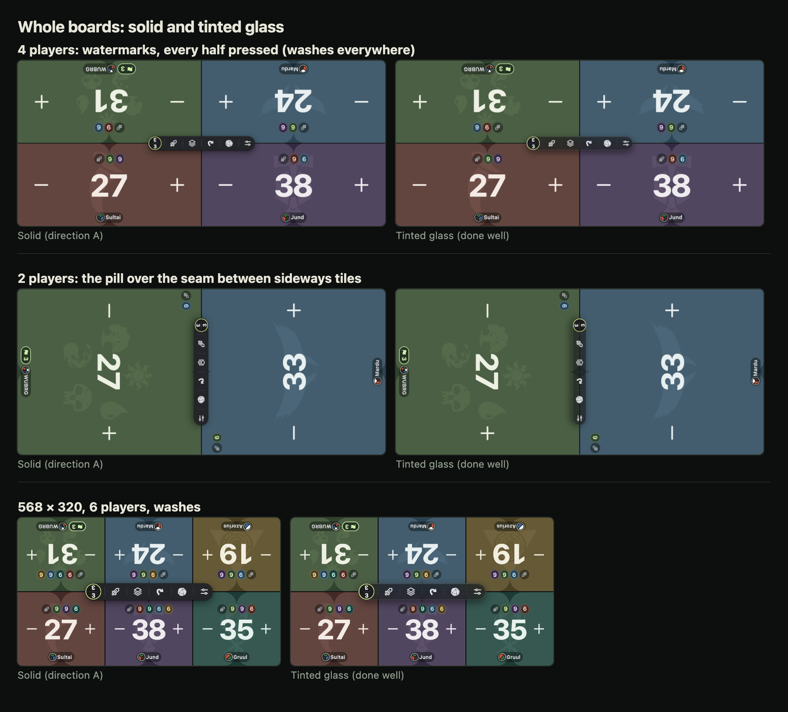

# Glass pill: the trade-off

**Status:** for the owner, 22 November 2026. The owner said Yes to the glass pill (STYLE Q6) and asked to see the trade-off. The build ships a solid pill for now.

**About the mock-ups:**

- Drawn by [glass.mjs](glass.mjs) on the committed app (ff0cbf0) with the Graphite chrome.
- The working copy of `web/` was mid-build and didn't load, so `LIFEPOD_APP` points the renders at a clean export: a copy of `web/`, the folder or its `index.html` (`serveApp` in [scripts/serve.mjs](../../scripts/serve.mjs)).
- Each crop's caption is a **measurement**:
  1. The pill's icons are hidden.
  2. The backdrop under the pill is screenshotted.
  3. The icon colour (Graphite soft text) is compared against the lightest 5% of those pixels ("worst") and against their median ("typical").

**The three pills compared:**

| Pill | Recipe |
|---|---|
| **Solid** | Direction A: `--raised` fill and a soft shadow |
| **Clear glass** | 6% white, `blur(10px) saturate(1.8)`, light edge: the "real Liquid Glass" look |
| **Tinted glass** | 68% `--surface` over `blur(18px) saturate(1.3)`, light edge: glass done carefully |

---

## What it looks like in the hard cases

**Icon contrast against the backdrop** (WCAG 1.4.11 asks 3:1 for icons):

| Case | Solid | Clear glass | Tinted glass |
|---|---|---|---|
| 4 players, watermarks, every half pressed (washes) | 11.5 | 5.2 | 10.5 |
| 2 players, pill over the seam of sideways tiles | 11.5 | **4.4** | 9.9 |
| 6 players | 11.5 | 5.2 | 10.5 |
| Counters mode (Undo · ✓ · ✕) | 11.5 | 7.3 | 11.5 |
| Mana mode | 11.5 | 7.3 | 11.5 |
| A pill button pressed (dice) | 7.9 | 5.2 | 7.9 |
| 568 × 320, 6 players, washes | 11.5 | 5.1 | 10.3 |

Worst-case figures. The typical figures are within 0.6 of these, except where the pressed disc lightens the pill.

**What the numbers and images show:**

- **Every pill stays readable.** The board under the pill is dark (tile panels, seams and faint watermarks), so even clear glass keeps the icons at 4.4:1 or better.
- **Clear glass loses half the contrast** and, more visibly, the pill's *shape*. Over two tiles of different colours it becomes a tinted smear across the seam. It's hardest to find at a glance in the 2-player layout, where it runs down the seam.
- **Tinted glass reads almost like solid.** It keeps 10:1, and the tile colours show softly through the edges. That softness is all the "glass" a player will notice on a dark board.
- **In modes** the board dims, so all three look alike.

## Cost: rendering and battery

**How blur is drawn:**

- `backdrop-filter: blur()` is a convolution: "for every output pixel a number of input pixels have to be considered. The bigger the image or the bigger the blur radius, the more costly the effect" ([Chrome Developers: Animated blur](https://developer.chrome.com/blog/animated-blur)).
- When the content under it changes, the GPU re-blurs. When nothing changes, the compositor produces no new frame, so there's no cost.

**When it applies to LifePod:**

- **At rest the board is static**, so glass costs nothing.
- **It costs when the backdrop moves:**
  - a life total near the centre animating on each tap;
  - hold-repeat (ten updates a second);
  - the seat wash appearing and disappearing on every press;
  - mode transitions.
- These are short bursts, but they happen during the most-used interaction, near the pill.
- The pill is small (about 290 × 36px), which limits the cost.

**What's known about low-end phones:**

- Chrome's own guidance: "Always test your web apps on mobile devices. Desktop machines tend to have deceptively powerful GPUs" ([Chrome Developers](https://developer.chrome.com/blog/animated-blur)).
- Firefox bug reports describe the same mechanism, for example "Scrolling is not smooth … with backdrop-filter enabled" ([Mozilla bug 1779085](https://bugzilla.mozilla.org/show_bug.cgi?id=1779085)) and backdrop-filter animation using twice the GPU of Chrome ([Mozilla bug 1769944](https://bugzilla.mozilla.org/show_bug.cgi?id=1769944)).
  - These are the bugs' titles. Bugzilla refused automated reading, so I couldn't read the threads.
  - They're Gecko, not the Chromium WebView LifePod uses, so they show *why* it costs, not how much.
- **I found no published frame-time measurements for Android WebView or WKWebView.** So treat the cost as unknown until measured on a real low-end device:
  - Android: a Perfetto or Chrome DevTools trace on a phone like the Pixel 4a or an Android Go device;
  - iOS: a Safari Web Inspector timeline on an iPhone SE.

**Battery:**

- At rest: none.
- During taps: the extra GPU work is per frame, while frames are being drawn. Small in absolute terms, but on a device kept awake for a 2-hour game, every bit of GPU time counts.
- I have no measurement, so I'm not claiming a figure.

## Fallbacks

| Situation | Behaviour |
|---|---|
| No `backdrop-filter` support | `@supports not (backdrop-filter: blur(1px))`: the solid pill. All current WebViews support it (Chrome 76+, Safari 9+ with `-webkit-`), so this is a safety net. |
| Reduce Transparency, Android and Chrome | `@media (prefers-reduced-transparency: reduce)`: solid pill. Chrome supports the query from 118 ([Chrome Developers](https://developer.chrome.com/blog/css-prefers-reduced-transparency)). |
| Reduce Transparency, iOS | WebKit doesn't support the query ([caniuse](https://caniuse.com/mdn-css_at-rules_media_prefers-reduced-transparency)). The iOS wrapper reads `UIAccessibility.isReduceTransparencyEnabled` and sets `data-reduce-transparency` on `<html>`, updating on `reduceTransparencyStatusDidChangeNotification`. CSS treats it like the media query. |
| Increase Contrast | `@media (prefers-contrast: more)`: solid pill with a 2px `--control-border` outline. |
| Battery saver or low-power mode | Not exposed to the web reliably, so nothing to hook. A switch in settings covers it. |

## Recommendation

**Ship the tinted glass pill as an option, off by default; keep solid as the default.**

**Why off by default:**

1. On LifePod's dark board, glass adds little a player will see: tinted glass looks nearly solid.
2. It costs GPU time during the busiest interaction, and that cost is unmeasured on low-end phones.
3. Clear glass, the version that looks most like Liquid Glass, is the one that hurts finding the pill at a glance.

**What "Yes" looks like, done well:**

- **Tinted, not clear:** 68% `--surface` over the blur, so the icons stay at 10:1 or better on any tile.
- **A small radius:** `blur(18px) saturate(1.3)`. Bigger costs more and looks no different at this size.
- **Glass on the pill only.** Not the settings header (it's over the app's own surface, where there's nothing to see through), not dialogs, not content (Apple: "Don't use Liquid Glass in the content layer").
- **A 1px light edge and an inner top highlight** (`inset 0 1px 0 #ffffff22`), so the pill's outline survives over any colour.
- **The fallbacks above,** including the iOS Reduce Transparency bridge.
- **A switch:** Settings → Table → **Glass centre controls**, off by default.
- **Measure before turning it on by default:** a trace on one low-end Android phone during hold-repeat. If frames stay under 16ms, default it on for devices with `navigator.deviceMemory >= 4`.

---

## Questions for review

**G1. The glass pill?** (`glass-pill`)

- Solid · The solid pill for everyone (what's being built) · `renders/glass-cases.png`
- Option · Tinted glass as a setting, off by default · `renders/glass-cases.png`
- Default · Tinted glass on by default, solid only as the fallback · `renders/glass-boards.png`
- **Recommended: Option.**

**G2. Which glass, if any?** (`glass-kind`)

- Tinted · 68% surface tint over an 18px blur: 10:1 icons, keeps its shape · `renders/glass-cases.png`
- Clear · 6% white over a 10px blur: the Liquid Glass look, 4.4:1 worst case, loses its shape over seams · `renders/glass-cases.png`
- **Recommended: Tinted.**

---

## After the design audit (23 November 2026)

- **The board's pill has no blur.** DESIGN-AUDIT S10 found that over the dark tiles the blurred, 68% pill read as the solid pill with the seam and the active tile's ring running through it, as this page predicted. The audit offered a denser tint or no blur; the build does both, since without the blur a 68% tint would show the seams sharply: the pill keeps Glass's edge and highlight over a 90% tint (`--pill-tint`), and no `backdrop-filter`, which also saves the GPU during hold-repeat. Settings' header and the dialogs keep the blur.
- **WebKit.** The audit measured the blur only in Chromium, and wasn't sure headless WebKit draws a pill's backdrop blur at all. With the pill unblurred that question no longer touches the board. The settings header and the dialogs were looked at in Playwright's WebKit too: the computed filter is the same as in Chromium (`tests/style.test.mjs` checks it in both engines), and labels scrolling under the header look about as soft as in Chromium, but a screenshot at a 68% tint can't prove the blur is drawn. That still needs a look on an iPhone.
