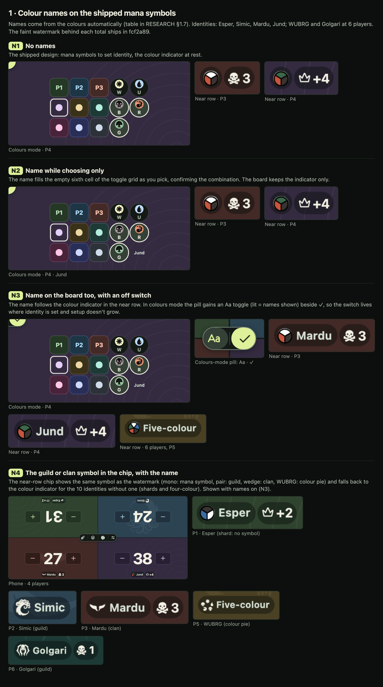
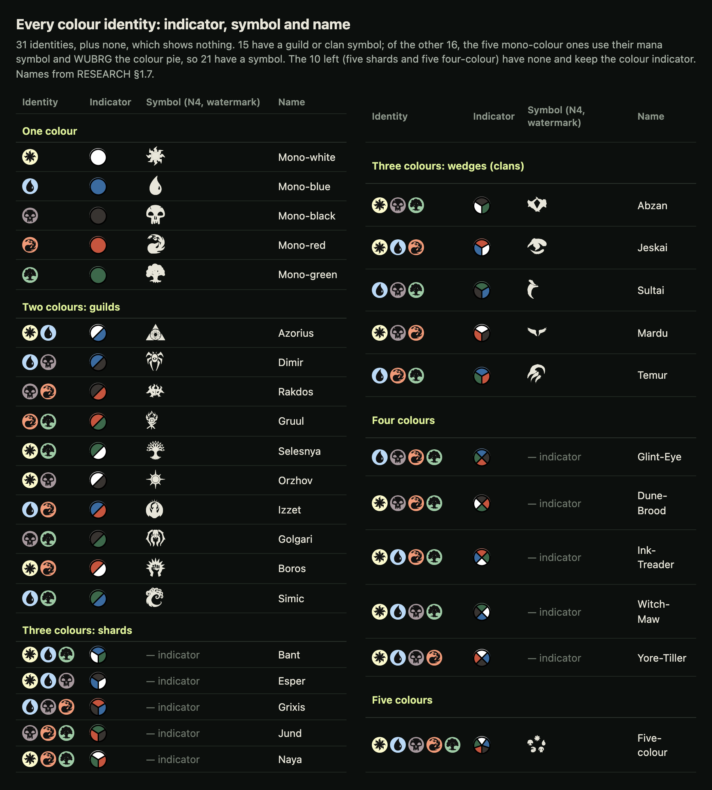
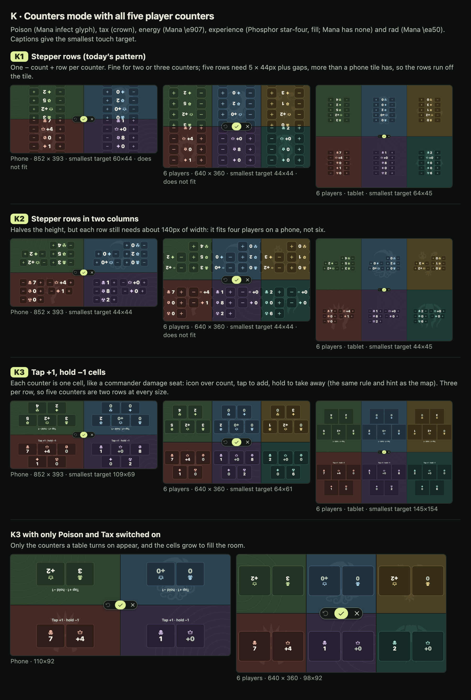
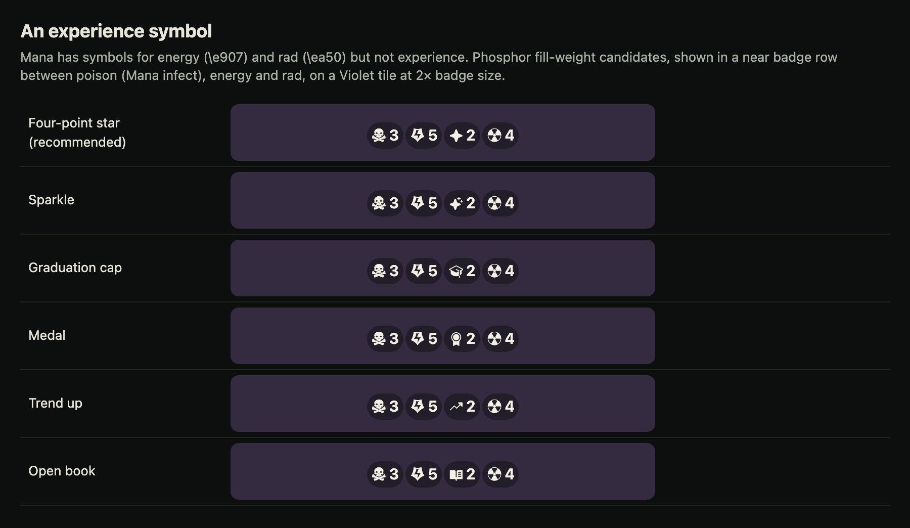
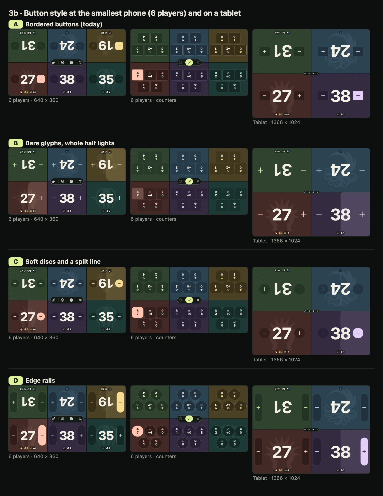
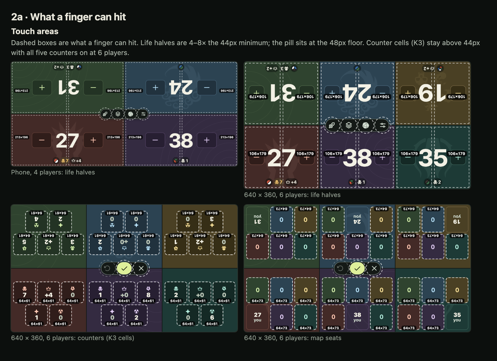
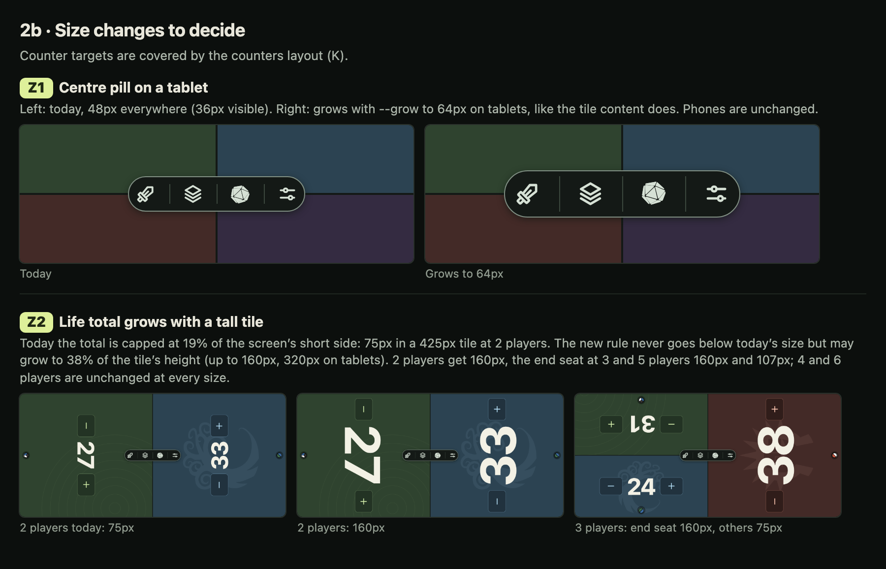
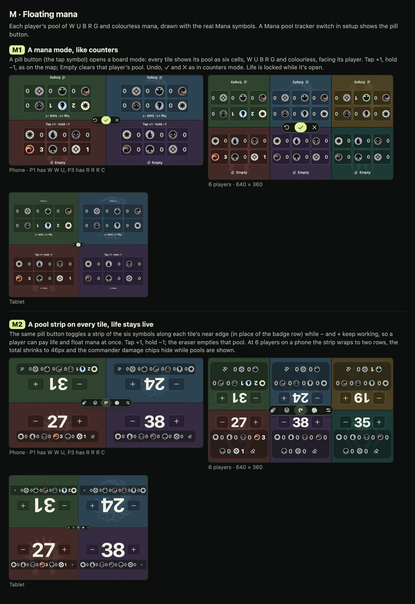

# Polish round: options to choose from

**Status:** design review, 21 November 2026. These are mock-ups only; I changed nothing in `web/`. This file goes with [RESEARCH.md](RESEARCH.md) (policy and stores) and [OVERVIEW.md](OVERVIEW.md) (flows and sizes).

- **How the images are made:** every frame is the current app (`web/` at 2f28705) opened in Playwright with a seeded game. The only changes are the CSS and JS each option injects, all in [render.mjs](render.mjs). The identity watermarks and the colour indicator chips in the frames are the shipped ones.
- **Symbols:** mana and counter symbols come from the bundled Mana font: W U B R G `\e600`–`\e604`, colourless `\e904`, energy `\e907`, rad `\ea50`, infect `\ea73`, tap `\e61a`, guilds `\e90c`–`\e915`, clans `\e916`–`\e91a`.
- **Re-render:** `node design/polish/render.mjs [strip ...]` takes about 20s. Images go to `renders/` at 2×, 1800px wide.

**Already shipped since this round started, so not asked again:**

- Real mana symbols from the Mana font (f1dc7f9).
- The colour indicator in a round chip on the board, with the mana symbols only for setting identity (9a8ec7e).
- Infect for poison and the d20 for dice (9a8ec7e).
- Identity watermarks behind the life total (fcf2a89).
- The fix that keeps the commander damage row clear of the pill (2f28705). The far row now sits at 26px.

---

## 1. Colour names

- **N1. No names.** This is what ships.
- **N2. The name only while choosing.** "Jund" fills the empty sixth cell of the toggle grid in colours mode. The board doesn't change.
- **N3. The name on the board too.**
  - The near row shows the colour indicator and then the name ("◕ Jund").
  - The off switch is an **Aa** toggle in the colours-mode pill, beside ✓, where identity is set. Setup doesn't grow.
  - The longest names still fit at 6 players on the smallest phone.
- **N4. The guild or clan symbol in the chip, with the name.**
  - The chip shows the watermark's symbol: the mana symbol for one colour, the guild for pairs, the clan for wedges, the colour pie for WUBRG.
  - **The 10 identities with no symbol** (five shards, five four-colour) keep the colour indicator.
  - The [identity table](renders/identity-symbols.png) shows all 31 identities.

**Recommendation: N3, names on by default.**

- N4 looks rich, but it mixes two languages in one row: some chips show colours, and others show monochrome symbols that only say the colours if you know the guild.
- The watermark already puts that same symbol behind each tile, so the chip would only repeat it.
- The colour indicator works the same way for all 31 identities, and the name says the rest.

For four colours, I recommend the *Nephilim* names (Glint-Eye, Dune-Brood, Ink-Treader, Witch-Maw, Yore-Tiller). In my experience they're the most widely used of the three sets; I didn't verify that this round. The full table is in [RESEARCH §1.7](RESEARCH.md#17-name-table).

---

## 2. Player counters: poison, tax, energy, experience and rad

Player counters only, never permanent counters. Each counter has its own switch, and only the ones switched on appear.

### 2K. Counters mode layout

- **K1. Stepper rows (today).**
  - One − count + row per counter.
  - Five rows need about 250px of height, and a phone tile has 196px (179px at 6 players on the smallest phone). They run off the tile at every phone size.
- **K2. Stepper rows in two columns.** It fits 4 players on a phone. At 6 players a row needs about 140px of width and the tile has 213px for two columns, so it doesn't fit.
- **K3. Tap +1, hold −1 cells.**
  - Each counter is one cell: icon over count, tap to add, hold to take away and keep repeating.
  - That's the same rule and hint ("Tap +1 · hold −1") as the commander damage map.
  - Three to a row, with the last row centred.
  - The smallest cell is **64×61** (6 players, 640×360). It's 109×69 on a phone at 4 players and 145×154 on a tablet. With only Poison and Tax on, the two cells are 98–110 × 92.

**Recommendation: K3.** It's the only layout that fits five counters at every size, and it reuses the map's interaction. It also retires the 44×44 steppers, the smallest targets in the app.

### 2S. Switching the counters on in setup

There are seven trackers: Commander, Poison, Energy, Experience, Rad, Turns and Mana pool. Today's setup sheet is 354px tall, and it must fit a 427px-tall landscape phone. It fits 393px today, too.

- **S1. Toggle chips under "Track".** Seven 44px chips on two lines in a 560px sheet: one tap each. The sheet grows to 402px, which fits 427 but scrolls at 393.
- **S2. A Track row that opens its own sheet.**
  - The row shows what's on ("⚔ ☠ ⚑ Commander · Poison · Turns ›").
  - It opens a **Track** sheet with a switch, icon and name for each tracker, in two columns (282px tall).
  - Setup stays at 354px. It costs one extra tap, set once per group.
- **S3. Switches in a grid.** Seven switches, three per row, 415px tall. It scrolls at both heights.

**Recommendation: S2.** It's the only option that leaves setup as tall as today, with room for more later. Closing the Track sheet returns to setup.

### 2E. An experience symbol

Mana has energy and rad symbols but none for experience. The candidates are Phosphor fill-weight icons, shown next to infect, energy and rad.

**Recommendation: the four-point star.**

- It's solid like the Mana glyphs.
- It stays legible at badge size.
- It doesn't collide with the other symbols.

Alternatives: sparkle, graduation cap, medal, trend up, open book.

### 2B. The near badge row

- **B1. One row, as today.** Every set counter gets its own chip.
  - With everything set (indicator, poison, tax, energy, experience, rad), it fits at full size (12.5px) at 6 players on the smallest phone: 176 of 204px used.
  - With two-digit counts on everything, the existing fit-to-width rule takes it to 12px.
- **B2. Counters in one shared capsule.** I tried this: it saves nothing, and the worst case gets smaller type (11.6px).

**Recommendation: B1.** It needs no change: the five counters show in the near row exactly as poison and tax do.

---

## 3. Button style

Every frame shows held states: P3 holding +, P2 holding −, and the dice button pressed. The crops show counters mode (K3) with energy held.

- **A. Bordered buttons (today).** It suggests you must hit the button, though the whole half counts.
- **B. Bare glyphs, whole half lights.**
  - Larger − and + near the outer edges.
  - A press washes the whole half in the seat colour (17%), so the first tap shows the target.
  - Counter cells are a faint fill that lights up when pressed.
- **C. Soft discs and a split line.** Round borderless discs, and a faint line above and below the total.
- **D. Edge rails.** Tall capsules on the outer edges. It's the heaviest option, and on a tablet the rails read as chrome.

**Recommendation: B.**

- It's the most modern of the four.
- It explains the touch area on the first press.
- It drops 2–12 boxes from the board.
- It matches the pill, which is already bare glyphs on a capsule.

---

## 4. Sizes

The measurements are in [OVERVIEW §3](OVERVIEW.md#3-button-sizes).

- **Z1. The pill on tablets:** grow from 48px to 64px with `--grow`. Phones are unchanged. **Recommend: grow.**
- **Z2. Life total on tall tiles:**
  - Never below today's size, but up to 38% of the tile's height.
  - That's 160px at 2 players (75px today), and 160px or 107px on the end seat at 3 or 5 players.
  - 4 and 6 players don't change.
  - **Recommend: yes.**

---

## 5. Who goes first, and turns

The owner accepts that following the mana curve needs a tap each round or each turn. The aim is to make that tap cheap and natural.

- **The useful number is the round.** In round N, every player is on their own Nth turn.
- **The tap belongs to a person, on their own tile, facing them,** not to a shared control.

- **Setup:** Turns is one of the trackers (§2S). Off means nothing about turns shows anywhere.
- **New game, with Turns on:** "Who goes first?" opens.
  - Each tile shows "Me first".
  - The centre shows a shuffle button (a random pick from the dice's crypto RNG) and ✕ to skip.
- **A. The first player taps their flag to start each round.**
  - The flag on their near edge shows the round (⚑ 3) and is the button. Its hit area is 44px; hold takes a round back.
  - The pill shows the round to everyone, printed twice like a card index. Tapping it there does the same, as a backup.
  - One tap per lap, by the player whose turn is starting.
- **B. Each player ends their own turn (a chess clock).**
  - The active tile gets a seat-colour frame and a "Turn 3 ›" chip. Its player taps the chip when done, and the next player to the left lights up.
  - It answers "whose turn is it?" too. The cost is a tap from everyone on every turn.
- **Undo and new game:** hold steps back. A new game resets to round 1 and asks again.

**Recommendation: A.** It's the cheapest tap that keeps the curve right. B only suits tables that want a whose-turn light. Both share the setup switch, the start screen and the pill, so switching later is cheap.

---

## 6. Floating mana

The owner suggests the mana symbols earn their place mainly here. A pool is W U B R G and colourless, drawn with the real symbols. The symbols are the controls themselves: tap a symbol to add that mana.

- **M1. A mana mode, like counters.**
  - A pill button (the tap symbol, shown when the Mana pool tracker is on) opens a board mode.
  - Every tile shows its pool as six cells with large symbols (1.5em, about 30px on a phone) and an **Empty** button.
  - Undo, ✓ and ✕ work as in counters mode.
  - It's robust at every size. Life is locked while it's open.
- **M2. A pool strip on every tile, while life stays live.**
  - The same pill button toggles a strip of the six symbols (22–26px) plus an eraser along each tile's near edge. − and + keep working.
  - That matters: players pay life (Phyrexian mana, fetch lands) and take drain damage while mana floats.
  - At 6 players on the smallest phone the strip wraps to two rows, the total shrinks to 46px, and the commander damage chips hide while pools show.
- **Adding and spending:** tap a symbol for +1, hold for −1 with repeat. It's the same rule as the map and K3.
- **Emptying:**
  - The app can't see steps and phases, so emptying is manual: Empty or the eraser clears one pool, and turning the pill toggle off clears them all.
  - With Turns on, advancing the round (A) or ending a turn (B) also empties every pool, because that's the one boundary the app knows about.
  - In M1, ✓ also empties the pools as the mode closes.

**Recommendation: M2, emptied by hand and by the turn tracker.**

- Keeping life live while mana floats is the reason to track the pool in the app at all.
- The symbols are still the hero: they're the strip's buttons.

If the 6-player squeeze matters more than live life, M1 shows the symbols largest.

**The pill:** with everything on, it reaches six buttons (round, sword, counters, mana, dice, setup), 288px. That's still clear of the badge rows. If it's too long, drop the round button; the flag stays the round's control.

---

## Questions for review

Each question lists its options as letter · label · image, then the recommendation.

**Q1. Should the colour identity's name show?** (`names`)

- N1 · No names (as shipped) · `renders/pips-names.png`
- N2 · Only while choosing, in colours mode · `renders/pips-names.png`
- N3 · Indicator + name on the board; Aa off switch; on by default · `renders/pips-names.png`
- N4 · Guild/clan/mana symbol + name; the indicator for the 10 without a symbol · `renders/pips-names.png`, `renders/identity-symbols.png`
- **Recommended: N3.**

**Q2. Which names for four-colour identities?** (`four-colour-names`)

- a · Nephilim names: Glint-Eye, Dune-Brood, Ink-Treader, Witch-Maw, Yore-Tiller · `renders/identity-symbols.png`
- b · Commander 2016 names: Chaos, Aggression, Altruism, Growth, Artifice · —
- c · Plain: "No white", "No blue" … · —
- **Recommended: a.**

**Q3. How should counters mode lay out up to five counters?** (`counters-layout`)

- K1 · Stepper rows (today); doesn't fit five on phones · `renders/counters-mode.png`
- K2 · Stepper rows in two columns; doesn't fit 6 players · `renders/counters-mode.png`
- K3 · Tap +1, hold −1 cells, three to a row · `renders/counters-mode.png`
- **Recommended: K3.**

**Q4. How are Energy, Experience and Rad (and the other trackers) switched on?** (`setup-trackers`)

- S1 · Toggle chips under "Track"; scrolls at 393px tall · `renders/counters-setup.png`
- S2 · A Track row that opens its own sheet; setup height unchanged · `renders/counters-setup.png`
- S3 · Switches in a grid; scrolls at both heights · `renders/counters-setup.png`
- **Recommended: S2.**

**Q5. Which symbol for experience?** (`experience-glyph`)

- Star · Phosphor four-point star (fill) · `renders/experience-glyph.png`
- Sparkle · Phosphor sparkle (fill) · `renders/experience-glyph.png`
- Cap · Phosphor graduation cap (fill) · `renders/experience-glyph.png`
- Medal · Phosphor medal (fill) · `renders/experience-glyph.png`
- **Recommended: Star.**

**Q6. How do the new counters show in the badge row?** (`counter-badges`)

- B1 · One chip each in the near row, as poison and tax do today · `renders/counters-badges.png`
- B2 · Counters share one capsule · `renders/counters-badges.png`
- **Recommended: B1.**

**Q7. Which button style?** (`button-style`)

- A · Bordered buttons (today) · `renders/style-phone.png`
- B · Bare glyphs; the whole pressed half lights up · `renders/style-phone.png`
- C · Soft round discs and a split line · `renders/style-phone.png`
- D · Edge rails · `renders/style-phone.png`
- **Recommended: B.** 6-player, counters and tablet views: `renders/style-sizes.png`.

**Q8. Grow the centre pill on tablets?** (`pill-size`)

- Yes · Grows to 64px on tablets, phones unchanged · `renders/size-options.png`
- No · 48px everywhere (today) · `renders/size-options.png`
- **Recommended: Yes.**

**Q9. Let the life total grow on tall tiles?** (`life-size`)

- Yes · Up to 38% of the tile height, never smaller than today · `renders/size-options.png`
- No · 19% of the screen's short side (today) · `renders/size-options.png`
- **Recommended: Yes.**

**Q10. How should turns be tracked?** (`turn-model`)

- A · The first player taps their flag to start each round · `renders/turns-models.png`
- B · Each player taps "Turn N ›" to end their turn · `renders/turns-models.png`
- None · No turn tracking · —
- **Recommended: A.**

**Q11. When should "Who goes first?" appear?** (`first-prompt`)

- Auto · Opens on every new game while Turns is on · `renders/turns-start.png`
- Manual · Only by holding the flag or round button at round 1 · `renders/turns-start.png`
- **Recommended: Auto.**

**Q12. Where should floating mana live?** (`mana-pool`)

- M1 · A mana mode, like counters; big symbols, life locked while open · `renders/mana-pool.png`
- M2 · A pool strip on every tile; life stays live · `renders/mana-pool.png`
- None · No mana pool · —
- **Recommended: M2.**

**Q13. When should mana pools empty?** (`mana-empty`)

- Manual · Only by the Empty/eraser or the pill toggle · `renders/mana-pool.png`
- Manual + turns · Also whenever the turn tracker advances · `renders/mana-pool.png`
- **Recommended: Manual + turns.**

**Q14. Build a one-switch fallback from mana symbols to plain discs?** (`symbol-fallback`)

- Yes · Keep a tested plain-disc style behind one flag · —
- No · Leave it; the symbols come from one font and a few `--glyph` values, so a fallback is a one-release change if ever needed · —
- **Recommended: No.**
