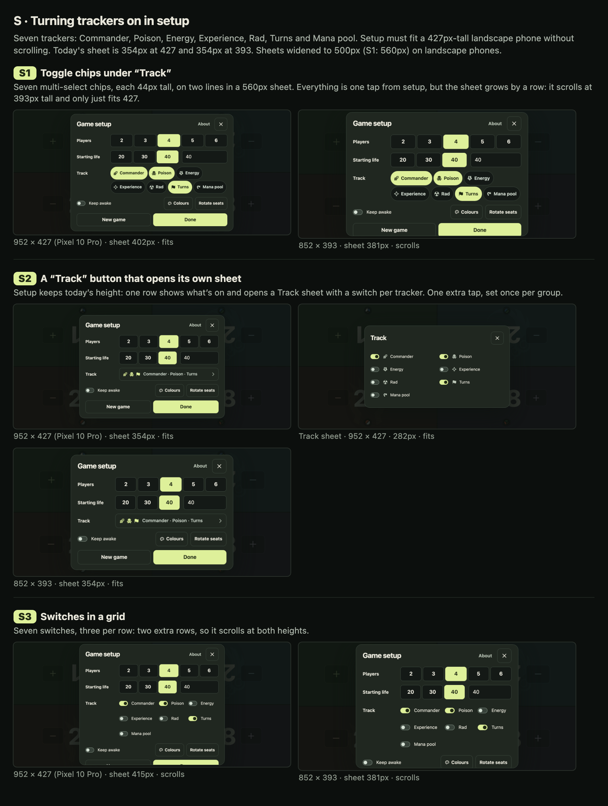
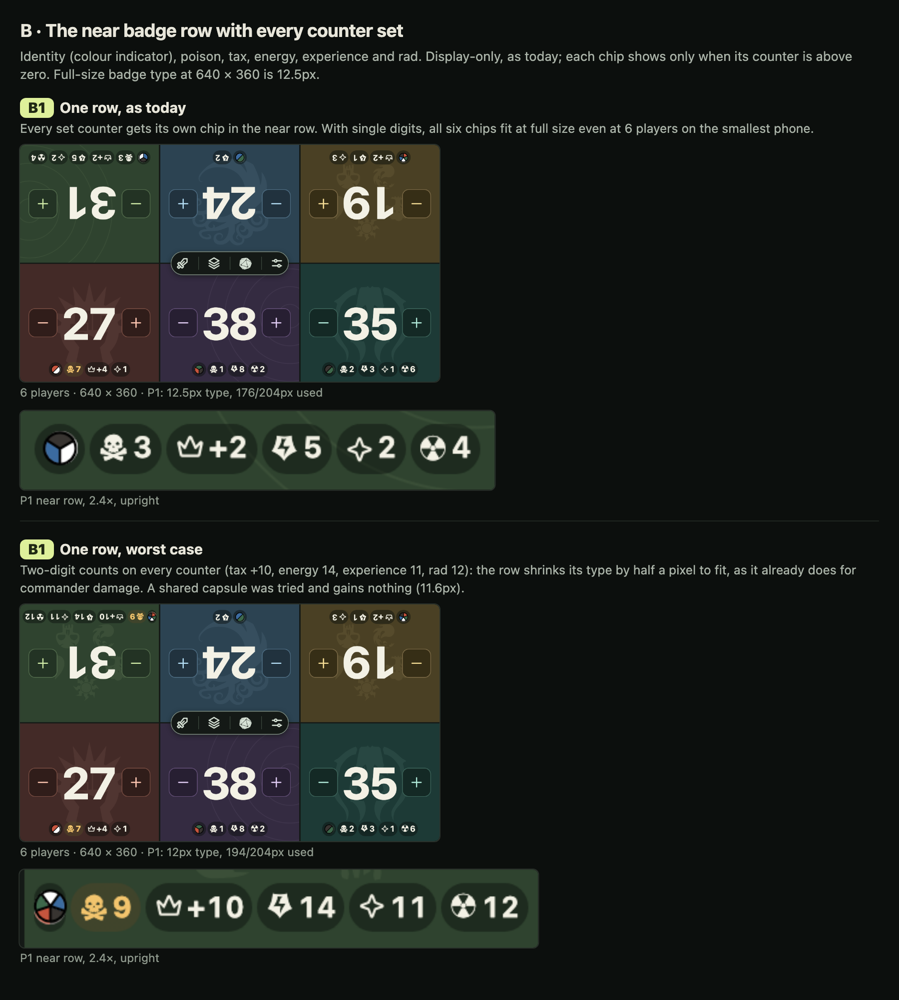
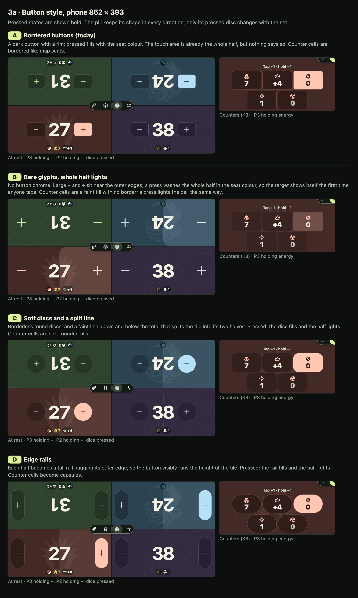
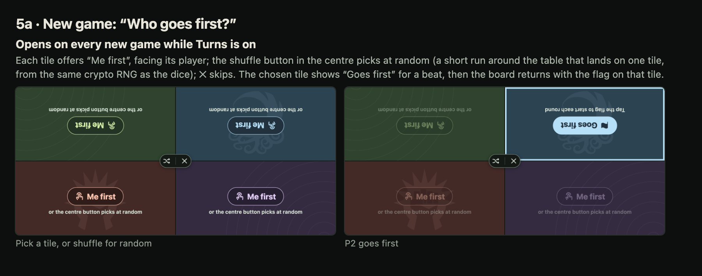
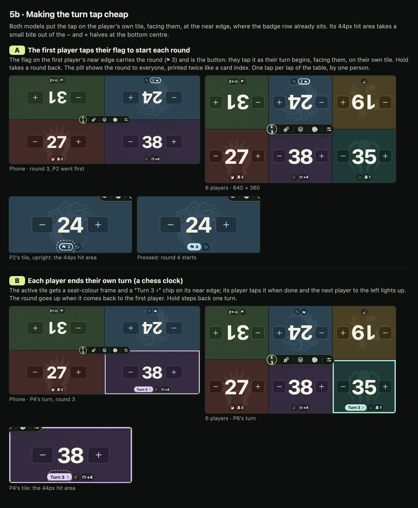

# Polish round: options to choose from

**Status:** design review, 21 November 2026. These are mock-ups only; I changed nothing in `web/`. This file goes with [RESEARCH.md](RESEARCH.md) (policy and stores) and [OVERVIEW.md](OVERVIEW.md) (flows and sizes).

- **How the images are made:** every frame is the real app (`web/` at 2f28705, with the Mana font) opened in Playwright with a seeded game. The only changes are the CSS and JS each option injects, all in [render.mjs](render.mjs).
- **Symbols:** mana and counter symbols come from the bundled Mana font: W U B R G `\e600`–`\e604`, colourless `\e904`, energy `\e907`, rad `\ea50`, infect `\ea73`, tap `\e61a`. Mana has no experience symbol, so experience uses Phosphor's four-point star.
- **Re-render:** `node design/polish/render.mjs [strip ...]` takes about 20s. Images go to `renders/` at 2×, 1800px wide.

**Decided since the first draft:**

- The owner chose the real mana symbols (Mana font v1.18.0, SIL OFL). This shipped in f1dc7f9 and 9a8ec7e, so the stylised-pip options are gone.
- The 2- and 3-player overlap of commander damage under the pill is fixed in 2f28705.

---

## 1. Colour names

- **N1. No names.** This is what ships: the mana symbols when setting identity, and the colour indicator at rest.
- **N2. The name only while choosing.**
  - "Jund" fills the empty sixth cell of the toggle grid as you pick.
  - It confirms the combination and teaches the names, and the board doesn't change.
- **N3. The name on the board too.**
  - The near row shows "◕ Jund".
  - The off switch is an **Aa** toggle in the colours-mode pill, beside ✓, where identity is set. Setup doesn't grow.
  - The longest names ("Five-colour", "Ink-Treader") still fit at 6 players on the smallest phone.

**Recommendation: N3, names on by default.** That's what the owner asked for: automatic, with an off switch.

For four colours, I recommend the *Nephilim* names (Glint-Eye, Dune-Brood, Ink-Treader, Witch-Maw, Yore-Tiller). In my experience they're the most widely used of the three sets; I didn't verify that this round. The full table is in [RESEARCH §1.7](RESEARCH.md#17-name-table).

---

## 2. Player counters: poison, tax, energy, experience and rad

Player counters only, never permanent counters. Each counter has its own switch, and only the ones switched on appear.

### 2K. Counters mode layout

- **K1. Stepper rows (today).**
  - One − count + row per counter.
  - Five rows need about 250px of height, and a phone tile has 196px (179px at 6 players on the smallest phone). The rows run off the tile at every phone size.
- **K2. Stepper rows in two columns.** It fits four players on a phone. At 6 players a row needs about 140px of width and the tile has 213px for two columns, so it doesn't fit.
- **K3. Tap +1, hold −1 cells.**
  - Each counter is one cell: icon over count, tap to add, hold to take away and keep repeating.
  - That's the same rule and hint ("Tap +1 · hold −1") as the commander damage map, so there's nothing new to learn.
  - Three to a row, with the last row centred.
  - The smallest cell is **64×61** (6 players, 640×360). It's 109×69 on a phone at 4 players and 145×154 on a tablet. With only Poison and Tax on, the two cells grow to 98–110 × 92.

**Recommendation: K3.**

- It's the only layout that fits all five counters at every size above 44px.
- It reuses the map's interaction.
- It retires the steppers, the smallest targets in the app.

The cost is that −1 is a hold rather than a visible button. The map has already taught that, and the hint is on every tile.

### 2S. Turning counters on in setup

There are seven trackers to switch: Commander, Poison, Energy, Experience, Rad, Turns and Mana pool. Today's setup sheet is 354px tall, and it must fit a 427px-tall landscape phone (Pixel 10 Pro). It fits 393px today, too.

- **S1. Toggle chips under "Track".**
  - Seven 44px chips on two lines, in a 560px-wide sheet.
  - It's one tap per tracker. The sheet grows to 402px: that fits 427, but it scrolls at 393.
- **S2. A Track row that opens its own sheet.**
  - The row shows what's on ("⚔ ☠ ⚑ Commander · Poison · Turns ›") and opens a **Track** sheet with a switch, icon and name per tracker, in two columns (282px tall).
  - Setup stays at 354px.
  - It costs one extra tap, and a group sets it once.
- **S3. Switches in a grid.** Seven switches, three per row. 415px, so it scrolls at both heights.

**Recommendation: S2.**

- It's the only option that leaves setup exactly as tall as today.
- It has room for more trackers later.
- These switches are set once per playgroup.

The Track sheet faces the bottom of the screen like setup does. Closing it returns to setup.

### 2B. The near badge row

No change is needed.

- With every counter set (identity, poison, tax, energy, experience, rad), the row fits at full size (12.5px) at 6 players on the smallest phone: 176 of 204px used.
- The worst case, with two-digit counts on everything, shrinks the type by half a pixel through the existing fit-to-width rule.
- I tried a shared capsule for the counters; it gains nothing.

---

## 3. Button style

Every frame shows held states: P3 holding +, P2 holding −, and the dice button pressed. The crops show counters mode (K3) with energy held.

- **A. Bordered buttons (today).**
  - Clear and familiar.
  - It suggests you must hit the button, though the whole half counts.
  - Counter cells are bordered like map seats.
- **B. Bare glyphs, whole half lights.**
  - No chrome. The − and + are larger and sit near the outer edges.
  - A press washes the whole half in the player's seat colour (17%), with a rounded inner edge, so the first tap shows the target.
  - Counter cells are a faint fill with no border, and a press lights the cell.
  - The pill is already bare glyphs on a capsule, so the set becomes one family.
- **C. Soft discs and a split line.**
  - Round borderless discs, and a faint line above and below the total.
  - Pressed: the disc fills and the half lights.
  - Counter cells are soft rounded fills.
- **D. Edge rails.**
  - Tall capsules hug the outer edges, and counter cells become capsules.
  - It's the most explicit option and the heaviest. On a tablet the rails read as chrome.

**Recommendation: B.**

- It's the most modern of the four.
- It explains the touch area on the first press.
- It drops 2–12 boxes from the board.
- It looks the same at every size.

The wash is translucent so the total stays readable through it, and it only shows while a finger is down.

---

## 4. Sizes

The measurements are in [OVERVIEW §3](OVERVIEW.md#3-button-sizes). The life halves are generous, and with K3 every counter target is at least 64×61. Two changes are left:

- **Z1. The pill on tablets:** 48px everywhere today, or grow with `--grow` up to 64px. Phones are unchanged. **Recommend: grow.**
- **Z2. Life total on tall tiles:**
  - It never drops below today's size, but grows to 38% of a tall tile's height.
  - That's 160px at 2 players (75px today), and 160px or 107px on the end seat at 3 or 5 players.
  - 4 and 6 players don't change.
  - **Recommend: yes.**

---

## 5. Who goes first, and turns

The owner accepts that following the mana curve needs a tap each round or each turn. The aim is to make that tap cheap and natural.

### The model

- **The useful number is the round.** In round N, every player is on their own Nth turn, so "round 3" means "your third land drop" for everyone at the table.
- **The tap belongs to a person, on their own tile, facing them,** not to a shared control in the middle. People forget shared chores; they don't forget their own button.

- **Setup:** Turns is one of the trackers (§2S). It's off by default and saved. Off means nothing about turns shows anywhere.
- **New game, with Turns on:** the board opens **"Who goes first?"**.
  - Each tile shows "Me first".
  - The centre shows a shuffle button (a random pick from the dice's crypto RNG, with a short run around the table) and ✕ to skip.
  - The chosen tile shows "Goes first" for a beat.
- **A. The first player taps their flag to start each round.**
  - The flag on the first player's near edge shows the round (⚑ 3) and *is* the button.
  - They tap it as their turn begins. It has a 44px hit area at the bottom centre of their tile, which takes a small bite out of the − and + halves. Hold takes a round back.
  - The pill shows the round to everyone, printed twice like a card index so both long sides read it. Tapping it does the same as the flag, as a backup.
  - One tap per lap of the table, by one person, who has a reason to remember: it's their turn.
- **B. Each player ends their own turn (a chess clock).**
  - The active tile gets a seat-colour frame and a "Turn 3 ›" chip on its near edge.
  - Its player taps the chip when done, and the next player to the left lights up. The round goes up when play reaches the first player again. Hold steps back.
  - It also answers "whose turn is it?". The cost is a tap from everyone on every turn, skipping players who are out, and a hold-back for extra turns.
- **Undo and new game:** hold steps back. A new game resets to round 1 and asks again. **Turns off mid-game:** the round and the flag are kept but hidden.

**Recommendation: A.** It's the cheapest tap that still keeps the curve right: one person, once a round, on their own tile. B is the better pick only for tables that want a whose-turn light. Both share every other piece (setup, start, pill, flag), so switching later is cheap.

---

## 6. Floating mana

Each player's mana pool: W U B R G and colourless, drawn with the real Mana symbols.

- **Where it lives:**
  - **M1. A mana mode, like counters.**
    - A pill button (the tap symbol, shown when the Mana pool tracker is on) opens a board mode.
    - Every tile shows its pool as six cells facing its player, with an **Empty** button. Undo, ✓ and ✕ work as in counters mode.
    - It's robust at every size. Life is locked while it's open.
  - **M2. A pool strip on every tile, while life stays live.**
    - The same pill button toggles a strip of the six symbols plus an eraser along each tile's near edge, in place of the badge row. − and + keep working.
    - This matters in practice: players pay life (Phyrexian mana, fetch lands) and take damage while mana floats.
    - At 6 players on the smallest phone the strip wraps to two rows, the total shrinks to 46px, and the commander damage chips hide while pools show.
- **Adding and spending:** tap a symbol for +1, hold for −1 with repeat. It's the map and counters rule again (K3), so there are no new gestures and no −/+ pairs × 6.
- **Emptying:**
  - Mana pools empty at the end of every step and phase. The app can't see steps, so emptying is manual: Empty (M1) or the eraser (M2) clears one player's pool, and turning the pill toggle off clears every pool.
  - With Turns on, advancing the round (A) or ending a turn (B) also empties every pool. That's the one moment the app *knows* a step ended.
  - In M1, ✓ closes the mode and empties every pool. A pool kept for later is rare enough to leave out.

**Recommendation: M2, emptied by hand and by the turn tracker.**

- Keeping life live while mana floats is the reason to track the pool in the app at all.
- The strip appears only while the toggle is on.

If the 6-player squeeze matters more, M1 is the safe fallback.

**The pill:** at rest it could reach six buttons with everything on: round, sword, counters, mana, dice and setup, which is 288px. It still sits clear of every badge row (2f28705). If that's too long, the round button can go and the flag stays the round's only control.

---

## Questions for review

Each question lists its options as letter · label · image, then the recommendation.

**Q1. Should the colour name (Esper, Jund…) show?** (`names`)

- N1 · No names (as shipped) · `renders/pips-names.png`
- N2 · Only while choosing, in colours mode · `renders/pips-names.png`
- N3 · On the board too; Aa off switch in colours mode; on by default · `renders/pips-names.png`
- **Recommended: N3.**

**Q2. Which names for four-colour identities?** (`four-colour-names`)

- a · Nephilim names: Glint-Eye, Dune-Brood, Ink-Treader, Witch-Maw, Yore-Tiller · —
- b · Commander 2016 names: Chaos, Aggression, Altruism, Growth, Artifice · —
- c · Plain: "No white", "No blue" … · —
- **Recommended: a.**

**Q3. How should counters mode lay out up to five counters?** (`counters-layout`)

- K1 · Stepper rows (today) · `renders/counters-mode.png`
- K2 · Stepper rows in two columns · `renders/counters-mode.png`
- K3 · Tap +1, hold −1 cells, three to a row · `renders/counters-mode.png`
- **Recommended: K3.**

**Q4. How should trackers be switched on in setup?** (`setup-trackers`)

- S1 · Toggle chips under "Track" (scrolls at 393px tall) · `renders/counters-setup.png`
- S2 · A Track row that opens its own sheet (setup height unchanged) · `renders/counters-setup.png`
- S3 · Switches in a grid (scrolls at both heights) · `renders/counters-setup.png`
- **Recommended: S2.**

**Q5. Which button style?** (`button-style`)

- A · Bordered buttons (today) · `renders/style-phone.png`
- B · Bare glyphs; the whole pressed half lights up · `renders/style-phone.png`
- C · Soft round discs and a split line · `renders/style-phone.png`
- D · Edge rails · `renders/style-phone.png`
- **Recommended: B.** 6-player, counters and tablet views: `renders/style-sizes.png`.

**Q6. Grow the centre pill on tablets?** (`pill-size`)

- Yes · Grows to 64px on tablets, phones unchanged · `renders/size-options.png`
- No · 48px everywhere (today) · `renders/size-options.png`
- **Recommended: Yes.**

**Q7. Let the life total grow on tall tiles (2 players, the end seat at 3 and 5)?** (`life-size`)

- Yes · Up to 38% of the tile height, never smaller than today · `renders/size-options.png`
- No · 19% of the screen's short side (today) · `renders/size-options.png`
- **Recommended: Yes.**

**Q8. How should turns be tracked?** (`turn-model`)

- A · The first player taps their flag to start each round · `renders/turns-models.png`
- B · Each player taps "Turn N ›" to end their turn (a chess clock) · `renders/turns-models.png`
- None · No turn tracking · —
- **Recommended: A.**

**Q9. When should "Who goes first?" appear?** (`first-prompt`)

- Auto · Opens on every new game while Turns is on · `renders/turns-start.png`
- Manual · Only by holding the flag or round button at round 1 · `renders/turns-start.png`
- **Recommended: Auto.**

**Q10. Where should floating mana live?** (`mana-pool`)

- M1 · A mana mode, like counters (life locked while open) · `renders/mana-pool.png`
- M2 · A pool strip on every tile; life stays live · `renders/mana-pool.png`
- None · No mana pool · —
- **Recommended: M2.**

**Q11. When should mana pools empty?** (`mana-empty`)

- Manual · Only by the per-player Empty/eraser or the pill toggle · `renders/mana-pool.png`
- Manual + turns · Also whenever the turn tracker advances · `renders/mana-pool.png`
- **Recommended: Manual + turns.**
