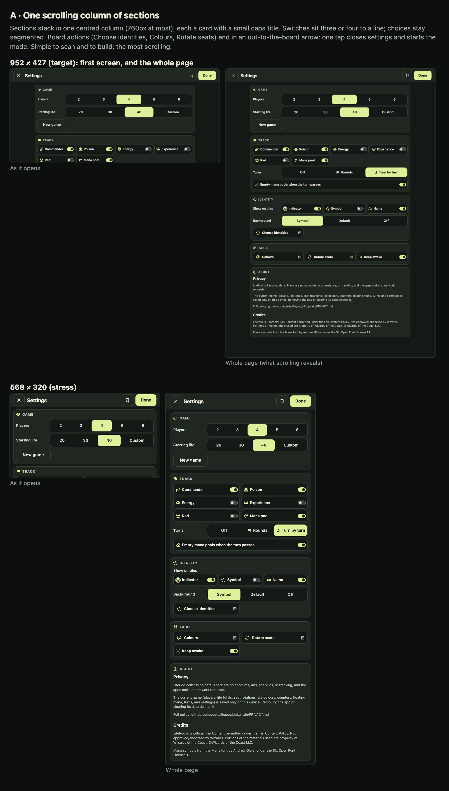
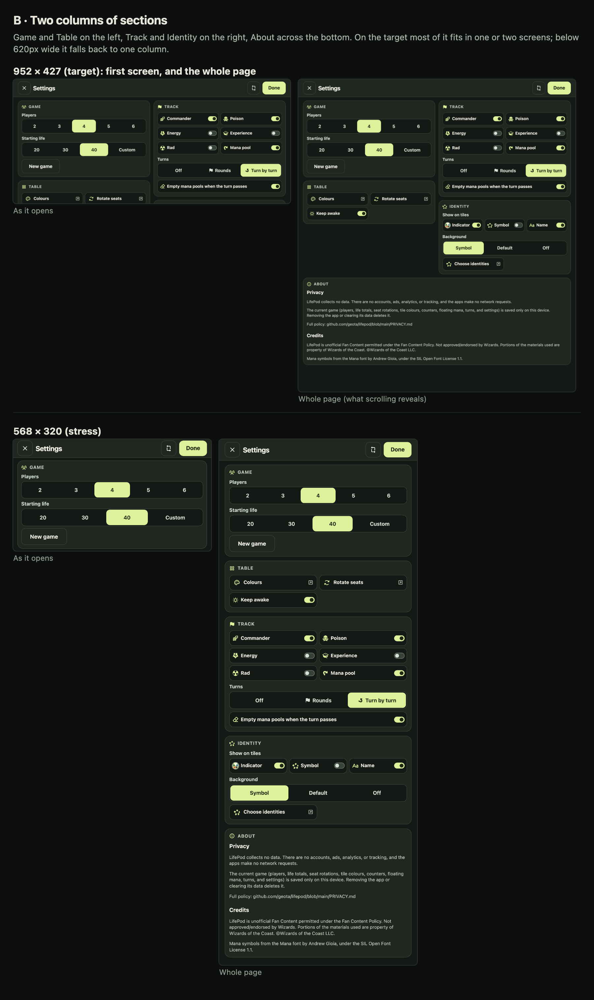
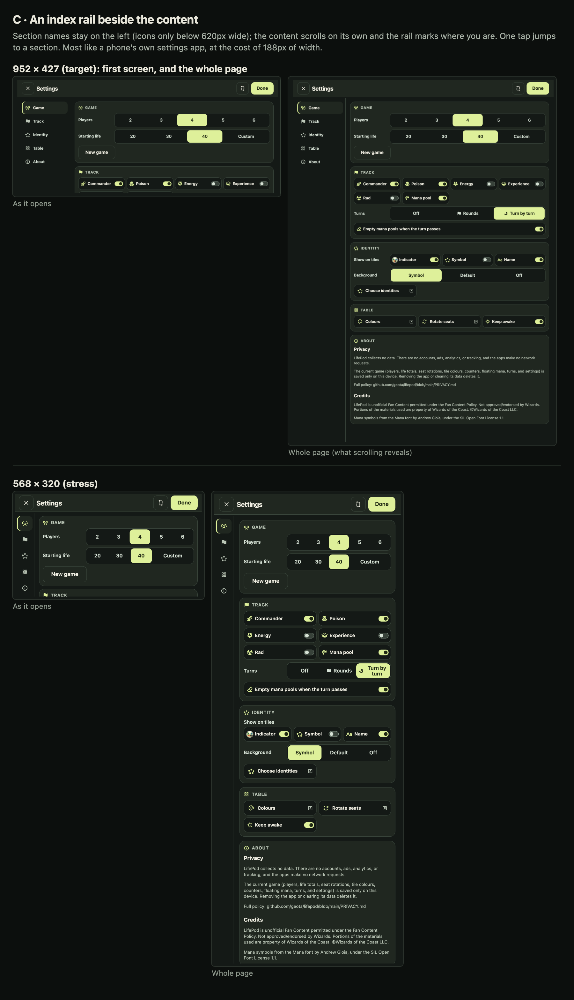
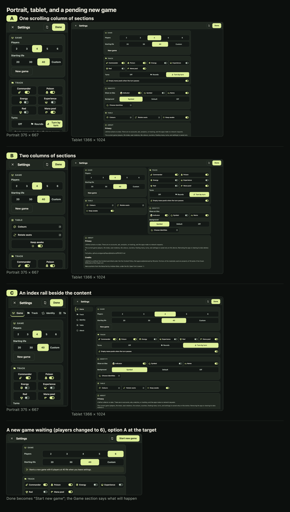

# Settings refactor: options

**Status:** options for the owner, 22 November 2026. Nothing in `web/` has changed. The build-ready spec follows once the picks come back.

**The ask:**

> Something that takes over the full screen. Scrolling is fine. Aligns on smaller toggles for the things that toggle. Sections for each group of settings to eliminate having to click colour identity and then have to click set colour identity.

**What changes:**

- One full-screen settings page replaces the setup dialog, the Track and Identity sheets, and the separate About sheet. It scrolls vertically, with nothing to drill into.
- Every on/off setting is a compact switch row, aligned in one grid.
- Choices that aren't on/off stay segmented and are sized to match.
- **Board actions start from their own section:** Choose identities, Colours and Rotate seats close settings and start their board mode in one tap.

**About the mock-ups:**

- Drawn by [settings.mjs](settings.mjs) (`node design/polish/settings.mjs`) on the current app at a1dc4cd.
- Built from clones of the app's own controls (segmented, stepper, compact switch rows, buttons), so they use the shipped classes, icons and palette.
- Each option is shown at 952 × 427 (the target) and 568 × 320 (the stress size). The images show the first screen and the whole scrolling length.

---

## Grouping and order (shared by all three layouts)

| # | Section | Contents |
|---|---|---|
| 1 | **Game** | Players (segmented 2–6), starting life (20 · 30 · 40 · Custom, where Custom becomes the − n + stepper), and New game |
| 2 | **Track** | Commander, Poison, Energy, Experience, Rad and Mana pool as compact switches; Turns (Off · Rounds · Turn by turn); "Empty mana pools when the turn passes" (only while Mana pool is on and Turns isn't Off) |
| 3 | **Identity** | Show on tiles (Indicator, Symbol and Name as compact switches); Background (Symbol · Default · Off); **Choose identities** as a board action |
| 4 | **Table** | **Colours** and **Rotate seats** as board actions; Keep awake |
| 5 | **About** | Privacy and credits, inline, in small muted type |

**Why this order:**

- Game is what people change most.
- Track is set once per group.
- Identity and Table shape how the tiles look.
- About is reference material.

**The control set** is still six types, with one swap: sub-sheets are gone, so the navigation row becomes a **board action row**.

1. **Segmented choice:** single, or multi where every option is a switch.
2. **Stepper**, for custom life.
3. **Compact switch row:** a 44px row with an icon, the label and a small switch. The whole row is the target.
4. **Board action row:** icon, label, and an out-to-the-board arrow. It closes settings and starts the mode.
5. **Button:** primary, or secondary (New game).
6. **Header button:** ✕ to close, ⟲ to flip the page, and the primary **Done**.

**The header, in every layout:** ✕ · "Settings" · flip ⟲ · **Done**. It stays fixed at the top while the content scrolls.

---

## A. One scrolling column of sections

- The sections stack in one centred column, 760px at most, each a card with a small caps title.
- Switches sit three or four to a line on the target and two on narrow screens.
- **Length:** about 1.9 screens on the target and about 5 at 568 × 320.
- **For:** the simplest page to scan, the simplest to build, and the same order at every size.
- **Against:** the most scrolling on the target, with empty margins either side of the column.

## B. Two columns of sections

- **Target (952 × 427):** Game and Table on the left, Track and Identity on the right, About across the bottom. The first screen already shows players, life, every tracker and Turns. The whole page is about 1.4 screens.
- **Below 620px wide** (568 × 320) it becomes option A.
- **For:** the least scrolling where it matters, the target phone in landscape. The two most-changed sections (Game, Track) are side by side.
- **Against:**
  - The order is two-dimensional, so "next" is less obvious.
  - The columns end at different heights.
  - The layout changes at 620px.

## C. An index rail beside the content

- A rail of section names (icons only below 620px wide; a row of tabs in portrait) sits beside a scrolling content column. The rail marks where you are, and one tap jumps to a section.
- **For:** familiar from phone settings apps, and fast to jump on a long page.
- **Against:**
  - Five sections are too few to need an index.
  - The rail takes 188px of the target's width, so the content is no wider than A's.
  - At 568 × 320 the 60px rail is icons only, which is harder to read.

## Portrait, tablet and a pending new game

- **Portrait (375 × 667):** every option becomes one column. C's rail becomes a row of tabs. The compact switches go two to a line, label over switch (today's portrait rule).
- **Tablet (1366 × 1024):** A centres an 820px column, B spreads to 1180px, and C keeps its rail. Everything grows through `--grow` like the board does.

---

## Behaviour (all layouts)

- **Opening:** the pill's setup button opens settings, always at the top (Game).
- **Saving:** everything except players and starting life saves the moment it changes, as today.
- **Pending new game:**
  - Changing players or starting life marks a new game as waiting. The Game section says what will happen ("Starts a new game with 6 players at 40 life when you leave settings").
  - **Done** becomes **Start new game**.
  - New game (the same settings) hides while a change is waiting.
  - **Board actions while a new game is waiting** start the new game first, then the mode. Choosing colours or rotating seats right after changing the player count is exactly what people want next. The alternative is Q3 P2.
- **✕ and Android back** close settings and drop a waiting player or life change, which works as Cancel. Switches stay as set.
- **Orientation:**
  - A full-screen page can face only one side.
  - It follows the phone's own orientation, as today's dialogs do: whoever picks the phone up, or the side the OS considers down when it lies flat.
  - It doesn't rotate with the board, because the board turns back to keep seats fixed and the page would end up sideways.
  - The **flip ⟲** header button turns the page 180° for someone across the table. It resets when settings close.
- **Safe area:** the page pads by `env(safe-area-inset-*)` on every side, since the viewport is `viewport-fit=cover`.
- **Targets:** every control stays at least 44px at 568 × 320, including the header, segments, switch rows and action rows.

---

## Questions for review

**Q1. Which layout?** (`settings-layout`)

- A · One scrolling column of sections · `renders/settings-a.png`
- B · Two columns on wide landscape, one column below 620px · `renders/settings-b.png`
- C · Index rail beside a scrolling column · `renders/settings-c.png`
- **Recommended: B.** It has the least scrolling on the target phone and the first screen shows everything people change per game. On narrow screens it is A.

**Q2. How should the settings be grouped?** (`settings-groups`)

- G1 · Game · Track · Identity · Table · About · `renders/settings-a.png`
- G2 · Game (with Keep awake) · Track · Seats (Colours, Rotate seats, Identity) · About · —
- **Recommended: G1.** G2's Seats section would hold two board actions, three switches, a choice and a third action, which is too much for one card.

**Q3. What happens when players or starting life change?** (`settings-pending`)

- P1 · Done becomes "Start new game"; board actions start the new game, then their mode · `renders/settings-more.png`
- P2 · The Game section gets its own Start / Revert; board actions are disabled until one is tapped · —
- **Recommended: P1.**

**Q4. Which way does the page face?** (`settings-orientation`)

- O1 · The phone's own orientation, with a flip ⟲ button for the far side · `renders/settings-a.png`
- O2 · Fixed to the board's bottom edge (the landscape it was set up in) · —
- **Recommended: O1.**

**Q5. Where does About go?** (`settings-about`)

- Inline · The last section of the page · `renders/settings-a.png`
- Link · An About row that opens today's separate sheet · —
- **Recommended: Inline.** It's short, and one less sheet.
