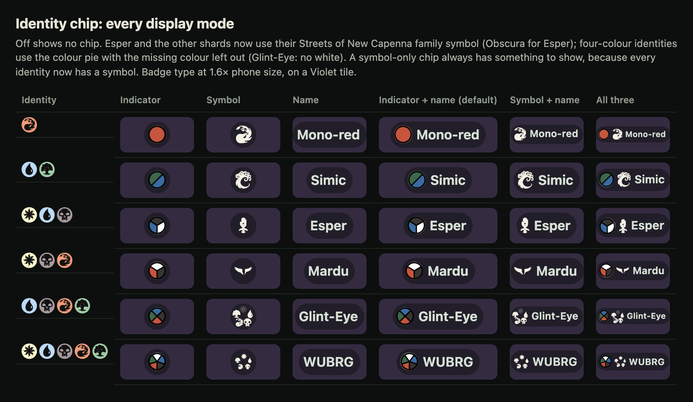
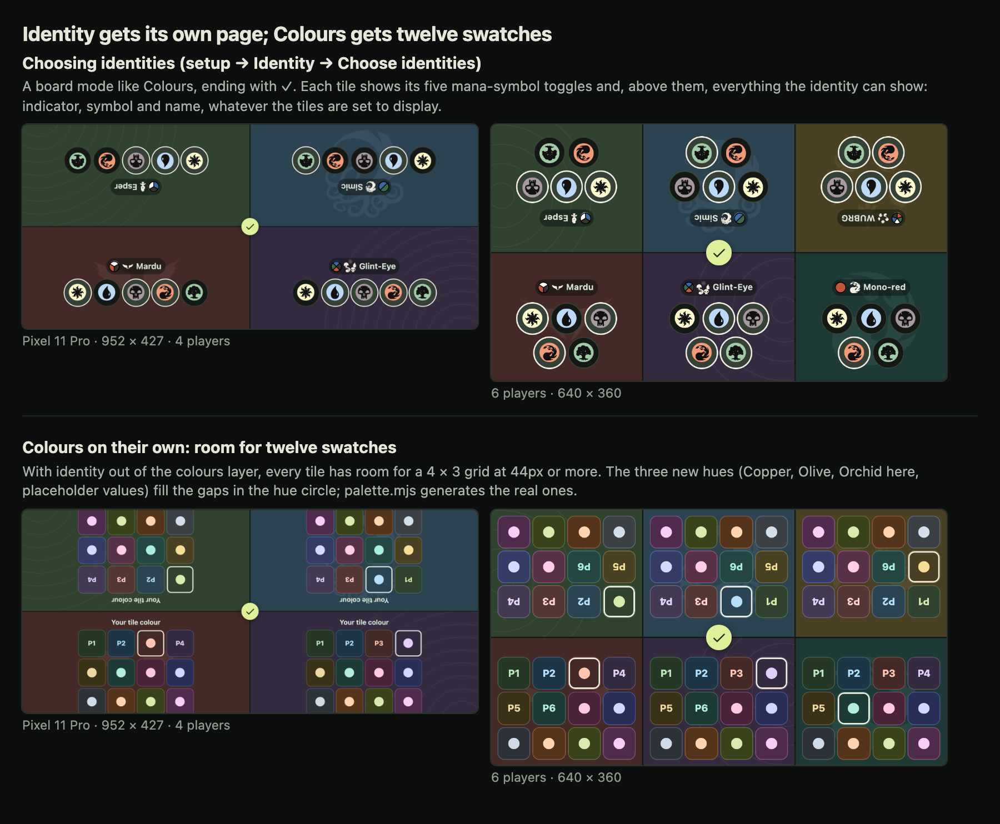
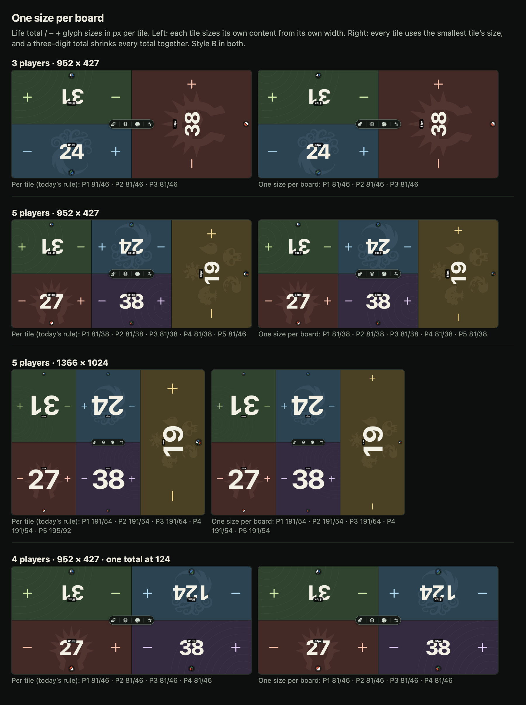
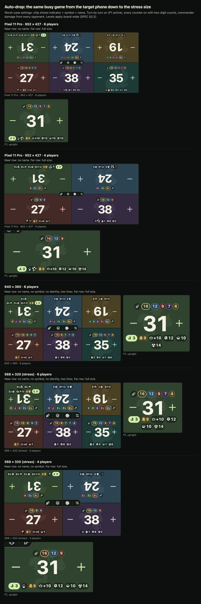
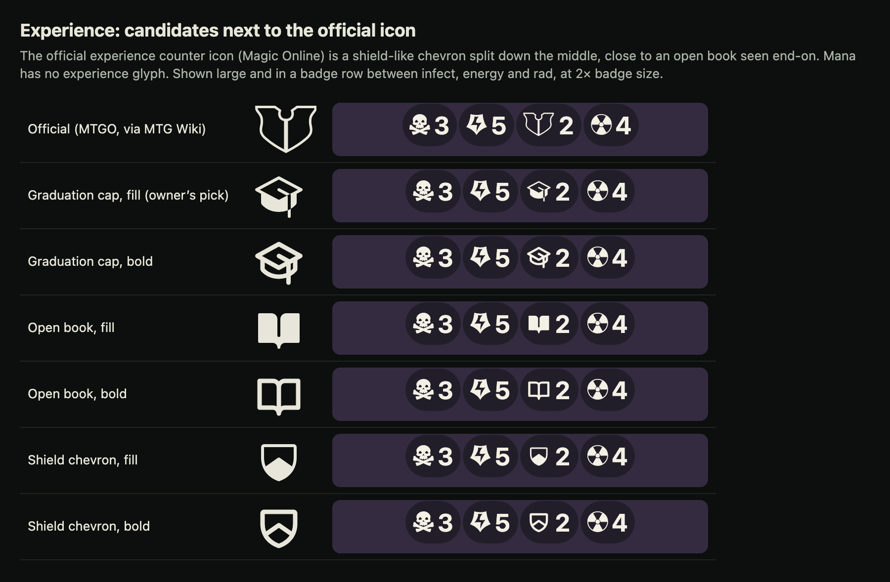
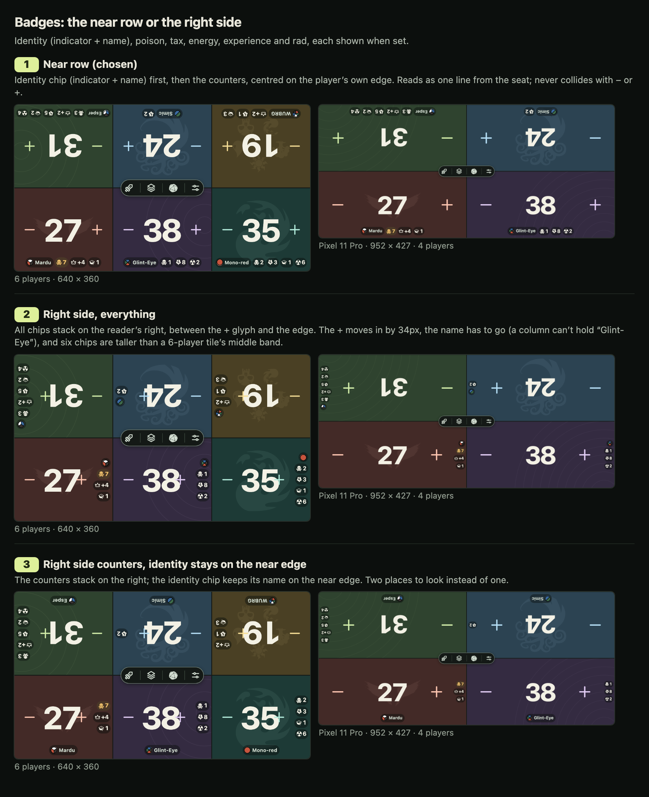
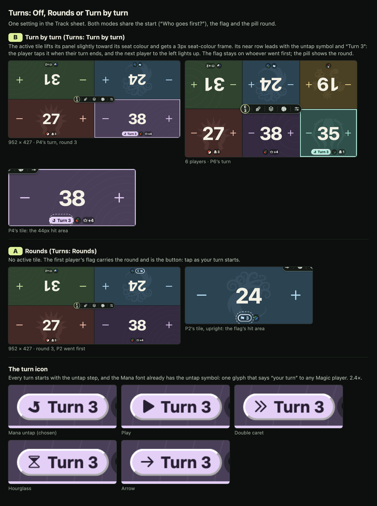

# Polish round: build spec

**Status:** built (v0.1.0-alpha.15 and later). Written 21 November 2026 as the build spec; later decisions are marked where they changed it. This turns the owner's answers to the 14 questions in [OPTIONS.md](OPTIONS.md) into decisions.

- Where the owner said "decide", the decision is here with its reason. Where an answer left a gap, I filled it and said so.
- The questions raised during the spec are all resolved (§12).
- The mock-ups are `renders/spec-*.png`, drawn on the current `web/` (2f28705) by [spec.mjs](spec.mjs) (`node design/polish/spec.mjs`). Every spec frame uses the new button style and the one-size-per-board rule.

**Target device: Pixel 11 Pro class, 952 × 427 CSS px in landscape.**

- The Pixel 11 Pro has the same panel as the Pixel 10 Pro: 6.3", 2856 × 1280 at 495 ppi ([whatismyscreensize.com: 11 Pro](https://www.whatismyscreensize.com/device/pixel-11-pro), [10 Pro](https://www.whatismyscreensize.com/device/pixel-10-pro)). At the default 3× density, that's the 952 × 427 already in `tests/sizes.test.mjs`. No published source gives the 11 Pro's CSS viewport, so check it on a device.
- **Design and render at 952 × 427 first.** Every mock-up's lead frame uses this size.
- 640 × 360 (the smallest real phone) and 568 × 320 (the stress test) must keep working:
  - life totals, the −/+ halves and every 44px target always work;
  - secondary information gives way by the drop rules in §3.2.
- Tablets scale up through `--grow`.

**What this spec covers:**

1. Button style
2. Colour identity: its own page, display modes, symbols and names
3. One size per board, and what drops when space runs out
4. Setup with a fixed set of controls
5. Tile colours: twelve swatches
6. Player counters
7. Badge row
8. Turns
9. Floating mana
10. Data model and settings
11. Build plan
12. Questions resolved
13. The monarch and the initiative (added after the build)

---

## 1. Button style (Q7: B)

- **Life halves:**
  - No button chrome.
  - The − and + glyphs sit near the tile's outer edges: inset `5 × u` from each edge (`u` is defined in §3).
  - Each half is still the whole touch area.
  - A press washes the pressed half in `color-mix(in oklab, var(--seat) 17%, transparent)`, with a 28px radius on the inner corners. The glyph turns `--text`.
  - The wash shows only while a finger is down, so it doesn't conflict with "no transparency" for colours at rest.
- **Counter and mana cells are circles** (decided). Reasons:
  - Physical counters (dice, tokens, beads) are round.
  - The pill's pressed state is a disc.
  - The commander damage map keeps its rounded-rectangle seats, so "seat" and "counter" stay visually different.
  - Each cell is filled `color-mix(in oklab, var(--button) 55%, var(--panel))`, with no border. A press fills it with `color-mix(in oklab, var(--seat) 26%, var(--panel))`. *As built:* cells press with the 10% state layer (`--state-pressed`, SETTINGS-SPEC.md §7); the 26% seat mix is kept only on the turn, strip, pass and reminder chips and on "Me first".
- **The pill keeps its shape.** Its pressed disc is unchanged.
- **Map seats are unchanged.**

## 2. Colour identity (Q1: N3, plus the owner's additions)

### 2.1 Identity has its own page, and no longer depends on Commander

- **Settings → Identity** (a section of the settings page, SETTINGS-SPEC.md; it began as an Identity sheet, §4) holds the identity settings. Its button **Choose identities** starts the identity board mode.
- **The Colours mode becomes tile colour only.** That frees the room for twelve swatches (§5).
- **Decision: identity is no longer tied to the Commander switch.** It has its own settings, and turning every display option off removes it from the board. Reason: identity is useful for tile meaning and names in any multiplayer game. The owner asked for a full off setting instead.

### 2.2 What a tile shows: the chip

- **Show on tiles** is any combination of Indicator, Symbol and Name.
  - None selected means the chip is off.
  - **Default: Indicator + Name**, the owner's N3 pick.
- **Order in the chip:** indicator, symbol, name.
  - A chip with only the indicator or only the symbol is the round 1.7em chip.
  - A chip with a name is a capsule.
- **Every identity has a symbol** (§2.4), so a Symbol-only chip never comes up empty. An unset identity shows no chip at all.
- **The chip leads the near badge row** (§7), after the turn chips (§8), which lead it when Turns is on.
- **Names come from the identity automatically** (§2.5).

### 2.3 The background ("indicator backgrounds")

My reading: this is the faint mark behind the life total. It's a setting of its own, independent of the chip.

Segmented **Symbol · Default · Off** (the owner's change; it replaced Symbol · Indicator · Off):

- **Symbol (default):** a tile whose identity is set shows the identity's symbol as the watermark, as shipped in fcf2a89. It now covers the shards and four-colour identities too. A tile with no identity shows the rings.
- **Default:** the rings on every tile, and no identity symbol.
- **Off:** no background effect on any tile: no rings and no symbol.
- There is no Indicator background any more.
- **Saved values** are `'symbol' | 'default' | 'off'`, with `identity.version: 2` (§10). A save without the version is from before this change, when Off meant the rings: `loadGame()` reads its `'off'` as `'default'` and its `'indicator'` as `'symbol'`, and anything else as `'symbol'`. Only a version 2 save can mean the new Off.
- **Combining with the chip:**
  - Symbol background plus a Symbol chip repeats the symbol. That's allowed, and the defaults avoid it.
  - Default or Off plus chip off is "identity off" without clearing anyone's picks.

This reading is confirmed (§12).

### 2.4 Symbols for all 31 identities

| Identities | Symbol | Mana code points |
|---|---|---|
| Mono (5) | The colour's mana symbol | `\e600`–`\e604` |
| Pairs (10) | Ravnica guild | `\e90c`–`\e915` (as shipped) |
| Wedges (5) | Khans clan | `\e916`–`\e91a` (as shipped) |
| Shards (5) | **Streets of New Capenna family**: Brokers = Bant (WUG) `\ea0d`, Cabaretti = Naya (WRG) `\ea0e`, Maestros = Grixis (UBR) `\ea0f`, Obscura = Esper (WUB) `\ea10`, Riveteers = Jund (BRG) `\ea11` | new |
| Four-colour (5) | **The colour pie with the missing colour as a ghost:** five mono symbols on a pentagon (W top, then clockwise U, B, R, G), the missing one at 25% of the symbol's opacity | composed from `\e600`–`\e604` |
| WUBRG | Colour pie | `\e9f0` (as shipped) |

- **The shard mapping is verified.** In a Scryfall search of each family's watermark, the most common colour identity among its cards is the shard's: Brokers 14 WUG, Cabaretti 14 WRG, Maestros 14 UBR, Obscura 14 WUB, Riveteers 15 BRG.
- **Research for four-colour identities:**
  - I scanned all 76 watermarks in Scryfall's catalog (`api.scryfall.com/catalog/watermarks`). None belongs to a four-colour faction.
  - The only four- or five-colour cards with any watermark are one-offs in Unfinity, Echoverse and the Avatar sets.
  - The *Nephilim* (Guildpact) and the Commander 2016 decks never had symbols.
  - So there's no official symbol, and the "pie minus one" is the closest honest one: it reuses an official mark and says exactly which colour is missing.
- **Not used:** Strixhaven colleges (they cover only the five enemy pairs) and Tarkir dragonlords. Guilds and clans cover every pair and wedge, and they're what ships.
- **The 25% ghost** keeps the pentagon readable at chip size. In the watermark (7% opacity) the ghost is effectively invisible, which is fine.

### 2.5 Names (Q1 and Q2)

One fixed table, with no setting. The owner confirmed the full four-colour names and "WUBRG" for five colours.

| Identity | Name |
|---|---|
| W / U / B / R / G | Mono-white / Mono-blue / Mono-black / Mono-red / Mono-green |
| WU UB BR RG WG WB UR BG WR UG | Azorius, Dimir, Rakdos, Gruul, Selesnya, Orzhov, Izzet, Golgari, Boros, Simic |
| WUG WUB UBR BRG WRG | Bant, Esper, Grixis, Jund, Naya |
| WBG WUR UBG WBR URG | Abzan, Jeskai, Sultai, Mardu, Temur |
| UBRG (no white) | Glint-Eye |
| WBRG (no blue) | Dune-Brood |
| WURG (no black) | Ink-Treader |
| WUBG (no red) | Witch-Maw |
| WUBR (no green) | Yore-Tiller |
| WUBRG | WUBRG |

### 2.6 Choosing identities: the identity board mode

- Like Colours mode, it ends with the single ✓, and Android back ends it too. Changes save instantly.
- **Each tile shows:**
  - a preview chip with *all three* (indicator, symbol and name), whatever the tiles are set to display (the owner: "show name / indicator / symbol when choosing");
  - the five mana-symbol toggles.
- **Toggles:** `clamp(44px, 12u, 72 × grow)`, one row where five fit, otherwise 3 + 2 (6 players on phones).
- An empty identity previews as "No identity".

## 3. One size per board, and what drops when space runs out (Q8: yes; Q9: no)

### 3.1 One size per board

**Confirming the lead's reading:**

- Within a game, every tile draws its content at the same size: the life total, the − and + glyphs, the badges, counter cells, map seats and mode layers.
- That size is the largest that fits the **smallest** tile.
- Content still scales with the device through `--grow`, and so does the pill: 48px on phones, up to 64px on tablets.
- Tall tiles get **no** extra growth (Q9: No).

**How:**

- `measureBoard()` (`web/js/layout/board.js`) measures every `.player-face` inside its pill clearances (see Centring below) and sets three properties on `#board`:
  - `--ui`: the smallest face width left inside them;
  - `--ub`: the smallest face height left inside them;
  - `--board-digits`: the most digits in any total, minimum 2.
- It runs again on resize, rotation, a player-count change, a seat rotation, and any total whose digit count changes.
- Tile CSS uses `u = var(--ui) / 100` in place of `cqi`: `--control-size: clamp(44px, 18u, 74 × grow)`, glyphs `clamp(1.75rem, 12u, …)`, badges `clamp(.78rem, 3.6u, …)` and so on.
- The total's size is `min(clamp(2rem, 19vmin, max(7rem, 112 × grow)), (ui − 2·control − 2·gap − 8px) × 1.5 / board-digits)`.

**Centring (added 22 November 2026):**

- A tile keeps clear of the centre pill only on the face edges the pill actually reaches, as `measureBoard()` measures them (`--clear-far`, `--clear-end`, `--clear-near`, `--clear-start`). A face the pill doesn't reach, such as the end seat at 3 or 5 players, keeps no clearance at all.
- Everything else is centred in what's left: the far row along its edge (no longer started at the reader's left on a sideways seat), and each mode layer's content (the commander damage map, the counter and mana cells, the swatches, the identity preview over its toggles, "Me first").
- A mode's hint sits on the far side of its content, so it doesn't push the content off-centre. Only where that side is shorter than the hint does the content give way toward the near edge.
- On narrow or short boards the swatches are centred too, and reach up to 6px into a clearance only along an axis where their grid doesn't fit otherwise.
- `tests/centring.test.mjs` checks the far row and every layer at 2–6 players, with seats turned three ways, at 952 × 427 and 568 × 320.

**What changes:**

- Totals are already equal on phones, because of the 19vmin cap.
- The differences today are in the glyphs (the 5-player end seat's ± is 46px against 34px elsewhere on a phone) and on tablets (the end seat's total is 195px against 191px).
- **A three-digit total shrinks every total together** (decided). Uniformity is the owner's rule, and totals of 100 or more are rare. Only the target (952 × 427) keeps full size with three digits. With 6 players a 100 shrinks every total from 68px to 52px at 640 × 360, and from 61px to 40px at 568 × 320, by the formula above.

**Board units by size**, measured on the current app: `ui` × `ub` is the smallest tile face, then the life total and the badge type.

| Screen | Players | `ui` × `ub` | Life | Badges |
|---|---|---|---|---|
| **952 × 427 (target)** | 2 | 427 × 475 | 81px | 15.4px |
| | 3–4 | 427–475 × 213 | 81px | 16px |
| | 5–6 | 316 × 213 | 81px | 12.5px |
| 640 × 360 | 6 | 212 × 179 | 68px | 12.5px |
| 568 × 320 (stress) | 6 | 188 × 159 | 61px | 12.5px |

### 3.2 Auto-drop: what gives way when a row runs out of room

**Never dropped, at any size including 568 × 320:**

- the life total;
- both −/+ halves;
- every count: poison, tax, energy, experience, rad and each commander damage chip, and the monarch's crown and the initiative's castle (§13);
- the identity chip, and its colour indicator wherever the chip shows one;
- every control: the turn chip, the mana strip, map seats, counter cells, the pill.

All of these keep 44px targets. Counts shrink their type before they ever leave.

**Overflow order, first to go first** (the owner's order, 22 November 2026; it replaced name, symbol, 11px, identity chip, 9px, wrap). Each step is taken only if the previous one didn't make the row fit, and the same order holds at every Badge size (Settings → Table, SETTINGS-SPEC.md §10).

| # | Near row (identity and counters) | Far row (commander damage) |
|---|---|---|
| 1 | Words: the identity **name**, "Turn" in the turn chip (leaving the untap symbol and "T" with the number, T12), and "Pass it on" in the hint chip (§13, leaving its icon and arrow). A chip that shows only the name keeps it, so it's never empty. | The **sword** label chip |
| 2 | The identity **symbol**, when the indicator also shows (one colour mark is enough). The indicator always stays, and the chip never goes. | Wrap onto a second line, growing toward the total |
| 3 | Wrap onto a second line, growing toward the total | Shrink the type, down to the 9px floor |
| 4 | Shrink the type, down to the 9px floor | |

**Two lines never cover the total.** Where a side's second line would cover a life total, its − or + glyph or the "Out" tag, that side shrinks its type before it wraps: steps 3 and 4 on the near row (2 and 3 on the far row) swap. A row that still doesn't fit on one line at 9px then wraps at 9px, the last resort. In practice the tall tiles of a 2-player game wrap first; on landscape phones at 3–6 players, where the rows sit close to the total, rows shrink first.

**How the rule runs:**

- `fitBadgeRows()` runs after every badge change and every layout change. For each side, `fitBadgeSide()` measures the rows at full type with the current drops, then takes the next step until every row fits.
- **Shrinking is measured, not estimated.** Text doesn't shrink exactly in proportion to its type (gaps, padding and rounding don't), so the type starts from a proportional estimate and steps down 0.25px at a time, measured again after each step, until every row fits or it reaches 9px. (WebKit left a busy row 2–4px wider than its tile with the estimate alone.)
- **Levels are board-wide.** The busiest tile decides for every tile, so the board stays uniform. That's the same principle as §3.1, and it stops names flickering on one tile while staying on another.
- **Hysteresis:** a dropped item comes back only when every row would fit it with 15% to spare, or at a new game or a change of Badge size. Counters ticking up and down by one can't make names blink.
- The steps are set as `data-drop` tokens on `#board` (`name`, `symbol`, `sword`, `wrap`, `wrap-far`, and `strip-wrap` for the mana strip, §9), and CSS hides the matching parts; `--near-badge-size` and `--far-badge-size` shrink the type.

**What the worst case does** (every counter on with two-digit counts, the chip showing indicator + symbol + name, Turn by turn, commander damage from every opponent), measured in Chromium with Roboto:

| Screen | Near row | Far row |
|---|---|---|
| 952 × 427, 4 or 6 players | Step 1 (names and "Turn" go) | Full size |
| 640 × 360, 6 players | Steps 1–2, then the type shrinks (9.6px) on one line | Full size |
| 568 × 320, 4 players | Steps 1–2 | Full size |
| 568 × 320, 6 players | Steps 1–2, then 9px on two lines | Full size |

**A typical game** (default chip, so indicator + name, long names like Ink-Treader, single-digit counts):

| Screen | Every counter on | Only Poison and tax |
|---|---|---|
| 952 × 427 (target), 4 or 6 players | Full size | Full size |
| 640 × 360, 6 players | Step 1: names go | Full size |
| 568 × 320, 4 players | Full size | Full size |
| 568 × 320, 6 players | Step 1: names go | Full size |

**Why the symbol goes before the indicator** (the owner's example had name, then indicator, then symbol):

- The indicator says the colours to everyone.
- The symbol only says them to someone who knows the guild or family.
- The default background already draws that same symbol behind the tile, so dropping it from the chip loses nothing.
- If the chip shows the symbol without the indicator, step 2 doesn't apply, and the symbol stays.

**Fixed thresholds** (by board unit, so they also apply board-wide):

| Item | Shown when |
|---|---|
| Mode hints ("Tap +1 · hold −1", "Your tile colour") | `ub ≥ 200` and `ui ≥ 240`, as today. Shown on the target; hidden at 640 × 360 and below with 6 players. |
| Identity toggles | One row of five when `ui ≥ 264`; otherwise 3 + 2. |
| Mana strip | Never dropped. It tries its four places (§9) at full type, then with its type shrunk to an 11px floor, then wrapped (`strip-wrap`). |
| Settings header | Fixed at the top of the full-screen settings page; it tightens to 4px padding under 360px tall (SETTINGS-SPEC.md §3). |
| Counter and mana cells | Always icon over count. Cells are 78px on the target and 50px at 568 × 320 with 6 players; never under 44px. |

## 4. Setup with a fixed set of controls (Q4: S2, plus the owner's restyle)

> **Superseded (22 November 2026).** Setup and its Track, Identity and About sheets are now one full-screen settings page,
> built from [SETTINGS-SPEC.md](SETTINGS-SPEC.md) (layout and behaviour) and styled by [STYLE.md](STYLE.md) direction A
> (tonal) with the Graphite + lime palette. Players and starting life are notched sliders with an inline life field,
> which replaces the stepper below. The rest of this section is kept as the record of the earlier build.

### 4.1 The six control types

Every control in setup, the Track sheet and the Identity sheet is one of these.

| Type | Use | Spec |
|---|---|---|
| **Segmented choice** | Players, starting life, Turns, Background | Equal segments in a 48px group (2px padding, 12px radius, `--background` fill, `--border` ring). Each segment is 44px tall. The selected one is filled `--accent` with `--ink` text. Optional 16px icon. |
| **Stepper** | Custom starting life | − value + inside the selected segment's accent fill, 44px buttons. Range 1–999. Hold repeats at 10 per second, then in steps of 5 after 1s. **No keyboard.** |
| **Navigation row** | Track, Identity, Colours, Rotate seats | 44px row: accent icon, label, optional summary icons, caret. Opens a sheet or a board mode. |
| **Switch row** | Keep awake, each tracker, auto-empty; the *compact* variant for Show on tiles | 44px row: icon, label, switch on the right. The whole row is the target. Compact rows sit three to a line with tighter padding (8px, 6px gaps). |
| **Button** | New game (secondary), Done / Start new game / Choose identities (primary) | 48px, 12px radius. |
| **Header button** | ✕ (close), ‹ (back), About (text) | 44px. |

### 4.2 Game setup

The sheet is `min(600px, 100% − 32px)` wide and 348px tall, so it fits the target (952 × 427) and 640 × 360 without scrolling. Below 360px tall the header folds into the Players row, giving 282px at 568 × 320 (§3.2).

| Row | Content |
|---|---|
| Header | "Game setup" · About · ✕ |
| Players | Segmented 2 3 4 5 6 |
| Starting life | Segmented 20 30 40 Custom. Choosing Custom turns that segment into the stepper, starting at the current value. Any other life (an old save with 25) opens with Custom selected. |
| Navigation | Track (summary: the icons of the trackers that are on) · Identity · Colours |
| Navigation and switch | Rotate seats · Keep awake switch |
| Actions | New game · Done. Done becomes "Start new game" when the player count or life changes, as today. |

### 4.3 Track sheet

284px tall.

- **Header:** ‹ · "Track" · ✕.
- **Switch rows, three per line:** Commander, Poison, Energy, Experience, Rad, Mana pool.
- **Turns:** segmented Off · Rounds · Turn by turn.
- **"Empty mana pools when the turn passes":** a switch row, shown only while Mana pool is on and Turns isn't Off.

### 4.4 Identity sheet

264px tall on the target (952 × 427), 286px at 568 × 320, where Show on tiles goes under its label.

- **Header:** ‹ · "Identity" · ✕.
- **Show on tiles:** three compact switch rows, Indicator · Symbol · Name, each with the mark it adds to the chip (the colour disc, the symbol, "Aa"). Any combination; indicator and name are on by default, and each saves the moment it changes. They sit on one line beside the label; below 620px wide they go under it, and on portrait phones each row puts its label over its mark and switch so no label is cut short.
- **Background:** segmented Symbol · Default · Off (§2.3).
- A one-line note.
- **Choose identities:** primary button. It closes the sheets and starts the identity mode.

**Navigation:**

- ‹ and Android back go from a sub-sheet to setup.
- ✕ closes everything.
- Settings save the moment they change, as the switches do today.

## 5. Tile colours: twelve swatches

- With identity moved out, Colours mode shows only the swatches, as a 4 × 3 grid: `clamp(44px, min((100% − 24px)/4, (100% − 40px)/3), 60 × grow)`. Every tile fits it at 44px or more, including 6 players at 640×360.
- **Decision: add three hues** where the hue circle has gaps: Copper (about 55°), Olive (120°) and Orchid (330°).
  - `palette.mjs` generates them with the existing contrast checks: life total ≥ 9:1, small text ≥ 7.6:1, and the life-out red ≥ 4.79:1.
  - The values in the mock-up are placeholders.
- The rules stay as they are: no two players share a colour, and a taken swatch shows its owner ("P2").
- Seats 1–6 keep their defaults.

## 6. Player counters (Q3: K3; Q5: Cap)

- **Trackers:** Poison, Energy, Experience and Rad, each a switch in Settings → Track (first built as the Track sheet), all off by default.
  - Commander tax comes with the Commander switch, as today.
  - Player counters only, never permanent counters.
- **Counters mode:**
  - One circle per enabled counter, in this order: poison, tax, energy, experience, rad.
  - Three per row, last row centred. *As built:* with the designations (§13), seven cells go four to a row.
  - Each circle shows the icon over the count. Tap +1; hold −1 with repeat (500ms, then every 100ms), the map's rule. The hint is "Tap +1 · hold −1", hidden on short tiles.
  - Cell size: `clamp(44px, min((ui − 20px)/3, (ub − 58px)/2), 92 × grow)`. That's 78px on the target at 4 or 6 players, 61px at 640 × 360 and 50px at 568 × 320 (6 players).
  - Undo, ✓ and ✕ work as today. Counts are 0–99, and tax shows +2n.
- **Icons:** poison is Mana infect `\ea73` (shipped), tax Mana's commander symbol `\e9c6` (`.ms-commander`; it was the Phosphor crown until the crown went to the monarch, §13), energy Mana `\e907`, rad Mana `\ea50`, experience the **Phosphor graduation cap (fill)**.

**Why the cap and not the official icon:**

- The owner picked Cap.
- The official MTGO experience icon (a split, shield-like chevron) isn't in the Mana font. Using it would mean bundling a fan-traced Wizards graphic from a wiki.
- At 12px it reads as a "V".
- The cap is the closest Phosphor shape and stays legible at badge size.

## 7. Badge row (Q6: B1)

- **Near row, as today:** the identity chip, then poison, tax, energy, experience and rad, each only when it's set or above zero, then the monarch's crown and the initiative's castle on their holder's tile (§13).
- It usually stays on one line at full size on the target; the worst case drops names there (§3.2). On smaller phones the auto-drop rules (§3.2) take the name, then the symbol, then wrap or shrink; the identity chip and its indicator always stay.
- **Decision: not the right side.** I mocked it with and without the identity chip. Reasons:
  - A column needs the + glyph to move in by 34px, which collides with the total at 6 players.
  - The name can't fit a column.
  - Six chips are taller than a 6-player tile's middle band.
  - Splitting identity (near edge) from counters (right side) means two places to look.
- Commander damage stays on the far row. *As built:* its type is 1.7em of the badge size (27.2px with 4 players and 21.25px with 6 on the target), not a fixed 26px.
- *As built:* the turn chips (§8) lead the near row, before the identity chip.

## 8. Turns (Q10: B, with both models; Q11: Auto)

- **Setting:** Settings → Track → Turns: **Off** (default) · **Rounds** · **Turn by turn**.
- **Who goes first?** opens automatically:
  - on every new game while Turns isn't Off;
  - when Turns changes from Off to on (decided: the game needs a first player).
  - Each tile offers "Me first". The pill holds a shuffle button (a random pick from `crypto.getRandomValues`, highlighting tiles in turn for about 0.8s) and ✕ to skip.
  - Skipping leaves no first player: no flag, round 1, and in Turn by turn no active tile until someone taps a tile's **Start** chip (the untap symbol and "Start"; "Turn N" is only ever on the active tile's chip).
- **Play order is clockwise on screen, which is passing to the left:**

  | Players | Order |
  |---|---|
  | 2 | P1, P2 |
  | 3 | P1, P3, P2 |
  | 4 | P1, P2, P4, P3 |
  | 5 | P1, P2, P5, P4, P3 |
  | 6 | P1, P2, P5, P6, P4, P3 |

  Seat rotation doesn't change it.
- **Rounds:**
  - The first player's near row leads with a flag chip showing the round (⚑ 3). It's a button with a 64 × 44 hit area.
  - Tap: next round. Hold: back one (minimum 1).
- **Turn by turn:**
  - The active tile's panel lifts 14% toward its seat colour, with a 3px inset ring in `--seat`.
  - Its near row leads with **[untap symbol] Turn 3**, a button with a 64 × 44 hit area. Tap: pass to the next player in order, skipping anyone who is out (`isOut`). The round goes up when play reaches the first player again. Hold: step back one turn.
  - The first player keeps a small flag chip.
  - **The icon is Mana's untap symbol `\e61b`** (decided): every turn begins by untapping, it's one glyph, and it reads instantly to players.
- **Both modes:**
  - The pill leads with a round button, the number printed twice like a card index so both sides can read it. Tap does the same as the chip, so anyone can act; hold steps back.
  - Turn steps save at once and aren't in any mode's Undo.
  - The last round is 999 (`maxRound`). Play holds there rather than start round 1000: in Rounds the flag stays at 999, and turn by turn the turn stays with the last player before the first player's seat.
  - **Off** hides everything about turns but keeps the state, so switching back on mid-game resumes. Only the Off → on change asks "Who goes first?" again, for a game with no first player.

## 9. Floating mana (Q12: M1 + M2 hybrid; Q13: Manual + turns, switchable)

- **Setting:** Settings → Track → Mana pool, off by default. When it's on, the pill shows the tap symbol `\e61a`, with a dot while any pool has mana.
- **Adding: the mana mode.**
  - Each tile shows six circles: W U B R G and colourless (`\e904`), mana symbols in cost style, sized like the counter cells. The `.pip` class needs a C entry.
  - Tap +1; hold −1 with repeat. Undo, ✓ and ✕ as in counters mode (edit kind `mana`).
- **At rest:**
  - A tile shows a strip **only while its pool has mana**, and only the colours it holds: for example (R)3 (C)1 [eraser].
  - **Both badge rows always stay** (FINAL-REVIEW #3: §3.2's "every count" wins over the first version of this section, which had the strip take the near row's place).
  - **The strip sits at the far edge, with commander damage** (moved there on 22 November 2026, at the owner's request): the two most used operations are together and the tile is balanced, with the near row at the player's edge and commander damage and mana at the far edge.
  - **Commander damage always has the far row to itself** (the owner's rule, 23 November 2026): mana never shares its line, displaces it or pushes it sideways.
  - **The strip's type never shrinks**, so every symbol stays legible on its 44px target. Overflow loses detail by folding instead.
  - It takes the first place that fits clear of the total, the glyphs, the "Out" tag, the near row and the pill: its own line just under the far row, toward the total, wrapping onto a second line there if needed; folded into one chip (the pool, and a caret › that says it opens mana mode, the full-size picker) on its own line under the far row; or that chip at the end of the near row, by the player. With no commander damage it takes the far row's place.
  - As built: on the phones checked (952 × 427 and 568 × 320, 3 to 6 players) the gap between the far row and the total is shorter than a 44px line, so the chip goes to the near row there; a 1366 × 1024 tablet and the 3- and 5-player end seats keep the full strip under commander damage.
  - *As built:* the strip tries those four places at full type, then again with its type shrunk (down to an 11px floor), then wrapped toward the total (`strip-wrap`, `layout/fit.js`). Its level is board-wide, with the same 15% hysteresis as the badge rows, and only the strips that need it fold.
  - The turn chip stays in the near row, so it never meets the strip.
  - Strip items are 44px tall:
    - **Tap a symbol to spend 1** of that colour. It saves at once. A colour that reaches 0 keeps its place, dimmed, until 800ms after the strip's last tap, then the strip reflows, so a quick extra tap can't land on whatever would have slid under the finger. The tile's − and + ignore touches for that time too.
    - **The eraser clears the pool** and leaves "Undo clear" in the strip's place for 5 seconds; a tap restores the pool.
- **Automatic emptying:**
  - Setting: "Empty mana pools when the turn passes", default on. It's shown while Mana pool is on and Turns isn't Off.
  - Each round step (Rounds) or turn pass (Turn by turn) empties every pool.
  - The step stores what it emptied, and holding back that same step restores it.
- Steps and phases aren't tracked, so mid-turn emptying is manual: one tap per pool.

## 10. Data model and settings

### 10.1 Saved game (additions to `loadGame`/`saveGame`)

| Field | Type | Default | Validation (anything else falls back to the default) |
|---|---|---|---|
| `counters` | `{ commander, poison, energy, experience, rad, monarch, initiative }` booleans | all false | strict `=== true` |
| `monarch`, `initiative` | int (seat index) or null (§13) | null | a whole number from 0 to players − 1 |
| `reminders` | `{ turns, passOn, gestures }` booleans (§13) | all true | `!== false` |
| `energy`, `experience`, `rad` | int[players], 0–99 | zeros | `fitCounts` |
| `pools` | int[players][6] (W U B R G C), 0–99 | zeros | new `fitPools` |
| `manaPool` | boolean | false | |
| `autoEmpty` | boolean | true | `!== false` |
| `turns` | `'off' \| 'rounds' \| 'turns'` | `'off'` | enum |
| `turn` | `{ first: int\|null, active: int\|null, round: int 1–999 }` | `{ null, null, 1 }` | indices must be valid seats; the round is capped at `maxRound` (999), and turn steps hold there |
| `identity` | `{ show: { indicator, symbol, name }, background: 'symbol'\|'default'\|'off', version: 2 }` | `{ show: {true, false, true}, 'symbol', 2 }` | without `version`, `'off'` → `'default'` and `'indicator'` → `'symbol'` (§2.3) |
| `colors` | as today, swatch index 0–11 | seats 1–6 defaults | `fitColors` with 12 swatches |
| `tileColours` | `'classic' \| 'soft' \| 'jewel' \| 'clear'` (SETTINGS-SPEC.md §7) | `'clear'` | enum (`tileSetOrder`) |
| `badgeSize` | `'default' \| 'large' \| 'larger'` (SETTINGS-SPEC.md §10) | `'default'` | enum (`badgeSizeOrder`) |
| `style` | `'material' \| 'glass'` or null (SETTINGS-SPEC.md §9) | null: the platform's default | enum, anything else is null |

- Unchanged: `scores`, `startingLife`, `rotations`, `keepAwake`, `landscapeAngle`, `poison`, `casts`, `identities`, `commanderDamage`.
- *As built:* each field falls back on its own. `startingLife` must be a whole number from 1 to 999 (`maxStartingLife`, the slider's range), or it's 40. A score that isn't a safe whole number starts at the starting life. Only when `scores` doesn't give a known player count (2–6) does the save get the default 4-player board; the fields that don't depend on the count, such as the settings, are still kept.
- Changing the player count resizes every array and resets `turn`.
- Not saved: the mode edit stacks, the "Undo clear" buffer and the hold-back buffer of a turn step.

### 10.2 New game

- **Resets:** scores (to the starting life), poison, casts (commander tax), energy, experience, rad, commander damage, pools, `turn` (round 1, no first or active player), the monarch and the initiative (nobody), and the colour identities (none; updated 22 November 2026: they used to be kept). It also clears what isn't saved: turn reminders, the turn steps a hold steps back through, and "Undo clear".
- **Opens** "Who goes first?" if Turns isn't Off.
- **Keeps:** every setting (the Track switches, Turns, Reminders, Style, Tile colours, Badge size and what tiles show of identities), the player count and starting life unless Settings changed them, the rotations (only when the player count is unchanged) and the tile colours.
- **Shuffle tile colours each game** (Settings → Table, off by default, `game.shuffleColours`): when on, a new game gives every player a random, distinct swatch instead, from `crypto.getRandomValues` through `randomBelow` (no modulo bias), with each seat in a different colour family of the tile set while families last (`tileSets[…].families`, six per set, found by `design/polish/tiles7.mjs`; TILES.md). `loadGame` keeps it only if it was saved as exactly `true`.
- **Where:** New game sits in the settings page's fixed header, beside Done. It opens a confirmation in the Discard dialog's style (the destructive **Start new game** in the danger tint, **Cancel** the focused primary), which lists what resets, naming only what this game shows, and what stays. While players or life are changed in Settings it hides, and Done reads **Start new game** and starts it without asking (P1).

### 10.3 Android back, in order

1. The topmost dialog closes: New game's confirmation over settings first, then settings (dropping a pending new game), the dice and other dialogs. (Updated for the settings page; there are no sub-sheets any more.)
2. Rotate, colours and identity modes end, keeping their changes.
3. Counters, damage and mana modes behave like ✕: they ask when there are edits.
4. "Who goes first?" is skipped.
5. At rest, back goes to the system.

### 10.4 Undo summary

| Where | How |
|---|---|
| Counters, commander damage, mana mode | The edit stack: Undo / ✓ / ✕, as today. Giving or clearing the monarch or the initiative is an edit, and so is a transfer that commander damage or a player going out causes, inside the edit that caused it (§13). |
| Turn steps | Hold the chip or pill to step back. That also restores auto-emptied pools. |
| Spending from the strip | No undo. Add it back in mana mode. |
| Clearing a pool | "Undo clear" for 5 seconds |
| Identity, colours, settings | Instant. Toggle back. |

## 11. Build plan

> **Historical.** Every milestone below has shipped. It's kept as the record of how the build was split; the sheets it names became the settings page (§4's banner).

Each milestone ships on its own and keeps `npm test` and lint green. The tests extend the existing `tests/*.test.mjs` suites, which use Playwright against `web/index.html`.

**M1. Look and size: style B, one size per board, pill growth, unified setup, circle cells.**

- The new button style for the life halves.
- Circle cells for the existing poison and tax.
- `--ui`, `--ub` and `--board-digits`.
- The pill scaling with `--grow`.
- The six control types, the new setup layout with the stepper, and the Track sheet holding Commander and Poison.
- Tests:
  - `sizes.test`, with 952 × 427 as the first screen:
    - on every screen in its list, every tile's total, ± glyph and badge size are equal within 0.5px at 3 and 5 players;
    - every target is still at least 44px, including at 568 × 320;
    - setup fits 427, 393, 360 and 320 tall without scrolling (the folded header at 320).
  - New `autodrop.test`: with a seeded worst-case game at 952 × 427, 640 × 360 and 568 × 320:
    - the `data-drop` tokens match the §3.2 table;
    - no count chip is ever hidden;
    - no row overflows its tile;
    - a name dropped at one count of 10 doesn't come back at 9 (hysteresis);
    - a new game restores full size.
  - `counters-mode.test`: cells tap +1 and hold −1 with repeat; Undo and discard still work.
  - New `setup.test`: the stepper (no text input), Custom selected for an old save at 25, Track ‹ and Android back return to setup, and switches save at once.
  - Pointerdown on a half sets the wash.

**M2. Identity.**

- The Identity sheet and identity mode.
- The `identity` settings.
- Shard and four-colour symbols, with ghosts.
- The name table (full names).
- The background setting.
- Colours mode with 12 swatches and the 3 new palettes from `palette.mjs`.
- Tests:
  - For all 31 identities × the 7 display combinations, the chip's contents and order.
  - The watermark glyph per identity for each background.
  - `loadGame` defaults and migration (old saves get the defaults; colours 0–8 stay valid).
  - Identity mode saves instantly, and back ends it.
  - Colour uniqueness with 12 swatches at 6 players.
  - Contrast checks for the new palettes in `palette.mjs`.

**M3. Energy, experience and rad.**

- The switches, data, cells and badges.
- Tests:
  - Only enabled counters appear, in order.
  - The badge order, and the fit at 6 players on 640×360 with two-digit counts.
  - A new game resets them, and switches persist.
  - Undo and discard cover the new kinds.

**M4. Turns and floating mana.**

- The Turns setting and "Who goes first?" (pick, shuffle, skip).
- Rounds and Turn by turn, with the play order and skipping players who are out.
- The pill round button.
- Mana mode, the at-rest strip (spend, clear, undo clear) and auto-empty with restore on hold-back.
- Tests:
  - The play order for 2–6 players.
  - The round goes up only on wrapping to the first player.
  - An eliminated player is skipped.
  - Hold steps back the round or turn.
  - "Who goes first?" opens on a new game and on Off → on, but not on Rounds ↔ Turn by turn.
  - The strip shows only non-zero colours and only on tiles with mana.
  - Spend, clear, and undo clear (it expires after 5s).
  - Auto-empty on a pass, and the restore on hold-back.
  - With auto-empty off, pools survive a pass.
  - Android back in each new mode.

## 12. Questions resolved

None are open.

1. **Four-colour names:** full (Glint-Eye, Dune-Brood, Ink-Treader, Witch-Maw, Yore-Tiller). There is no short-form setting.
2. **Five-colour name:** WUBRG.
3. **"Indicator backgrounds":** the background setting behind the total. Confirmed, and later changed by the owner to Symbol / Default / Off (§2.3).
4. **New hue names:** Copper, Olive and Orchid, unless the owner renames them once `palette.mjs` produces the palettes.

## 13. The monarch and the initiative (added after the build, 22 November 2026)

From the Comprehensive Rules effective 6 November 2026: the monarch (CR 726) and the initiative (CR 727). Each has at most one holder, and nobody holds either until an effect says so.

- **Track:** Monarch and Initiative switches after Mana pool, off by default, saved in `game.counters`. Either one shows the counters button.
- **Icons:** the monarch is the Phosphor crown (Bold), which tax used before (§6); the initiative is Phosphor's castle-turret (Fill).
- **Counters mode:** a crown cell and a castle cell after rad, in the circle-cell style, with the icon alone (0.51 of the cell). A tap gives it to that player and takes it from whoever had it; a tap on the holder's own cell clears it. The holder's cell fills with their seat colour. Each tap is an edit (`designation`) on the Undo / ✓ / ✕ stack.
  - Seven cells (every counter and both designations) go four to a row, with the column gaps closing from 10px to 2px before a cell would go under 44px; a turned seat too narrow for four (568 × 320, five players) takes three to a row with its gaps closed up.
- **At rest:** the holder's near row ends with a round crown or castle chip, like the flag. They count as counts: never dropped (§3.2).
- **Commander damage** is combat damage: adding it to the monarch makes the attacker the monarch (CR 726.3), and the same for the initiative (CR 727.3), as transfers inside the same edit, announced. Taking damage away moves nothing.
- **Leaving the game** (CR 726.4, 727.4), when a change puts the holder out (`isOut`):
  - Only in Turn by turn with an active player: the active player takes it, or, if the active player is the one leaving or is already out, the next player in turn order who is still in. If nobody else is in, the monarch goes to nobody; the initiative always has a holder, so it stays. Announced, and a new initiative holder is reminded to venture.
  - In counters or damage mode the handoff is part of the edit that caused it, so Undo or ✕ takes both back. At rest (a life total, or a Track switch that puts someone out) it saves at once.
  - Rounds doesn't follow whose turn it is, and Off follows no turns, so neither hands anything on. Nor does Turn by turn before anyone's turn has started.
  - Otherwise the out holder's near row shows **Pass it on** (the icon, an arrow and the words, outlined like a Start chip) until someone takes it in counters mode. It's a button with a 64 × 44 target that opens counters mode, and it doesn't dim with the out player's badges. It also shows for a holder someone gave it to after they were out, and never when nobody else is in to take it.
- **Turn reminders,** only in Turn by turn: "Monarch: draw a card" on the monarch's tile when they pass the turn (the draw is at the beginning of their end step); "Initiative: venture into Undercity" on the holder's tile when their turn starts (by the chip, the pill, a Start chip or "Who goes first?") or when they take the initiative mid-turn (commander damage or counters mode, once the mode is saved, or a handoff). Stepping back reminds nobody.
  - A chip in the turn chip's language: the tile's button fill, a ring and the icon in the seat colour, the label in bold. Inside the tile face, so it faces its player. 3 seconds, or until tapped (64 × 44 target), and announced.
  - It sits on its own line above the near edge where that's 4px clear of the total, the glyphs and the "Out" tag; on a tile too short for that it takes the near edge (the near row steps aside; the mana strip is at the far edge, §9) for its seconds. Too long for its tile, it drops its label, then wraps.
- **Settings → Reminders** (SETTINGS-SPEC.md): Turn reminders, Pass-it-on hints and Gesture hints (the "Tap +1 · hold −1" and "Tap your colours" lines in counters, mana, commander damage and identity modes). All on by default, saved in `game.reminders`.
- **Data:** `monarch` and `initiative` are seat indexes or null, validated in `loadGame()` (anything but a seat on the board is nobody). A new game clears both, which also covers a change of player count.
