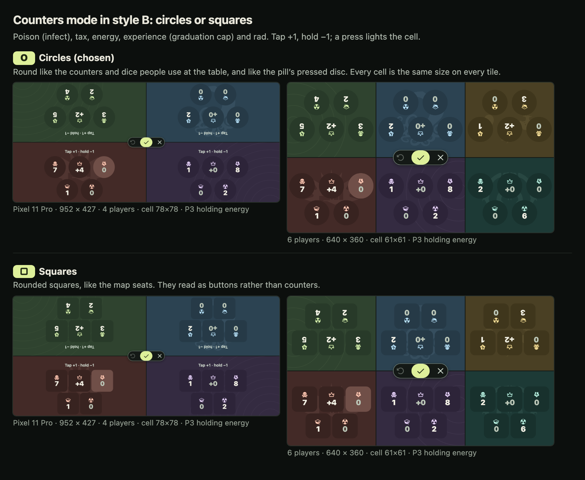
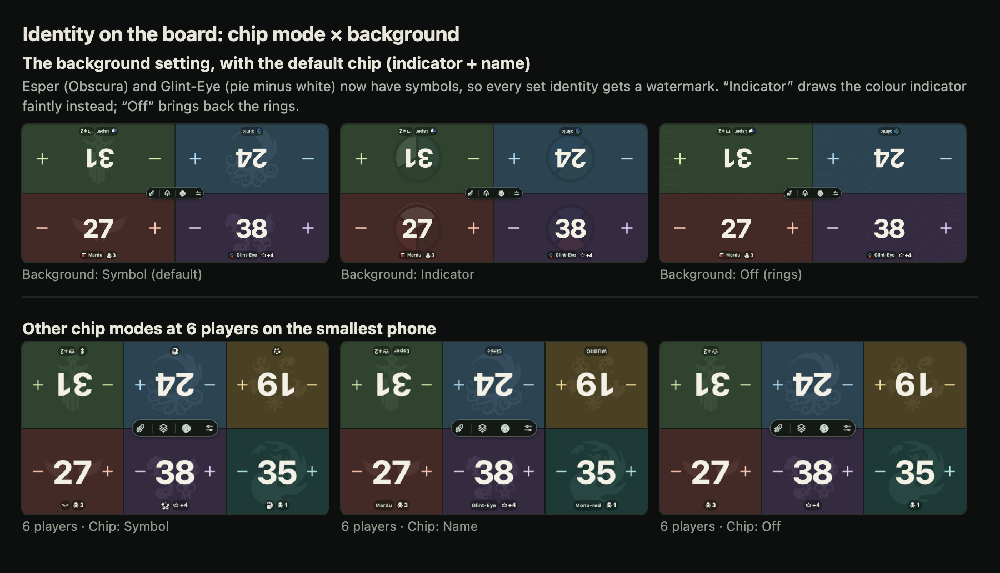
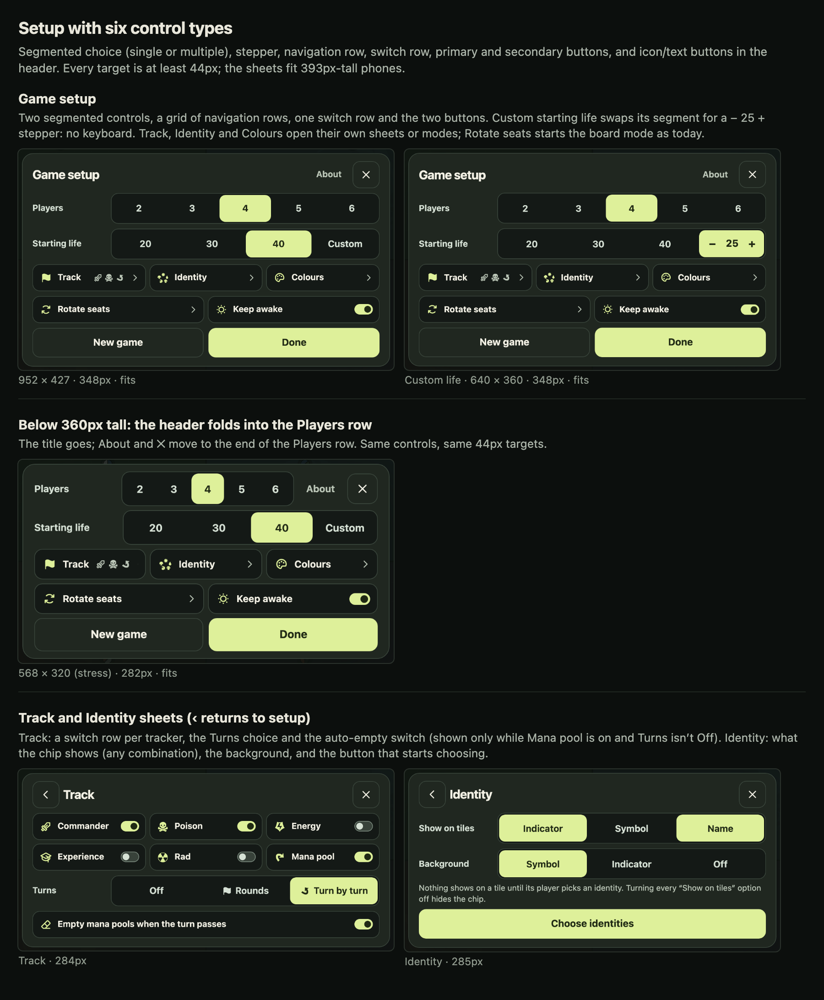
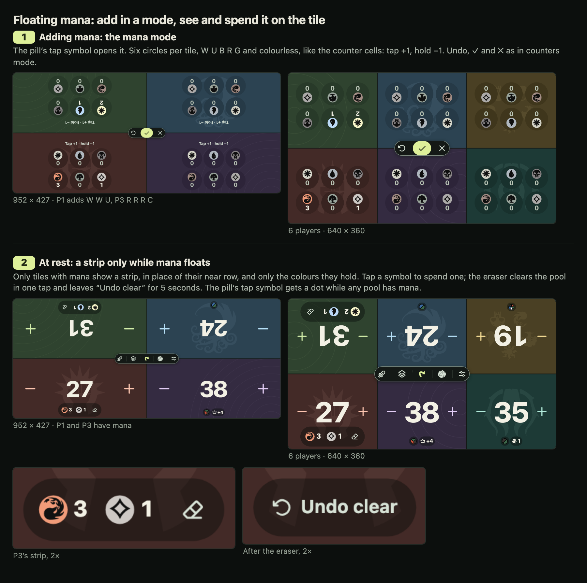

# Polish round: build spec

**Status:** built (v0.1.0-alpha.15 and later). Written 21 November 2026 as the build spec; later decisions are marked where they changed it. This turns the owner's answers to the 14 questions in [OPTIONS.md](OPTIONS.md) into decisions.

- Where the owner said "decide", the decision is here with its reason. Where an answer left a gap, I filled it and said so.
- The questions raised during the spec are all resolved (§12).
- The mock-ups are `renders/spec-*.png`, drawn on the current `web/` (2f28705) by [spec.mjs](spec.mjs) (`node design/polish/spec.mjs`). Every spec frame uses the new button style and the one-size-per-board rule.

**Target device: Pixel 11 Pro class, 952 × 427 CSS px in landscape.**

- The Pixel 11 Pro has the same panel as the Pixel 10 Pro: 6.3", 2856 × 1280 at 495 ppi ([whatismyscreensize.com: 11 Pro](https://www.whatismyscreensize.com/device/pixel-11-pro), [10 Pro](https://www.whatismyscreensize.com/device/pixel-10-pro)). At the default 3× density, that's the 952 × 427 already in the `tests/sizes-*.test.mjs` checks (`tests/sizes-checks.mjs`). No published source gives the 11 Pro's CSS viewport, so check it on a device.
- **Design and render at 952 × 427 first.** Every mock-up's lead frame uses this size.
- 640 × 360 (the smallest real phone) and 568 × 320 (the stress test) must keep working:
  - life totals, the −/+ halves and every 44px target always work;
  - secondary information gives way by the drop rules in §3.2.
- Tablets scale up through `--grow`.

**What this spec covers:**

1. Button style
2. Colour identity: its own page, display modes, symbols and names
3. One size per board, and what drops when space runs out
4. Setup with a fixed set of controls
5. Tile colours: twelve swatches
6. Player counters
7. Badge row
8. Turns
9. Floating mana
10. Data model and settings
11. Build plan
12. Questions resolved
13. The monarch and the initiative (added after the build)
14. The centre pill and Track (added 24 November 2026)

---

## 1. Button style (Q7: B)

- **Life halves:**
  - No button chrome.
  - The − and + glyphs sit near the tile's outer edges: inset `5 × u` from each edge (`u` is defined in §3).
  - Each half is still the whole touch area.
  - A press washes the pressed half in `color-mix(in oklab, var(--seat) 17%, transparent)`, with a 28px radius on the inner corners. The glyph turns `--text`.
  - The wash shows only while a finger is down, so it doesn't conflict with "no transparency" for colours at rest.
- **Counter and mana cells are circles** (decided). Reasons:
  - Physical counters (dice, tokens, beads) are round.
  - The pill's pressed state is a disc.
  - The commander damage map keeps its rounded-rectangle seats, so "seat" and "counter" stay visually different.
  - Each cell is filled `color-mix(in oklab, var(--button) 55%, var(--panel))`, with no border. A press fills it with `color-mix(in oklab, var(--seat) 26%, var(--panel))`. *As built:* cells press with the 10% state layer (`--state-pressed`, SETTINGS-SPEC.md §7); the 26% seat mix is kept only on the turn, strip, pass and reminder chips and on "Me first".
- **The pill keeps its shape.** Its pressed disc is unchanged.
- **Map seats are unchanged.**

## 2. Colour identity (Q1: N3, plus the owner's additions)

### 2.1 Identity has its own page, and no longer depends on Commander

- **Settings → Identity** (a section of the settings page, SETTINGS-SPEC.md; it began as an Identity sheet, §4) holds the identity settings. Its button **Choose identities** starts the identity board mode.
- **The Colours mode becomes tile colour only.** That frees the room for twelve swatches (§5).
- **Decision: identity is no longer tied to the Commander switch.** It has its own settings, and turning every display option off removes it from the board. Reason: identity is useful for tile meaning and names in any multiplayer game. The owner asked for a full off setting instead.

### 2.2 What a tile shows: the chip

- **Show on tiles** is any combination of Indicator, Symbol and Name.
  - None selected means the chip is off.
  - **Default: Indicator + Name**, the owner's N3 pick.
- **Order in the chip:** indicator, symbol, name.
  - A chip with only the indicator or only the symbol is the round 1.7em chip.
  - A chip with a name is a capsule.
- **Every identity has a symbol** (§2.4), so a Symbol-only chip never comes up empty. An unset identity shows no chip at all.
- **The chip leads the near badge row** (§7), after the turn chips (§8), which lead it when Turns is on.
- **Names come from the identity automatically** (§2.5).

### 2.3 The background ("indicator backgrounds")

My reading: this is the faint mark behind the life total. It's a setting of its own, independent of the chip.

Segmented **Symbol · Default · Off** (the owner's change; it replaced Symbol · Indicator · Off):

- **Symbol (default):** a tile whose identity is set shows the identity's symbol as the watermark, as shipped in fcf2a89. It now covers the shards and four-colour identities too. A tile with no identity shows the rings.
- **Default:** the rings on every tile, and no identity symbol.
- **Off:** no background effect on any tile: no rings and no symbol.
- There is no Indicator background any more.
- **Saved values** are `'symbol' | 'default' | 'off'`, with `identity.version: 2` (§10). A save without the version is from before this change, when Off meant the rings: `loadGame()` reads its `'off'` as `'default'` and its `'indicator'` as `'symbol'`, and anything else as `'symbol'`. Only a version 2 save can mean the new Off.
- **Combining with the chip:**
  - Symbol background plus a Symbol chip repeats the symbol. That's allowed, and the defaults avoid it.
  - Default or Off plus chip off is "identity off" without clearing anyone's picks.

This reading is confirmed (§12).

### 2.4 Symbols for all 31 identities

| Identities | Symbol | Mana code points |
|---|---|---|
| Mono (5) | The colour's mana symbol | `\e600`–`\e604` |
| Pairs (10) | Ravnica guild | `\e90c`–`\e915` (as shipped) |
| Wedges (5) | Khans clan | `\e916`–`\e91a` (as shipped) |
| Shards (5) | **Streets of New Capenna family**: Brokers = Bant (WUG) `\ea0d`, Cabaretti = Naya (WRG) `\ea0e`, Maestros = Grixis (UBR) `\ea0f`, Obscura = Esper (WUB) `\ea10`, Riveteers = Jund (BRG) `\ea11` | new |
| Four-colour (5) | **The colour pie with the missing colour as a ghost:** five mono symbols on a pentagon (W top, then clockwise U, B, R, G), the missing one at 25% of the symbol's opacity | composed from `\e600`–`\e604` |
| WUBRG | Colour pie | `\e9f0` (as shipped) |

- **The shard mapping is verified.** In a Scryfall search of each family's watermark, the most common colour identity among its cards is the shard's: Brokers 14 WUG, Cabaretti 14 WRG, Maestros 14 UBR, Obscura 14 WUB, Riveteers 15 BRG.
- **Research for four-colour identities:**
  - I scanned all 76 watermarks in Scryfall's catalog (`api.scryfall.com/catalog/watermarks`). None belongs to a four-colour faction.
  - The only four- or five-colour cards with any watermark are one-offs in Unfinity, Echoverse and the Avatar sets.
  - The *Nephilim* (Guildpact) and the Commander 2016 decks never had symbols.
  - So there's no official symbol, and the "pie minus one" is the closest honest one: it reuses an official mark and says exactly which colour is missing.
- **Not used:** Strixhaven colleges (they cover only the five enemy pairs) and Tarkir dragonlords. Guilds and clans cover every pair and wedge, and they're what ships.
- **The 25% ghost** keeps the pentagon readable at chip size. In the watermark (7% opacity) the ghost is effectively invisible, which is fine.

### 2.5 Names (Q1 and Q2)

One fixed table, with no setting. The owner confirmed the full four-colour names and "WUBRG" for five colours.

| Identity | Name |
|---|---|
| W / U / B / R / G | Mono-white / Mono-blue / Mono-black / Mono-red / Mono-green |
| WU UB BR RG WG WB UR BG WR UG | Azorius, Dimir, Rakdos, Gruul, Selesnya, Orzhov, Izzet, Golgari, Boros, Simic |
| WUG WUB UBR BRG WRG | Bant, Esper, Grixis, Jund, Naya |
| WBG WUR UBG WBR URG | Abzan, Jeskai, Sultai, Mardu, Temur |
| UBRG (no white) | Glint-Eye |
| WBRG (no blue) | Dune-Brood |
| WURG (no black) | Ink-Treader |
| WUBG (no red) | Witch-Maw |
| WUBR (no green) | Yore-Tiller |
| WUBRG | WUBRG |

### 2.6 Choosing identities: the identity board mode

- Like Colours mode, it ends with the single ✓, and Android back ends it too. Changes save instantly.
- **Each tile shows:**
  - a preview chip with *all three* (indicator, symbol and name), whatever the tiles are set to display (the owner: "show name / indicator / symbol when choosing");
  - the five mana-symbol toggles.
- **Toggles:** `clamp(44px, 12u, 72 × grow)`, one row where five fit, otherwise 3 + 2 (6 players on phones). *As built:* a face too narrow for three takes two to a row (`layout/board.js`).
- An empty identity previews as "No identity".

## 3. One size per board, and what drops when space runs out (Q8: yes; Q9: no)

### 3.1 One size per board

**Confirming the lead's reading:**

- Within a game, every tile draws its content at the same size: the life total, the − and + glyphs, the badges, counter cells, map seats and mode layers.
- That size is the largest that fits the **smallest** tile.
- Content still scales with the device through `--grow`, and so does the pill: 48px on phones, up to 64px on tablets.
- Tall tiles get **no** extra growth (Q9: No).

**How:**

- `measureBoard()` (`web/js/layout/board.js`) measures every `.player-face` inside its pill clearances (see Centring below) and sets three properties on `#board`:
  - `--ui`: the smallest face width left inside them;
  - `--ub`: the smallest face height left inside them;
  - `--board-digits`: the most digits in any total, minimum 2.
- It runs again on resize, rotation, a player-count change, a seat rotation, and any total whose digit count changes.
- Tile CSS uses `u = var(--ui) / 100` in place of `cqi`: `--control-size: clamp(44px, 18u, 74 × grow)`, glyphs `clamp(1.75rem, 12u, …)`, badges `clamp(.78rem, max(3.6u, min(5u, 4.4·ub/100)), …)` (from the tile's width, and up to 5u where its height leaves room, so tablet badges grow) and so on.
- The total's size is `min(clamp(2rem, 19vmin, max(7rem, 112 × grow)), (ui − 2·control − 2·gap − 8px) × 1.5 / board-digits)`.

**Centring (added 22 November 2026):**

- A tile keeps clear of the centre pill only on the face edges the pill actually reaches, as `measureBoard()` measures them (`--clear-far`, `--clear-end`, `--clear-near`, `--clear-start`). A face the pill doesn't reach, such as the end seat at 3 or 5 players, keeps no clearance at all.
- Everything else is centred in what's left: the far row along its edge (no longer started at the reader's left on a sideways seat), and each mode layer's content (the commander damage map, the counter and mana cells, the swatches, the identity preview over its toggles, "Me first").
- A mode's hint sits on the far side of its content, so it doesn't push the content off-centre. Only where that side is shorter than the hint does the content give way toward the near edge.
- On narrow or short boards the swatches are centred too, and reach up to 6px into a clearance only along an axis where their grid doesn't fit otherwise.
- `tests/centring.test.mjs` checks the far row and every layer at 2–6 players, with seats turned three ways, at 952 × 427 and 568 × 320.

**What changes:**

- Totals are already equal on phones, because of the 19vmin cap.
- The differences today are in the glyphs (the 5-player end seat's ± is 46px against 34px elsewhere on a phone) and on tablets (the end seat's total is 195px against 191px).
- **A three-digit total shrinks every total together** (decided). Uniformity is the owner's rule, and totals of 100 or more are rare. Only the target (952 × 427) keeps full size with three digits. With 6 players a 100 shrinks every total from 68px to 52px at 640 × 360, and from 61px to 40px at 568 × 320, by the formula above.
- **Floating mana shrinks every total together too**, where its row needs the room, and moves each total toward its far row, to no less than two thirds of its size (§9).

**Board units by size**, measured on the current app: `ui` × `ub` is the smallest tile face, then the life total and the badge type.

| Screen | Players | `ui` × `ub` | Life | Badges |
|---|---|---|---|---|
| **952 × 427 (target)** | 2 | 427 × 475 | 81px | 16px |
| | 3–4 | 427–475 × 213 | 81px | 16px |
| | 5–6 | 316 × 213 | 81px | 12.5px |
| 640 × 360 | 6 | 212 × 179 | 68px | 12.5px |
| 568 × 320 (stress) | 6 | 188 × 159 | 61px | 12.5px |

### 3.2 Auto-drop: what gives way when a row runs out of room

**Never dropped, at any size including 568 × 320:**

- the life total;
- both −/+ halves;
- every count: poison, tax, energy, experience, rad and each commander damage chip, and the monarch's crown and the initiative's castle (§13);
- the identity chip, and its colour indicator wherever the chip shows one;
- every control: the turn chip, the mana strip, map seats, counter cells, the pill.

All of these keep 44px targets. Counts shrink their type before they ever leave.

**Overflow order, first to go first** (the owner's order, 22 November 2026; it replaced name, symbol, 11px, identity chip, 9px, wrap). Each step is taken only if the previous one didn't make the row fit, and the same order holds at every Badge size (Settings → Table, SETTINGS-SPEC.md §10).

| # | Near row (identity and counters) | Far row (commander damage) |
|---|---|---|
| 1 | Words: the identity **name**, "Turn" in the turn chip (leaving the untap symbol and "T" with the number, T12), and "Pass it on" in the hint chip (§13, leaving its icon and arrow). A chip that shows only the name keeps it, so it's never empty. | The **sword** label chip |
| 2 | The identity **symbol**, when the indicator also shows (one colour mark is enough). The indicator always stays, and the chip never goes. | Wrap onto a second line, growing toward the total |
| 3 | Wrap onto a second line, growing toward the total | Shrink the type, down to the 9px floor |
| 4 | Shrink the type, down to the 9px floor | |

**Two lines never cover the total.** Where a side's second line would cover a life total, its − or + glyph or the "Out" tag, that side shrinks its type before it wraps: steps 3 and 4 on the near row (2 and 3 on the far row) swap. A row that still doesn't fit on one line at 9px then wraps at 9px, the last resort. In practice the tall tiles of a 2-player game wrap first; on landscape phones at 3–6 players, where the rows sit close to the total, rows shrink first.

**How the rule runs:**

- `fitBadgeRows()` runs after every badge change and every layout change. For each side, `fitBadgeSide()` measures the rows at full type with the current drops, then takes the next step until every row fits.
- **Shrinking is measured, not estimated.** Text doesn't shrink exactly in proportion to its type (gaps, padding and rounding don't), so the type starts from a proportional estimate and steps down 0.25px at a time, measured again after each step, until every row fits or it reaches 9px. (WebKit left a busy row 2–4px wider than its tile with the estimate alone.)
- **Levels are board-wide.** The busiest tile decides for every tile, so the board stays uniform. That's the same principle as §3.1, and it stops names flickering on one tile while staying on another.
- **Hysteresis:** a dropped item comes back only when every row would fit it with 15% to spare, or at a new game or a change of Badge size. Counters ticking up and down by one can't make names blink.
- The steps are set as `data-drop` tokens on each tile's `.near-edge` (`name`, `symbol`, `wrap`) and `.far-edge` (`sword`, `wrap-far`), and CSS hides the matching parts there; `--near-badge-size` and `--far-badge-size` on the same edges shrink the type. `#board`'s `data-drop` lists every token taken, for the tests; nothing styles from it.
- **A larger Badge size never draws a row smaller** (FINAL.md U1). Its taller chips can make a second line cover the total where a smaller size's doesn't, so the row shrinks on one line instead and can land below the smaller size's full type. When a side has to shrink, the fit tries again from each smaller size's full type (`--near-full-size`, `--far-full-size`) while that's larger, and keeps whichever draws the largest type.

**What the worst case does** (every counter on with two-digit counts, the chip showing indicator + symbol + name, Turn by turn, commander damage from every opponent), measured in Chromium with Roboto:

| Screen | Near row | Far row |
|---|---|---|
| 952 × 427, 4 or 6 players | Step 1 (names and "Turn" go) | Full size |
| 640 × 360, 6 players | Steps 1–2, then the type shrinks (9.6px) on one line | Full size |
| 568 × 320, 4 players | Steps 1–2 | Full size |
| 568 × 320, 6 players | Steps 1–2, then 9px on two lines | Full size |

**A typical game** (default chip, so indicator + name, long names like Ink-Treader, single-digit counts):

| Screen | Every counter on | Only Poison and tax |
|---|---|---|
| 952 × 427 (target), 4 or 6 players | Full size | Full size |
| 640 × 360, 6 players | Step 1: names go | Full size |
| 568 × 320, 4 players | Full size | Full size |
| 568 × 320, 6 players | Step 1: names go | Full size |

**Why the symbol goes before the indicator** (the owner's example had name, then indicator, then symbol):

- The indicator says the colours to everyone.
- The symbol only says them to someone who knows the guild or family.
- The default background already draws that same symbol behind the tile, so dropping it from the chip loses nothing.
- If the chip shows the symbol without the indicator, step 2 doesn't apply, and the symbol stays.

**Fixed thresholds** (by board unit, so they also apply board-wide):

| Item | Shown when |
|---|---|
| Mode hints ("Tap +1 · hold −1", "Your tile colour") | `ub ≥ 200` and `ui ≥ 240`, as today. Shown on the target; hidden at 640 × 360 and below with 6 players. |
| Identity toggles | One row of five when `ui ≥ 264`; otherwise 3 + 2, or two to a row where three don't fit. |
| Mana strip | Never dropped, and its type never shrinks. It has a row of its own above the near row, and folds into its chip where the strip doesn't fit there (§9). The life total gives way for that row first, to no less than two thirds of its size. *As built (MANA-SPEC-v2):* the strip is one chip tall, in the near row's full type. |
| Treasure chip | Never dropped (MANA-SPEC-v2 §1.3), a count like the others: it shrinks with the near row's type. |
| Settings header | Fixed at the top of the full-screen settings page; it tightens to 4px padding under 360px tall (SETTINGS-SPEC.md §3). |
| Counter and mana cells | Always icon over count. Cells are 78px on the target and 50px at 568 × 320 with 6 players; never under 44px. *As built (MANA-SPEC-v2 §2):* mana mode takes the seven-cell grid, four to a row, so its cells are 78px on the target at 3–4 players, 69px at 5–6, and 44px at 568 × 320 with 5–6. |

## 4. Setup with a fixed set of controls (Q4: S2, plus the owner's restyle)

> **Superseded (22 November 2026).** Setup and its Track, Identity and About sheets are now one full-screen settings page,
> built from [SETTINGS-SPEC.md](SETTINGS-SPEC.md) (layout and behaviour) and styled by [STYLE.md](STYLE.md) direction A
> (tonal) with the Graphite + lime palette. Players and starting life are notched sliders with an inline life field,
> which replaces the stepper below. The rest of this section is kept as the record of the earlier build.

### 4.1 The six control types

Every control in setup, the Track sheet and the Identity sheet is one of these.

| Type | Use | Spec |
|---|---|---|
| **Segmented choice** | Players, starting life, Turns, Background | Equal segments in a 48px group (2px padding, 12px radius, `--background` fill, `--border` ring). Each segment is 44px tall. The selected one is filled `--accent` with `--ink` text. Optional 16px icon. |
| **Stepper** | Custom starting life | − value + inside the selected segment's accent fill, 44px buttons. Range 1–999. Hold repeats at 10 per second, then in steps of 5 after 1s. **No keyboard.** |
| **Navigation row** | Track, Identity, Colours, Rotate seats | 44px row: accent icon, label, optional summary icons, caret. Opens a sheet or a board mode. |
| **Switch row** | Keep awake, each tracker, auto-empty; the *compact* variant for Show on tiles | 44px row: icon, label, switch on the right. The whole row is the target. Compact rows sit three to a line with tighter padding (8px, 6px gaps). |
| **Button** | New game (secondary), Done / Start new game / Choose identities (primary) | 48px, 12px radius. |
| **Header button** | ✕ (close), ‹ (back), About (text) | 44px. |

### 4.2 Game setup

The sheet is `min(600px, 100% − 32px)` wide and 348px tall, so it fits the target (952 × 427) and 640 × 360 without scrolling. Below 360px tall the header folds into the Players row, giving 282px at 568 × 320 (§3.2).

| Row | Content |
|---|---|
| Header | "Game setup" · About · ✕ |
| Players | Segmented 2 3 4 5 6 |
| Starting life | Segmented 20 30 40 Custom. Choosing Custom turns that segment into the stepper, starting at the current value. Any other life (an old save with 25) opens with Custom selected. |
| Navigation | Track (summary: the icons of the trackers that are on) · Identity · Colours |
| Navigation and switch | Rotate seats · Keep awake switch |
| Actions | New game · Done. Done becomes "Start new game" when the player count or life changes, as today. |

### 4.3 Track sheet

284px tall.

- **Header:** ‹ · "Track" · ✕.
- **Switch rows, three per line:** Commander, Poison, Energy, Experience, Rad, Mana pool (*as built, MANA-SPEC-v2:* Mana and Treasure).
- **Turns:** segmented Off · Rounds · Turn by turn.
- **"Empty mana pools when the turn passes":** a switch row, shown only while Mana pool is on and Turns isn't Off.

### 4.4 Identity sheet

264px tall on the target (952 × 427), 286px at 568 × 320, where Show on tiles goes under its label.

- **Header:** ‹ · "Identity" · ✕.
- **Show on tiles:** three compact switch rows, Indicator · Symbol · Name, each with the mark it adds to the chip (the colour disc, the symbol, "Aa"). Any combination; indicator and name are on by default, and each saves the moment it changes. They sit on one line beside the label; below 620px wide they go under it, and on portrait phones each row puts its label over its mark and switch so no label is cut short.
- **Background:** segmented Symbol · Default · Off (§2.3).
- A one-line note.
- **Choose identities:** primary button. It closes the sheets and starts the identity mode.

**Navigation:**

- ‹ and Android back go from a sub-sheet to setup.
- ✕ closes everything.
- Settings save the moment they change, as the switches do today.

## 5. Tile colours: twelve swatches

- With identity moved out, Colours mode shows only the swatches, as a 4 × 3 grid (*as built:* on a narrow or short board, `ui < 240` or `ub < 200`, the first of 4 × 3, 3 × 4, 6 × 2 and 2 × 6 that fits each face, `layout/board.js`): `clamp(44px, min((100% − 24px)/4, (100% − 40px)/3), 60 × grow)`. Every tile fits it at 44px or more, including 6 players at 640×360.
- **Decision: add three hues** where the hue circle has gaps: Copper (about 55°), Olive (120°) and Orchid (330°).
  - `palette.mjs` generates them with the existing contrast checks: life total ≥ 9:1, small text ≥ 7.6:1, and the life-out red ≥ 4.79:1.
  - The values in the mock-up are placeholders.
- The rules stay as they are: no two players share a colour, and a taken swatch shows its owner ("P2").
- Seats 1–6 keep their defaults.

## 6. Player counters (Q3: K3; Q5: Cap)

- **Trackers:** Poison, Energy, Experience and Rad, each a switch in Settings → Track (first built as the Track sheet), all off by default.
  - Commander tax comes with the Commander switch, as today.
  - Player counters only, never permanent counters.
- **Counters mode:**
  - One circle per enabled counter, in this order: poison, tax, energy, experience, rad.
  - Three per row, last row centred. *As built:* with the designations (§13), seven cells go four to a row, and a face too narrow for three takes two.
  - Each circle shows the icon over the count. Tap +1; hold −1 with repeat (500ms, then every 100ms), the map's rule. The hint is "Tap +1 · hold −1", hidden on short tiles.
  - Cell size: `clamp(44px, min((ui − 20px)/3, (ub − 58px)/2), 92 × grow)`. That's 78px on the target at 4 or 6 players, 61px at 640 × 360 and 50px at 568 × 320 (6 players).
  - Undo, ✓ and ✕ work as today. Counts are 0–99, and tax shows +2n.
  - *As built (24 November 2026):* where the pill can't hold its buttons, counters mode is a tab of Track's (§14).
- **Icons:** poison is Mana infect `\ea73` (shipped), tax Mana's commander symbol `\e9c6` (`data-glyph="commander"`; it was the Phosphor crown until the crown went to the monarch, §13), energy Mana `\e907`, rad Mana `\ea50`, experience the **Phosphor graduation cap (fill)**.

**Why the cap and not the official icon:**

- The owner picked Cap.
- The official MTGO experience icon (a split, shield-like chevron) isn't in the Mana font. Using it would mean bundling a fan-traced Wizards graphic from a wiki.
- At 12px it reads as a "V".
- The cap is the closest Phosphor shape and stays legible at badge size.

## 7. Badge row (Q6: B1)

- **Near row, as today:** the identity chip, then poison, tax, energy, experience and rad, each only when it's set or above zero, then the monarch's crown and the initiative's castle on their holder's tile (§13). *As built (MANA-SPEC-v2 §1.3):* Treasure's chip, a button, comes after rad and before the crown, while Mana and Treasure is on and the count is above 0.
- It usually stays on one line at full size on the target; the worst case drops names there (§3.2). On smaller phones the auto-drop rules (§3.2) take the name, then the symbol, then wrap or shrink; the identity chip and its indicator always stay.
- **Decision: not the right side.** I mocked it with and without the identity chip. Reasons:
  - A column needs the + glyph to move in by 34px, which collides with the total at 6 players.
  - The name can't fit a column.
  - Six chips are taller than a 6-player tile's middle band.
  - Splitting identity (near edge) from counters (right side) means two places to look.
- Commander damage stays on the far row. *As built:* its type is 1.7em of the badge size (27.2px with 4 players and 21.25px with 6 on the target), not a fixed 26px.
- *As built:* the turn chips (§8) lead the near row, before the identity chip.

## 8. Turns (Q10: B, with both models; Q11: Auto)

- **Setting:** Settings → Track → Turns: **Off** (default) · **Rounds** · **Turn by turn**.
- **Who goes first?** opens automatically:
  - on every new game while Turns isn't Off;
  - when Turns changes from Off to on (decided: the game needs a first player).
  - Each tile offers "Me first". The pill holds a shuffle button (a random pick from `crypto.getRandomValues`, highlighting tiles in turn for about 0.8s) and ✕ to skip.
  - Skipping leaves no first player: no flag, round 1, and in Turn by turn no active tile until someone taps a tile's **Start** chip (the untap symbol and "Start"; "Turn N" is only ever on the active tile's chip).
- **Play order is clockwise on screen, which is passing to the left:**

  | Players | Order |
  |---|---|
  | 2 | P1, P2 |
  | 3 | P1, P3, P2 |
  | 4 | P1, P2, P4, P3 |
  | 5 | P1, P2, P5, P4, P3 |
  | 6 | P1, P2, P5, P6, P4, P3 |

  Seat rotation doesn't change it.
- **Rounds:**
  - The first player's near row leads with a flag chip showing the round (⚑ 3). It's a button with a 64 × 44 hit area.
  - Tap: next round. Hold: back one (minimum 1).
- **Turn by turn:**
  - The active tile's panel lifts 14% toward its seat colour, with a 3px inset ring in `--seat`.
  - Its near row leads with **[untap symbol] Turn 3**, a button with a 64 × 44 hit area. Tap: pass to the next player in order, skipping anyone who is out (`isOut`). The round goes up when play reaches the first player again. Hold: step back one turn.
  - The first player keeps a small flag chip.
  - **The icon is Mana's untap symbol `\e61b`** (decided): every turn begins by untapping, it's one glyph, and it reads instantly to players.
- **Both modes:**
  - The pill leads with a round button, the number printed twice like a card index so both sides can read it. Tap does the same as the chip, so anyone can act; hold steps back.
  - Turn steps save at once, and each is one step of the game's history (MANA-UNDO-SPEC §6), with the pools it emptied; the hold stays, and is a step of its own. *As built (M4):* an undo or redo of a turn step empties the hold-back buffer, so a hold after it steps back by the play order, as after a relaunch.
  - The last round is 999 (`maxRound`). Play holds there rather than start round 1000: in Rounds the flag stays at 999, and turn by turn the turn stays with the last player before the first player's seat.
  - **Off** hides everything about turns but keeps the state, so switching back on mid-game resumes. Only the Off → on change asks "Who goes first?" again, for a game with no first player.

## 9. Floating mana (Q12: M1 + M2 hybrid; Q13: Manual + turns, switchable)

- **Setting:** Settings → Track → Mana pool, off by default. When it's on, the pill shows the tap symbol, with a dot while any pool has mana. *As built (MANA-UNDO-SPEC §5, M1):* the classic tilted T, Mana's `\e61c`, in `--pip-ink` on a `--pip-c` disc 0.56 of the button (with Glass's light inner edge); the dot is a 9px `--accent` dot on the pip's upper end, ringed 2px in `--pill-background`, and the disc never turns lime. The button's name adds what's floating: "Mana pool, 3 mana floating". `\e61a`, the curved arrow it replaced, is gone from the font subset.
- **Adding: the mana mode.**
  - Each tile shows six circles: W U B R G and colourless (`\e904`), mana symbols in cost style, sized like the counter cells. The `.pip` class needs a C entry.
  - Tap +1; hold −1 with repeat. Undo, ✓ and ✕ as in counters mode, on the game's history (MANA-UNDO-SPEC §6.5).
- **At rest:**
  - A tile shows a strip **only while its pool has mana**, and only the colours it holds: for example (R)3 (C)1 [eraser].
  - **Both badge rows always stay** (FINAL-REVIEW #3: §3.2's "every count" wins over the first version of this section, which had the strip take the near row's place).
  - **Commander damage always has the far row to itself** (the owner's rule, 23 November 2026): mana never shares its line, displaces it or pushes it sideways.
  - **Floating mana has a row of its own, directly above the near row** (the owner's rule, 23 November 2026, replacing the strip under commander damage and the chip at the end of the near row): two bottom rows, mana over the player's own badges, between them and the total. Mana never shares a line with another badge, whether it shows as the strip or folded into its chip.
  - **The strip's type never shrinks**, so every symbol stays legible on its 44px target. Overflow loses detail by folding instead, and the folded chip keeps the near row's full type, so its pips never shrink either.
  - **The life total gives way first.** To make room for the mana row, every total on the board shrinks alike (one size per board, §3.1), and each moves toward its far row, with its − and +, as little as that needs. Tiles whose far rows share a line move theirs alike, so a board row's totals stay in line. The totals stay 2px clear of every row and of the mana.
  - **The floor is two thirds of the total's own size** (never below 2rem). That's what a three-digit total already costs on the 568 × 320 stress size (61px to 40px, §3.1), the smallest total the board accepts elsewhere. Keeping a strip's spend buttons may cost the total only a quarter of its size; past that the strip folds, and the chip may cost it a third.
  - Each tile's mana takes the first place that fits clear of the total, the glyphs, the "Out" tag, both rows and the pill:
    1. **The strip on its row**, where it fits across the row at full type and the totals stay at three quarters of their size or more.
    2. **Folded on its row**: one chip, the pool and a caret › that says it opens mana mode (the full-size picker), where the totals stay at two thirds or more.
    3. **Fallback: the chip under the far row**, 2px under commander damage, in the far row's full type, where the totals at their floor can't make room for a row by the player but can for this chip. Seen with a Larger Badge size at 852 × 393 (4 players) and 568 × 320 or 320 × 568 (3 and 4 players).
    4. **Last resort: the chip ends the near row**, as before, where even the fallback can't fit at the floor. Seen only on the most crowded small boards: every counter, the monarch, the initiative and the turn chip at 5 or 6 players on 568 × 320 or 320 × 568, where the near row already takes two lines.
  - Only the tiles that need it fold or fall back, so a short pool elsewhere keeps its spend buttons.
  - *As built* (`layout/fit.js`, `fitStrips` and `fitScore`): the rows are fitted around totals at their own size, with every strip on its row; a strip wider than its row folds; then the totals are fitted around the mana, and the tile whose mana would take them below what its place allows takes its next place, one round per layout. The totals' size is `--score-size` and each tile's lift `--score-lift`, both on the tile's `.controls`, so a fit restyles only the controls (PERFORMANCE.md P10). With no mana floating, nothing is written and the totals are as §3.1 sizes them. Where turn reminders can show (§13), the totals also keep clear of the line a reminder takes over the near edge on a short tile, since a reminder lasts only seconds and the totals don't move for it.
  - *As built*, a busy board (Turn by turn, the identity chip with its name, poison, tax, energy, the monarch, commander damage from every opponent, all six colours on every tile), at the default Badge size:

    | Screen | Players | Mana | Life total |
    |---|---|---|---|
    | 952 × 427 (target) | 3 / 4 | strip | 81 → 76 / 74px |
    | | 5 / 6 | strip | 81px, unchanged |
    | 852 × 393 | 3 / 4 | strip | 75 → 63 / 60px |
    | | 5 / 6 | folded (the 5-player end seat keeps its strip) | 75px, unchanged |
    | 640 × 360 | 3 / 4 | strip | 68 → 54px |
    | | 5 / 6 | folded (the 5-player end seat keeps its strip) | 68px, unchanged |
    | 568 × 320 (stress) | 3–6 | folded (the 3- and 5-player end seats keep their strips) | 61 → 57 (3–4 players) / 58px (5–6) |
    | 1366 × 1024 | 3–6 | strip | 195 / 191px, unchanged |

  - The turn chip stays in the near row, so it never meets the strip.
  - Strip items are 44px tall:
    - **Tap a symbol to spend 1** of that colour. It saves at once. A colour that reaches 0 keeps its place, dimmed, until 800ms after the strip's last tap, then the strip reflows, so a quick extra tap can't land on whatever would have slid under the finger. The tile's − and + ignore touches for that time too.
    - **The eraser clears the pool** as one undo step (MANA-UNDO-SPEC §6.5): Undo in the centre restores it. *As built (M4):* "Undo clear" is retired; the strip holds its place, its colours at 0, for the 800ms after a tap, so a second tap lands on the eraser again and does nothing.
- **Automatic emptying:**
  - Setting: "Empty mana pools when the turn passes", default on. It's shown while Mana pool is on and Turns isn't Off.
  - Each round step (Rounds) or turn pass (Turn by turn) empties every pool.
  - The step stores what it emptied, and holding back that same step restores it.
- Steps and phases aren't tracked, so mid-turn emptying is manual: one tap per pool.
- *As built (design/polish/MANA-SPEC-v2.md, 26 November 2026):* the switch is **Mana and Treasure**, and three things joined this section.
  - **Treasure:** a count per player (`game.treasure`, 0–99) that only a new game empties. In mana mode it's a counter cell, the Mana font's gold counter `ms-counter-gold` (`\e934`) in `--text` over the count, tap +1 and hold −1. At rest it's a chip in the near row after rad while above 0, a button with the folded chip's look (the button fill, a 1.5px `--rim` ring and a 44 × 44 touch area); a tap uses one with no colour pick, and at 0 the chip stays dimmed for `stripHoldTime`, then goes. It doesn't light the pill's mana dot.
  - **Keep:** one on or off per player (`game.keepMana`), "don't empty this pool when the turn passes". In mana mode it's a toggle cell in the designation cells' language (`aria-pressed`): a 2px outline in `--text-soft` at 55% with the lock and "Keep" when off; the seat colour with the identity toggles' check when on. It shows only while pools can empty (Mana and Treasure on, auto-empty on and Turns not Off; `poolsCanEmpty`), and the saved values stay while it's hidden. At rest a small lock in `--text-soft` leads a kept pool's strip and folded chip; it isn't a target. A turn pass empties only the pools nobody kept (`turnPassPools`), and its step and the turn chip's hold store only those, so Undo restores exactly them; the announcement adds "Player 4's mana kept".
  - **Mana mode's grid:** W U B over R G C, as before, and a fourth column for what stays, Treasure over Keep, on the counters mode's seven-cell grid (cell `clamp(44px, min((ui − 42px) / 4, (ub − 10px − pill) / 2), 92 × grow)`, gaps closing to 2px before a cell goes under 44px). A face too narrow for four takes three, with Treasure and Keep as a third row. A 1px rule in `--text` at 22% splits the colours from that column where the gap is 6px or more.
  - **The strip is one chip tall:** 1.7em of the near row's full type, with 1.38em pips, each spend button at least 44px wide with a 44 × 44 touch area through `::after`, as the folded chip has. Colour and count at every amount, as before; its places and fold rules are unchanged. With one floating mana on every tile (alternating red and blue, a poison count, an identity chip and commander damage from every opponent):

    | Screen | Players | No mana | Before (44px strip) | As built |
    |---|---|---|---|---|
    | 952 × 427 | 3 / 4 | 81px | row, 76 / 74px | row, 81px |
    | | 5–6 | 81px | row, 81px | row, 81px |
    | 852 × 393 | 3 / 4 | 75px | row, 63 / 60px | row, 75px |
    | | 5–6 | 75px | row, 69px | row, 75px |
    | 640 × 360 | 3–6 | 68px | row, 54px | row, 68px |
    | 568 × 320 | 3 | 61px | folded (the end seat a row), 59px | row, 59px: the spend buttons stay |
    | | 4–6 | 61px | folded, 57px | row, 57px: the spend buttons stay |
    | 1366 × 1024 | 3–6 | 195 / 191px | row, unchanged | row, unchanged |

  - *As built, alpha.20 (the owner: "The treasure pip should be part of the mana bar. It should just have different rules for when it gets cleared"):* **Treasure is on the strip,** not in the near row. It follows the colours and comes before the eraser, the gold counter in `--text` and the count (`.strip-token`), set apart by a .3em gap and a 1px hairline in `--text` at 30% where colours precede it. A tap uses one, as before (key `token:i:treasure`, merged; the 800ms hold, during which the life halves under the strip ignore touches, as for a spend). The strip shows while the pool has mana **or** the player has Treasure; with only Treasure it holds that alone, led by Keep's lock where the lock shows, and no eraser. **The eraser empties the colours only** ("Empty floating mana, Player 2"), and the turn pass never touches Treasure; Undo covers both, and a new game resets everything. The folded chip adds the gold counter and count after the pool ("2 mana and 3 Treasure. Player 1's pool: 2 red. Open mana", or "3 Treasure. Player 1. Open mana"). The strip keeps its places, floors and fold order. Totals with Treasure only (3 on every tile, no floating mana) on the board of the table above, Chromium:

    | Screen | Players | alpha.19 (the chip in the near row) | alpha.20 (Treasure on the strip) |
    |---|---|---|---|
    | 952 × 427 | 2–6 | 81px | row, 81px |
    | 852 × 393 | 2–6 | 75px | row, 75px |
    | 640 × 360 | 2–6 | 68px | row, 68px |
    | 568 × 320 | 2 | 61px | row, 61px |
    | | 3 | 61px | row, 59px |
    | | 4 | 61px | row, 57px |
    | | 5–6 | 61px | row, 57px |
    | 841 × 701 | 2–4 / 5–6 | 133 / 115px | row, unchanged |
    | 1366 × 1024 | 2–4 / 5–6 | 195 / 191px | row, unchanged |

    A Treasure-only strip costs exactly what one floating mana does: nothing from 640 × 360 up, and at 568 × 320 the same 2–4px the one-mana row costs, with its button kept. One floating mana with Treasure beside it costs the same as one floating mana alone.

## 10. Data model and settings

### 10.1 Saved game (additions to `loadGame`/`saveGame`)

| Field | Type | Default | Validation (anything else falls back to the default) |
|---|---|---|---|
| `counters` | `{ commander, poison, energy, experience, rad, monarch, initiative }` booleans | all false | strict `=== true` |
| `monarch`, `initiative` | int (seat index) or null (§13) | null | a whole number from 0 to players − 1 |
| `reminders` | `{ turns, passOn, gestures }` booleans (§13) | all true | `!== false` |
| `energy`, `experience`, `rad` | int[players], 0–99 | zeros | `fitCounts` |
| `pools` | int[players][6] (W U B R G C), 0–99 | zeros | new `fitPools` |
| `manaPool` | boolean | false | |
| `treasure` | int[players], 0–99 (MANA-SPEC-v2) | zeros | `fitCounts` |
| `keepMana` | boolean[players] (MANA-SPEC-v2) | all false | each `=== true` (`fitFlags`) |
| `autoEmpty` | boolean | true | `!== false` |
| `turns` | `'off' \| 'rounds' \| 'turns'` | `'off'` | enum |
| `turn` | `{ first: int\|null, active: int\|null, round: int 1–999 }` | `{ null, null, 1 }` | indices must be valid seats; the round is capped at `maxRound` (999), and turn steps hold there |
| `identity` | `{ show: { indicator, symbol, name }, background: 'symbol'\|'default'\|'off', version: 2 }` | `{ show: {true, false, true}, 'symbol', 2 }` | without `version`, `'off'` → `'default'` and `'indicator'` → `'symbol'` (§2.3) |
| `colors` | as today, swatch index 0–11 | seats 1–6 defaults | `fitColors` with 12 swatches |
| `tileColours` | `'classic' \| 'soft' \| 'jewel' \| 'clear'` (SETTINGS-SPEC.md §7) | `'clear'` | enum (`tileSetOrder`) |
| `badgeSize` | `'default' \| 'large' \| 'larger'` (SETTINGS-SPEC.md §10) | `'default'` | enum (`badgeSizeOrder`) |
| `style` | `'material' \| 'glass'` or null (SETTINGS-SPEC.md §9) | null: the platform's default | enum, anything else is null |
| `trackTab` | `'damage' \| 'counters' \| 'mana'` (§14) | `'damage'` | enum (`trackTabKinds`); Track opens on the first tab that's on when it's off |
| `dice` | `{ sides, rolls: [{ d, r, t }] }` (§16, DICE-SPEC.md) | `{ sides: 20, rolls: [] }` | `fitDice`: `sides` is 4, 6, 8, 10, 12, 20 or 2 (the coin), else 20; a roll whose `d` isn't one of those, whose `r` isn't a whole number from 1 to `d` or whose `t` isn't a whole number of seconds is dropped, and only the newest 50 (`diceLedgerCap`) are kept. A settings field: no undo step |

- Unchanged: `scores`, `startingLife`, `rotations`, `keepAwake`, `landscapeAngle`, `poison`, `casts`, `identities`, `commanderDamage`.
- *As built:* each field falls back on its own. `startingLife` must be a whole number from 1 to 999 (`maxStartingLife`, the slider's range), or it's 40. A score that isn't a safe whole number starts at the starting life. Only when `scores` doesn't give a known player count (2–6) does the save get the default 4-player board; the fields that don't depend on the count, such as the settings, are still kept.
- Changing the player count resizes every array and resets `turn`.
- `history` (MANA-UNDO-SPEC §10): `{ v: 1, at, base, steps }`, checked by `fitHistory` in `logic/history.js`; anything wrong drops steps or the whole history, never the game.
- Not saved: the hold-back buffer of a turn step, the open bursts and the toasts. *As built (M5):* the mode edit stacks are gone; a mode keeps only where the history stood when it opened.

### 10.2 New game

- **Resets:** scores (to the starting life), poison, casts (commander tax), energy, experience, rad, commander damage, pools, Treasure and every Keep (MANA-SPEC-v2), `turn` (round 1, no first or active player), the monarch and the initiative (nobody), the colour identities (none; updated 22 November 2026: they used to be kept) and the dice ledger (§16; the die last picked stays). It also clears what isn't saved: turn reminders, the turn steps a hold steps back through, and strip holds. *Updated 27 November 2026 (the owner: "a new game should reset the undo stack"):* it **empties the undo history**, the steps back, the steps ahead and any open burst, so Undo is dimmed and History is empty until the new game's first action. A new game isn't an undo step, and Undo can't reach the game before it; the confirmation is the only guard, and says "You can't undo a new game." The same goes for a pending players or life change started with **Start new game**. (It used to be one undo step that kept the history, MANA-UNDO-SPEC §6.9.)
- **Opens** "Who goes first?" if Turns isn't Off.
- **Keeps:** every setting (the Track switches, Turns, Reminders, Style, Tile colours, Badge size and what tiles show of identities), the tab Track opens on (§14), the player count and starting life unless Settings changed them, the rotations (only when the player count is unchanged) and the tile colours.
- **Shuffle tile colours each game** (Settings → Table, off by default, `game.shuffleColours`): when on, a new game gives every player a random, distinct swatch instead, from `crypto.getRandomValues` through `randomBelow` (no modulo bias), with each seat in a different colour family of the tile set while families last (`tileSets[…].families`, six per set, found by `design/polish/tiles7.mjs`; TILES.md). `loadGame` keeps it only if it was saved as exactly `true`.
- **Where:** New game sits in the settings page's fixed header, beside Done. It opens a confirmation in the Discard dialog's style (the destructive **Start new game** in the danger tint, **Cancel** the focused primary), which lists what resets, naming only what this game shows, and what stays. While players or life are changed in Settings it hides, and Done reads **Start new game** and starts it without asking (P1).

### 10.3 Android back, in order

1. The topmost dialog closes: New game's confirmation over settings first, History over settings, then settings (dropping a pending new game), the dice, History and other dialogs. (Updated for the settings page; there are no sub-sheets any more.)
2. Rotate, colours and identity modes end, keeping their changes.
3. Counters, damage and mana modes behave like ✕: they ask when there are edits. In Track (§14) that's the whole visit, across its tabs.
4. "Who goes first?" is skipped.
5. At rest, back goes to the system.

### 10.4 Undo summary

*Replaced by MANA-UNDO-SPEC §12, as built in M4 and M5 (24 November 2026):*

| Where | How |
|---|---|
| **Anything at rest:** life, spending floating mana, the eraser, using a Treasure, turn steps (with what they emptied), "Who goes first?" | **Undo** in the centre: back one step per tap. Quick taps on one tile and count are one step while each comes within 1.5s of the last; the running delta shows it. **Redo** on the toast after an undo, beside Undo for keyboards, or in History. Any new game action ends Redo. |
| New game | Not undoable (updated 27 November 2026): it empties the history, back and forward, so Undo starts again with the new game (§10.2). |
| Counters, commander damage and mana in their modes | The same history. The mode's Undo stops at what was changed in the mode; ✓ closes; ✕ asks, then undoes the mode's changes (which Redo can bring back). Transfers of the monarch and the initiative are in the step that caused them. In Track (§14), one visit across its tabs is one mode: Undo switches to the tab its step was taken on. |
| Many steps at once | Hold Undo (or Settings → Game → History): the list, Back and Forward, or tap a row to go back to it. |
| Turn steps, the turn chip or pill held | Steps back one turn, restoring what that pass emptied. It's a step of its own, so Undo can take it back. |
| Settings, Rotate seats, tile colours, identities | Instant, and not in the history. Toggle back. |

## 11. Build plan

> **Historical.** Every milestone below has shipped. It's kept as the record of how the build was split; the sheets it names became the settings page (§4's banner).

Each milestone ships on its own and keeps `npm test` and lint green. The tests extend the existing `tests/*.test.mjs` suites, which use Playwright against `web/index.html`.

**M1. Look and size: style B, one size per board, pill growth, unified setup, circle cells.**

- The new button style for the life halves.
- Circle cells for the existing poison and tax.
- `--ui`, `--ub` and `--board-digits`.
- The pill scaling with `--grow`.
- The six control types, the new setup layout with the stepper, and the Track sheet holding Commander and Poison.
- Tests:
  - `sizes.test`, with 952 × 427 as the first screen:
    - on every screen in its list, every tile's total, ± glyph and badge size are equal within 0.5px at 3 and 5 players;
    - every target is still at least 44px, including at 568 × 320;
    - setup fits 427, 393, 360 and 320 tall without scrolling (the folded header at 320).
  - New `autodrop.test`: with a seeded worst-case game at 952 × 427, 640 × 360 and 568 × 320:
    - the `data-drop` tokens match the §3.2 table;
    - no count chip is ever hidden;
    - no row overflows its tile;
    - a name dropped at one count of 10 doesn't come back at 9 (hysteresis);
    - a new game restores full size.
  - `counters-mode.test`: cells tap +1 and hold −1 with repeat; Undo and discard still work.
  - New `setup.test`: the stepper (no text input), Custom selected for an old save at 25, Track ‹ and Android back return to setup, and switches save at once.
  - Pointerdown on a half sets the wash.

**M2. Identity.**

- The Identity sheet and identity mode.
- The `identity` settings.
- Shard and four-colour symbols, with ghosts.
- The name table (full names).
- The background setting.
- Colours mode with 12 swatches and the 3 new palettes from `palette.mjs`.
- Tests:
  - For all 31 identities × the 7 display combinations, the chip's contents and order.
  - The watermark glyph per identity for each background.
  - `loadGame` defaults and migration (old saves get the defaults; colours 0–8 stay valid).
  - Identity mode saves instantly, and back ends it.
  - Colour uniqueness with 12 swatches at 6 players.
  - Contrast checks for the new palettes in `palette.mjs`.

**M3. Energy, experience and rad.**

- The switches, data, cells and badges.
- Tests:
  - Only enabled counters appear, in order.
  - The badge order, and the fit at 6 players on 640×360 with two-digit counts.
  - A new game resets them, and switches persist.
  - Undo and discard cover the new kinds.

**M4. Turns and floating mana.**

- The Turns setting and "Who goes first?" (pick, shuffle, skip).
- Rounds and Turn by turn, with the play order and skipping players who are out.
- The pill round button.
- Mana mode, the at-rest strip (spend, clear, undo clear) and auto-empty with restore on hold-back.
- Tests:
  - The play order for 2–6 players.
  - The round goes up only on wrapping to the first player.
  - An eliminated player is skipped.
  - Hold steps back the round or turn.
  - "Who goes first?" opens on a new game and on Off → on, but not on Rounds ↔ Turn by turn.
  - The strip shows only non-zero colours and only on tiles with mana.
  - Spend, clear, and undo clear (it expires after 5s).
  - Auto-empty on a pass, and the restore on hold-back.
  - With auto-empty off, pools survive a pass.
  - Android back in each new mode.

## 12. Questions resolved

None are open.

1. **Four-colour names:** full (Glint-Eye, Dune-Brood, Ink-Treader, Witch-Maw, Yore-Tiller). There is no short-form setting.
2. **Five-colour name:** WUBRG.
3. **"Indicator backgrounds":** the background setting behind the total. Confirmed, and later changed by the owner to Symbol / Default / Off (§2.3).
4. **New hue names:** Copper, Olive and Orchid, unless the owner renames them once `palette.mjs` produces the palettes.

## 13. The monarch and the initiative (added after the build, 22 November 2026)

From the Comprehensive Rules effective 6 November 2026: the monarch (CR 726) and the initiative (CR 727). Each has at most one holder, and nobody holds either until an effect says so.

- **Track:** Monarch and Initiative switches after Mana pool, off by default, saved in `game.counters`. Either one shows the counters button.
- **Icons:** the monarch is the Phosphor crown (Bold), which tax used before (§6); the initiative is Phosphor's castle-turret (Fill).
- **Counters mode:** a crown cell and a castle cell after rad, in the circle-cell style, with the icon alone (0.51 of the cell). A tap gives it to that player and takes it from whoever had it; a tap on the holder's own cell clears it. The holder's cell fills with their seat colour. Each tap is a step (`designation`) of the game's history, which Undo / ✓ / ✕ work on.
  - Seven cells (every counter and both designations) go four to a row, with the column gaps closing from 10px to 2px before a cell would go under 44px; a turned seat too narrow for four (568 × 320, five players) takes three to a row with its gaps closed up.
- **At rest:** the holder's near row ends with a round crown or castle chip, like the flag. They count as counts: never dropped (§3.2).
- **Commander damage** is combat damage: adding it to the monarch makes the attacker the monarch (CR 726.3), and the same for the initiative (CR 727.3), as transfers inside the same edit, announced. Taking damage away moves nothing.
- **Leaving the game** (CR 726.4, 727.4), when a change puts the holder out (`isOut`):
  - Only in Turn by turn with an active player: the active player takes it, or, if the active player is the one leaving or is already out, the next player in turn order who is still in. If nobody else is in, the monarch goes to nobody; the initiative always has a holder, so it stays. Announced, and a new initiative holder is reminded to venture.
  - The handoff is inside the step that caused it, so Undo or ✕ takes both back, in a mode or at rest (a life total). A Track switch that puts someone out isn't a step, so its handoff is a step of its own.
  - Rounds doesn't follow whose turn it is, and Off follows no turns, so neither hands anything on. Nor does Turn by turn before anyone's turn has started.
  - Otherwise the out holder's near row shows **Pass it on** (the icon, an arrow and the words, outlined like a Start chip) until someone takes it in counters mode. It's a button with a 64 × 44 target that opens counters mode, and it doesn't dim with the out player's badges. It also shows for a holder someone gave it to after they were out, and never when nobody else is in to take it.
- **Turn reminders,** only in Turn by turn: "Monarch: draw a card" on the monarch's tile when they pass the turn (the draw is at the beginning of their end step); "Initiative: venture into Undercity" on the holder's tile when their turn starts (by the chip, the pill, a Start chip or "Who goes first?") or when they take the initiative mid-turn (commander damage or counters mode, once the mode is saved, or a handoff). Stepping back reminds nobody.
  - A chip in the turn chip's language: the tile's button fill, a ring and the icon in the seat colour, the label in bold. Inside the tile face, so it faces its player. 3 seconds, or until tapped (64 × 44 target), and announced.
  - It sits on its own line above the near edge where that's 4px clear of the total, the glyphs and the "Out" tag; on a tile too short for that it takes the near edge (the near row steps aside; the mana strip is at the far edge, §9) for its seconds. Too long for its tile, it drops its label, then wraps.
- **Settings → Reminders** (SETTINGS-SPEC.md): Turn reminders, Pass-it-on hints and Gesture hints (the "Tap +1 · hold −1" and "Tap your colours" lines in counters, mana, commander damage and identity modes). All on by default, saved in `game.reminders`.
- **Data:** `monarch` and `initiative` are seat indexes or null, validated in `loadGame()` (anything but a seat on the board is nobody). A new game clears both, which also covers a change of player count.

## 14. The centre pill and Track (added 24 November 2026)

The owner chose PILL-SPEC.md's option A, Track, "only when it's needed. E.g. on small phones or layouts that require it." The pill stays one row.

- **The pill at rest:** the round (with Turns on), commander damage, counters and mana (each while it's on), Undo, the d20 and settings, in that order, 48px each on phones and up to 64px on tablets (`--setup-button`). In a mode it's Undo, ✓ and ✕, as before.
  - *As built, alpha.20 (PILL-CENTER-SPEC.md, option A; the owner: the turn number near the centre, Undo on a flank):* the order is **Undo · the modes (or Track) · the round · card lookup · the d20 · settings**, and in a mode **Undo · [Track's tabs] · ✓ · ✕**. The pill stays centred on its seam, so the round sits on the centre when the two flanks match (Commander alone) and half a button off when they differ by one (everything on: 24px at 952 × 427 and in the 2-player Track pill at 568 × 320, 32px on the iPad). The counts, Track's fit and the 44px fallback are unchanged; the markup is in that order, so focus follows it.
- **Where it doesn't fit, Track:** commander damage, counters and mana become one **Track** button in their place, and their modes become tabs of one Track mode.
  - At rest: round · Track · Undo · d20 · settings (as built in alpha.20: Undo · Track · round · magnifier · d20 · settings). Track's face is the icon of the tab it will open, raised over a dot for each tab that's on, that tab's dot lit; the mana dot shows on it while its face is mana and mana floats. Its name lists what it tracks: "Track: commander damage, counters, mana", then ", 3 mana floating" while mana floats.
  - In its mode: [damage | counters | mana] ‖ Undo · ✓ · ✕ (as built in alpha.20: Undo · [damage | counters | mana] ‖ ✓ · ✕). Only the tabs whose features are on show. Commander alone gives two, since commander tax is a counter. With one on there's nothing to merge, and that one keeps its own button.
  - The open tab is in the chosen tint (Accent L3: `--chosen-fill`, `--chosen-ink`, `--chosen-ring`), never solid lime, and its mana pip takes an accent ring. A 2px rule in `--text-soft` at 45% sets the tabs off from Undo (from ✓ since alpha.20).
  - A tap on a tab switches the tiles' layers in place. It isn't a step, and it saves no edit.
  - **Undo, ✓ and ✕ cover the whole visit across tabs.** Undo goes back newest first, and a step taken on another tab opens that tab first (`stepTab` in `logic/history.js`), so the change is seen; it stops at the visit's start. ✕ asks "Discard N changes?" and names what goes back: "Commander damage, life, counters and mana pools go back to how they were when you opened Track." *As built (MANA-SPEC-v2 §5.3):* Treasure and Keep steps belong to the mana tab, and the mana tab's words are "mana pools and Treasure". ✓ saves and closes. Android back is ✕.
  - **Re-entry opens the last tab,** saved as `game.trackTab` (§10.1), or the first that's still on. A tile's chip opens its own tab directly (the mana strip's folded chip opens mana, "Pass it on" opens counters), and that becomes the remembered tab. Any editing mode opening, from a button, Track or a chip, becomes the remembered tab, in either form of the pill.
- **When it collapses** (`pillFit` in `logic/rules.js`, decided by `measureBoard()`):
  - The pill's room is the seam it sits on, less 4px at each end: the board's height with 2 players (the pill stands upright), and otherwise the columns whose seats split into two rows (3 players: one column, 283px at 568 × 320).
  - Every button the pill can show, at rest or in a mode it opens, must fit that room at full size. If the three buttons fit, they stay. If not, Track. Only where even Track doesn't fit do the buttons shrink to 44px (`data-tight`).
  - The tools are a count (`pillTools` in `logic/data.js`: Undo, the d20 and settings), so card lookup's magnifier adds one there and the threshold follows.
  - The inputs are the window, the player count and the switches, read when the board is measured. The tiles don't move with the pill, so its form can't feed back into its room, and needs no hysteresis. A redraw doesn't measure, so it can't flip the form.
  - **Never mid-mode:** a resize across the threshold while any mode is open keeps the pill's form until the mode closes (`settlePillForm`). Closing gives focus back to the closed mode's button where Track went, or to Track where the buttons went.
- **Where it collapses, everything on, Turns on** (the sweep's sizes, 2–6 players; `tests/track.test.mjs`):

| Window | 2 players | 3 players | 4 players | 5 players | 6 players |
|---|---|---|---|---|---|
| 952 × 427, 852 × 393, 1366 × 1024 | buttons | buttons | buttons | buttons | buttons |
| 640 × 360 | buttons (magnifier: Track) | Track | buttons | buttons | buttons |
| 568 × 320 and 320 × 568 | Track | Track at 44px | buttons | buttons (magnifier: Track) | buttons |
| 375 × 667 | buttons (magnifier: Track) | Track | buttons | buttons | buttons |
| 841 × 701 | buttons | Track | buttons | buttons | buttons |

- **Accessibility:** the tabs are a `div role="tablist" aria-label="Track"` of `button role="tab"` elements with `aria-selected`, `aria-controls="board"` and `aria-orientation` (vertical with 2 players). Only the open tab is in the Tab order. The arrow keys, either way, move to the next or previous tab and open it, wrapping; Home and End go to the first and last. Focus stays on the tab. Opening announces "Track, commander damage, tab 1 of 3. Press a commander on a tile to add one damage. Switch tabs, Undo, Save or Cancel in the centre"; a switch, "Counters, tab 2 of 3. Press a counter to add one"; ✕ with no changes, "Track closed".

## 15. Card lookup (added 23 November 2026)

Every paper card's rules text, offline, from Scryfall (docs/DEVELOPING.md, "Card data"). No art.

- **Entry: a magnifier in the pill** (option A, the owner's choice on review), after Undo and before the d20, at rest only, like the d20. It opens its own sheet; the d20 stays Dice alone ("Roll dice"). It's one of the pill's tools (`pillTools` is 4: Undo, the magnifier, the d20 and settings), so §14's fit counts it, and the boards marked "magnifier: Track" in §14's table take Track for it. Option B, Dice and Cards as segments in one sheet behind the d20, was built first and dropped.
- **Search:** one field, names as you type: the whole name, then a name starting with the query as a word ("sol" → Sol Ring), then any name starting with it (Soliton), then every query word starting a word, then names containing every word. Case, accents and apostrophes are ignored. **Rules text** adds cards whose text contains the query, after the names, from three characters. The list draws 25 at a time and more as it scrolls.
- **The card:** name and cost, then each face (double-faced, split, adventure, flip and prepare cards name each), the type line, rules text with mana symbols drawn inline and reminder text in italics, power and toughness, loyalty or defense, the colour identity with the card's colour indicator and its name, and "Banned in Commander" where it is. Last, a card with rulings has "Rulings (n)", a full-width 44px button that is the section's heading, closed to begin with; open, each ruling with its date ("7 February 2025") under it, oldest first, symbols drawn, card names as plain text. Opening the card fetches its rulings shard; a card with none shows nothing. Card text uses the modern tap symbol (`\e61a`); the old-school T (`\e61c`) stays available for the pill.
- **Layout:** narrow, the card replaces the field, the list and the credit, with **Results** to go back; from 620px of sheet width, the card sits beside the list. Below 260px of height (a phone's keyboard open in landscape) the title and the credit give way and ✕ joins the field. Result rows can't be selected as text. iOS's keyboard shrinks only the visual viewport, so the sheet is sized and placed to it.
- **Not game state:** opening, searching and reading cards record no undo step and don't show in History.
- **Accessibility:** the field is a combobox over a listbox; arrows move through the results and Enter opens one, with focus moving to the card's name. The count is announced half a second after typing stops. Symbols are read as words ("tap: Add colourless colourless"). Focus returns to the magnifier on close; Escape and Android's back close the sheet.
- **Loading:** the gzipped data is fetched the first time card lookup opens, never at startup, and unpacked in the page.

## 16. Dice (added 26 November 2026)

The pill's d20 opens Dice, a full page for the whole table; design/polish/DICE-SPEC.md has the design and its as-built notes, and design/dice/SPEC.md the dice's shapes, colours and roll.

- **Layout:** the page lies the way the board does (it takes `data-board-turn`) in three columns: the six dice and the coin, four over three, above Roll on the left, with ✕ in the corner; the die at the centre of the phone, where a tap rolls it, with its result printed again at both long edges; and the Rolls card on the right. With two players the die and its result face the short ends. The flip turns the whole page for the far side. The page never scrolls, and every target is at least 44px.
- **The coin:** a seventh choice, flipped from the same secure generator as the dice, Heads (1) or Tails (2), announced "Coin: Heads".
- **The ledger:** the last 50 rolls, newest first, as "d20 · 17 · 2 min ago" or "Coin · Heads · just now". A roll joins it when it lands. Saved with the game in `dice` (§10.1), it's a setting rather than game state: rolls make no undo step and don't show in History. New game clears it (§10.2).
- **The last die picked** is remembered in `dice.sides`, the coin included.
