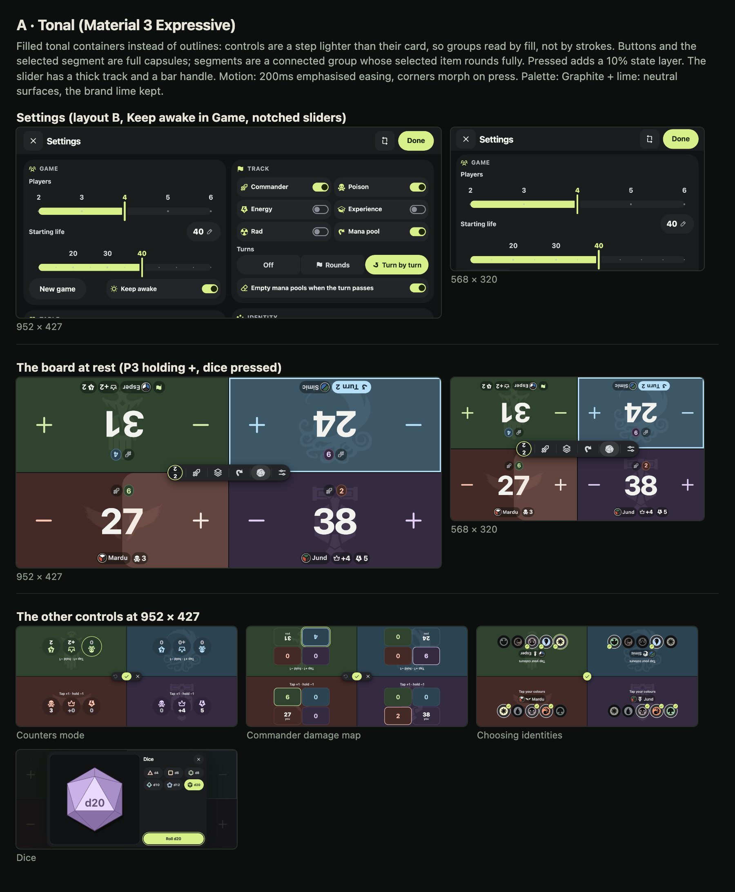
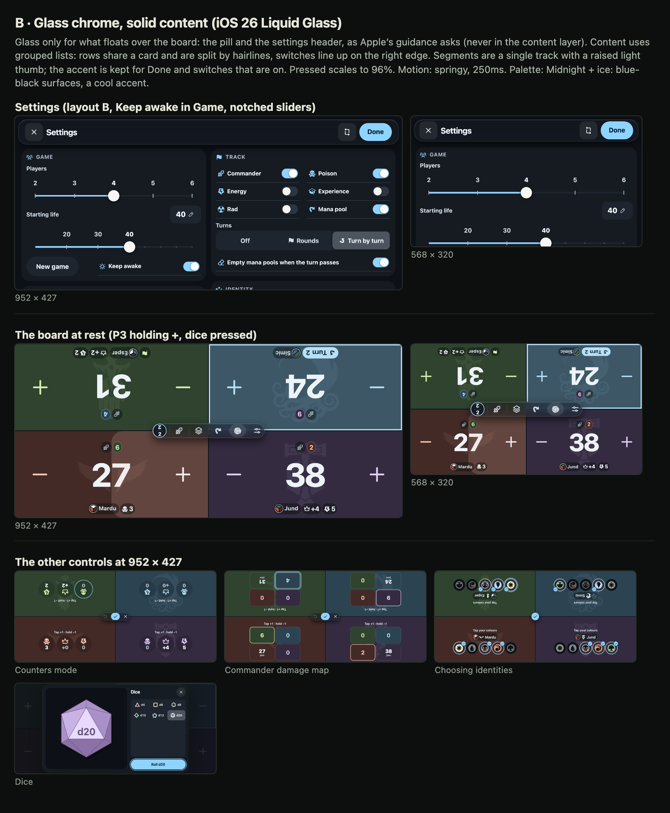
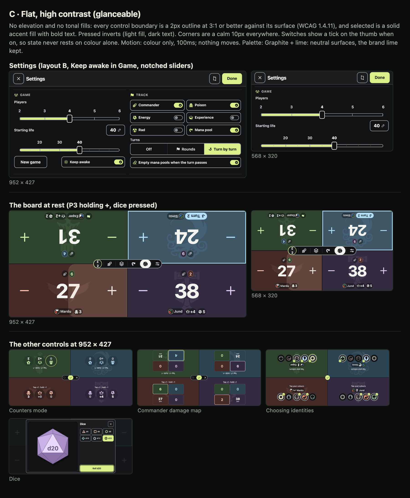
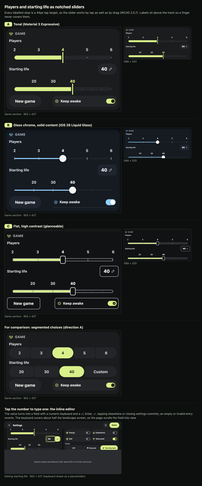
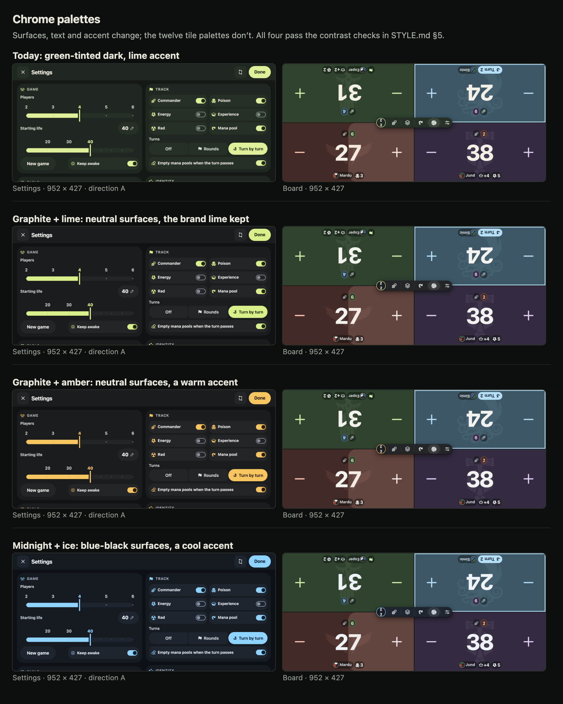

# Control styling: research, inventory and options

**Status:** built, 22 November 2026. Direction A ships as **Material** and direction B as **Glass**, picked in Settings → Table → Style; iOS starts on Glass, Android and browsers on Material. See [As built](#as-built-both-directions) at the end and [SETTINGS-SPEC.md](SETTINGS-SPEC.md) §7 and §9.

**The ask:**

> Deepsearch modern button styling and provide some alternatives options that cover the different type of buttons we have… the color scheme is also not the best. Like the 2-4-6 players could be a small slider with notches on the key points. Same with starting life, with being able to click the number and edit it. Looking for best practices and unified design approach.

**About the mock-ups:**

- Drawn by [style7.mjs](style7.mjs) on the current app (a1dc4cd) and the settings page from [SETTINGS-SPEC.md](SETTINGS-SPEC.md), layout B, with Keep awake in Game.
- Palettes come from [palettes7.mjs](palettes7.mjs). `node design/polish/palettes7.mjs` prints the contrast table in §5.
- Run `node design/polish/style7.mjs` to redraw them.

---

## 1. Research: what current guidance says

Primary sources, fetched 22 November 2026. Quotes are short.

**Apple HIG (iOS 26, Liquid Glass)**

- **Glass is for the control layer, not content.**
  - Liquid Glass "forms a distinct functional layer for controls and navigation elements … that floats above the content layer".
  - "Don't use Liquid Glass in the content layer."
  - "If you apply Liquid Glass effects to a custom control, do so sparingly." ([Materials](https://developer.apple.com/design/human-interface-guidelines/materials))
- **One prominent button per view.** "Use a button that has a prominent visual style for the most likely action in a view." The accent fills the background of "prominent buttons — such as the Done button". "Refrain from adding color to the background of multiple controls." ([Buttons](https://developer.apple.com/design/human-interface-guidelines/buttons), [Color](https://developer.apple.com/design/human-interface-guidelines/color))
- **Press states and targets.** "Always include a press state for a custom button." A hit region needs to be "at least 44x44 pt". ([Buttons](https://developer.apple.com/design/human-interface-guidelines/buttons))
- **Segmented controls.** They suit closely related choices: "no more than about five segments on iPhone". Keep segments equal in width. Use text or images, not a mix. ([Segmented controls](https://developer.apple.com/design/human-interface-guidelines/segmented-controls))
- **Switches.**
  - "Use the switch toggle style only in a list row."
  - "Avoid relying solely on different colors to communicate state."
  - The accent may replace the default green if it contrasts with the off state. ([Toggles](https://developer.apple.com/design/human-interface-guidelines/toggles))
- **Sliders.** "Consider supplementing a slider with a corresponding text field and stepper … having the ability to enter a specific value in a text field." ([Sliders](https://developer.apple.com/design/human-interface-guidelines/sliders)) Pair a stepper with a field "when large value changes are likely". ([Steppers](https://developer.apple.com/design/human-interface-guidelines/steppers))
- **Dark mode contrast.** At minimum 4.5:1; "strive for a contrast ratio of 7:1, especially in small text". Base and elevated backgrounds give depth. ([Dark Mode](https://developer.apple.com/design/human-interface-guidelines/dark-mode))

**Material 3 and M3 Expressive (Android)**

- **Connected button groups replace segmented buttons.** "Connected button groups replace segmented buttons", with "shape morphing when buttons are pressed or selected", and support for single- and multi-select. ([Android: Button groups](https://developer.android.com/develop/ui/compose/components/button-group))
- **Expressive is current.** M3 Expressive is "the next evolution of Material Design … research-backed updates to theming, components, motion, typography". The shape scale is like the type scale, "from square to fully circular". ([Android: Material 3](https://developer.android.com/develop/ui/compose/designsystems/material3))
- **State layers.** Material's tokens: pressed 0.10, focus 0.10, hover 0.08, dragged 0.16, disabled 0.38. Corner scale: 4, 8, 12, 16, 20, 28, 32 and 48px. ([material-web tokens: state](https://github.com/material-components/material-web/blob/main/tokens/versions/latest/sass/_md-sys-state.scss), [shape](https://github.com/material-components/material-web/blob/main/tokens/versions/latest/sass/_md-sys-shape.scss))
- **Sliders snap to steps.** `steps` is "the number of notches on the slider to which the thumb snaps", with optional tick marks. ([Android: Slider](https://developer.android.com/develop/ui/compose/components/slider), [material-web slider](https://github.com/material-components/material-web/blob/main/docs/components/slider.md))

**WCAG 2.2**

| Criterion | Rule | Source |
|---|---|---|
| 1.4.11 Non-text Contrast | Parts needed to identify a control, and its states, at 3:1 against adjacent colours. A control identified by its own text label doesn't need a visible boundary. | [Understanding 1.4.11](https://www.w3.org/WAI/WCAG22/Understanding/non-text-contrast.html) |
| 2.5.7 Dragging Movements | "All functionality that uses a dragging movement … can be achieved by a single pointer without dragging". A slider must also work by tap. | [Understanding 2.5.7](https://www.w3.org/WAI/WCAG22/Understanding/dragging-movements.html) |
| 2.4.13 Focus Appearance (AAA) | Focus indicator at least a 2px perimeter, at 3:1 between states | [Understanding 2.4.13](https://www.w3.org/WAI/WCAG22/Understanding/focus-appearance.html) |
| 2.4.11 Focus Not Obscured | A sticky header mustn't hide the focused control | [Understanding 2.4.11](https://www.w3.org/WAI/WCAG22/Understanding/focus-not-obscured-minimum.html) |
| 2.5.8 / 2.5.5 | 24px minimum, 44px enhanced | [RESEARCH.md §2](RESEARCH.md#2-touch-target-guidance) |

**Sliders for exact values**

- Nielsen Norman Group: "Selecting a precise value using a slider is a difficult task requiring good motor skills". Use one "only when the precise value won't matter … but rather only the approximate range".
- Labels must sit above the thumb, not under the finger. ([NN/g: Slider design](https://www.nngroup.com/articles/gui-slider-controls/))

**Dark, glanceable UIs** (Google's Design for Driving, the nearest well-documented glance-first system)

- A grayscale dark base, with extra colours at reduced intensity.
- 4.5:1 minimum between foreground and background.
- Primary text large.
- ([Android for Cars: color](https://developers.google.com/cars/design/automotive-os/design-system/color), [visual principles](https://developers.google.com/cars/design/design-foundations/visual-principles))

**What this means for LifePod**

1. One accent fill per view: Done, or the selected value. Nothing else is filled with the accent.
2. Every control has a visible press state.
3. State never relies on colour alone.
4. Glass, if used at all, only on the floating pill and header.
5. Segmented controls or button groups are the standard for five or fewer discrete choices. A slider is acceptable when every stop is a labelled tap target.
6. An exact number needs a field or a stepper, not a drag.
7. Neutral dark surfaces, so the coloured tiles are the only colour on the board.

---

## 2. Inventory: every control in the app

| Control | Where | Role | Today's look |
|---|---|---|---|
| **Life halves** | Each tile | The main action: tap −1 / +1, hold to repeat | Bare glyphs; the pressed half washes in the seat colour (style B, shipped) |
| **Pill buttons** | Board centre | Commander damage, counters, mana, dice, setup; Undo · ✓ · ✕ in modes; ✓ alone in rotate, colours and identity modes | Icons in one dark capsule with 1px dividers; pressed disc |
| **Turn chip / round button** | Near row, pill | Advance the turn or round; hold to step back | Seat-filled chip; ringed number in the pill |
| **Mana strip** | Near row | Spend one, or clear the pool | Mana symbols in a dark capsule |
| **Map seats** | Commander damage mode | Tap +1, hold −1 | The attacker's panel colour, ringed in the seat colour |
| **Counter and mana cells** | Counters and mana modes | Tap +1, hold −1 | Circles, tonal fill |
| **Identity toggles** | Identity mode, Identity sheet | Multi-select W U B R G | Mana-symbol discs with a check badge |
| **Swatches** | Colours mode | Single-select, taken ones disabled | Panel-coloured squares with a seat dot |
| **Segmented choice** | Setup: players, life, Turns, Background | Single-select | Bordered track, accent-filled selection |
| **Stepper** | Custom starting life | ±1, hold to repeat | Inside the accent segment |
| **Switch rows** | Track, Show on tiles, Keep awake, auto-empty | On/off | Bordered row, 30 × 17 switch |
| **Navigation / board-action rows** | Setup | Open a sheet / start a mode | Bordered row, caret |
| **Primary and secondary buttons** | Setup, dice, confirmations | Commit and cancel | Accent fill / bordered surface |
| **Header buttons** | Sheets | ✕, ‹, About | Bordered square, text button |
| **Dice picker and Roll** | Dice sheet | Single-select die; roll | Bordered buttons, accent selection; accent Roll |
| **Chips** | Badge rows | Display only (except the turn and mana chips) | Translucent dark capsules |
| **Dialogs** | Dice, discard, new game, settings | Containers | Surface, 18px radius, border, shadow |

**What's inconsistent today:**

1. Four corner radii (8, 10, 12 and 18px) with no rule for which applies where.
2. Some selections are an accent fill (segments, dice); others a ring plus a check (identity toggles), or an inset ring (swatches).
3. Borders on every row, so a settings screen is a grid of outlines.
4. The accent fills several things on one screen: Done, the selected segments and the switches that are on.
5. Pressed states differ: a fill, a darker surface, or a wash.

All three directions below fix these with one set of rules.

---

## 3. Three directions

Each direction is one token set applied to every control in §2. The tile palettes, the life-half wash and the map seats' own colours stay as they are in all three, because they belong to the players, not the chrome. So the board changes little between directions. The differences show in settings, dialogs, the pill and mode cells.

### A. Tonal (Material 3 Expressive) · recommended

| Property | Rule |
|---|---|
| Containers | Filled, not outlined. A control is one tone lighter than its card (`--raised` on `--surface`). Cards have no border. |
| Shape | Buttons, the selected segment and switch thumbs are full capsules. Segments are a *connected group*: 8px inner corners, 22px outer, and the selected one morphs to a full capsule. Cards 24px, dialogs 28px, cells circles, map seats and swatches 16px. |
| Elevation | None in content. The pill alone has a soft two-layer shadow. |
| Rest / pressed | Pressed = a 10% `--text` state layer over the fill (Material's pressed opacity). Life halves keep their seat wash. |
| Selected | Accent fill with `--ink` text, on the selected segment, the slider fill and an on switch. Only one accent *area* per group. |
| Disabled | 38% opacity, no state layer. |
| Focus | 2px accent ring, 2px out (3:1 against the surface or more). |
| Switch | 36 × 20. Off: an outlined track with a small thumb. On: an accent track with a larger ink thumb (the shape changes, not only the colour). |
| Slider | A 16px track with an accent fill, notches as dots, and a 4 × 44px bar handle. |
| Motion | 200ms emphasised easing, `cubic-bezier(.2, 0, 0, 1)`. Corners morph on press and select. Turned off under reduced motion. |

- **For:**
  - It's the platform's own current language on the target phone (Pixel).
  - Calm fills read well on a busy table.
  - It keeps every control's role clear without outlines.
- **Against:** a tonal step (1.1:1) doesn't meet WCAG 1.4.11 for its own *boundary*. That's allowed only because every control also has a text or icon label, and states (selected, on) meet 3:1 easily.

### B. Glass chrome, solid content (iOS 26)

| Property | Rule |
|---|---|
| Containers | Grouped lists: rows share a card and are split by hairlines. Switches line up on the right edge. |
| Glass | Only the pill and the settings header, which float over content (`backdrop-filter: blur(16–22px) saturate(1.5)`, with a light inner edge). Never cards or rows. |
| Shape | Capsule buttons, 20px cards, 30px dialogs, a 10px segment thumb inside a 12px track. |
| Elevation | The glass layer floats with a shadow. Content is flat. |
| Rest / pressed | Pressed scales to 96% plus a 10% white layer. |
| Selected | Segments: a raised light thumb, not the accent. The accent is kept for Done and on switches. |
| Disabled | 38%. |
| Focus | 2px accent ring. |
| Switch | iOS proportions: a 40 × 24 track and a white 20px thumb. |
| Slider | A thin 4px track, tick lines and a round white 28px thumb. |
| Motion | Springy, about 250ms, gentle overshoot. Reduced motion falls back to a fade. |

- **For:** the most modern look on iPhone, and the accent appears least.
- **Against:**
  - Glass costs GPU time on low-end Android WebViews, under a board people stare at for hours.
  - It reads iOS-native on the main (Android) target.
  - The light segment thumb is weaker at a glance than an accent fill.

### C. Flat, high contrast (glanceable)

| Property | Rule |
|---|---|
| Containers | 2px outlines at 3:1 or better against their surface (WCAG 1.4.11) on every control. Sections are split by rules, not cards. |
| Shape | 10px corners on everything (dialogs 14px). Cells circles. |
| Elevation | None anywhere. |
| Rest / pressed | Pressed inverts: a `--text` fill with `--background` text. |
| Selected | Solid accent fill and bold text. |
| Disabled | 38%. |
| Focus | 3px accent ring. |
| Switch | Outlined. On shows a tick on the thumb, so it never relies on colour. |
| Slider | A 12px outlined track with square notches and a tall rectangular handle. |
| Motion | Colour only, 100ms. Nothing moves or scales. |

- **For:** the strongest at a glance and in bright rooms; the most accessible; the cheapest to render.
- **Against:** a screen of outlines looks dated and busy, which is close to today's complaint ("the color scheme is also not the best").

---

## 4. Players and starting life: sliders

### What the research says

- **Five discrete values (players)** are the textbook case for a segmented control or connected button group, per Apple (five segments or fewer on iPhone) and Material.
- **A slider** is for approximate ranges (NN/g).
- **A notched slider whose every stop is a labelled tap target** is a segmented control drawn as a track. It meets WCAG 2.5.7 because a tap works without dragging, and it keeps the owner's look.
- **Starting life** is an exact number, so it needs a field or a stepper beside any slider (Apple's slider and stepper guidance).

### The mocked design

**Players:**

- A slider from 2 to 6 with five notches, the numbers above the track, 44px apart or more.
- Tap a number, or drag the thumb, which snaps to the notches.
- The track fill shows the choice.

**Starting life:**

- A slider from 10 to 60:
  - labelled notches at 20, 30 and 40;
  - small ticks every 5 in between;
  - dragging snaps to multiples of 5.
- The current value sits at the end of the label row: **40 ✎**.
- **Tap the number to edit it inline.** It becomes a field with a ✓.
  - Enter, ✓, tapping elsewhere or closing settings commits (1–999).
  - An empty or out-of-range entry reverts to the last value.
  - A value off the track (say 25 or 100) shows in the field. The thumb then rests at the nearest point on the track, or pinned to the end for 100.

### The no-keyboard decision

- SPEC §4 removed the keyboard because a text field opened the keyboard over a small dialog every time someone changed life.
- Here the slider and notches cover the common values (20, 30, 40 and every 5), and the keyboard only appears when someone taps the number on purpose.
- On a 427px-tall landscape phone the keyboard covers about half the screen, so the page scrolls the field into view, as the mock-up shows. The full-screen page can always scroll, unlike the old dialog.

So the old reason no longer applies. Recommended **on**.

### How the editor behaves on each platform

The field is `<input inputmode="numeric" pattern="[0-9]*" enterkeyhint="done" maxlength="3">`, with its value selected on open so typing replaces it.

| | Android (Gboard and other system keyboards, in the WebView) | iOS (WKWebView) |
|---|---|---|
| Keyboard | The number pad, with a Done/Enter key from `enterkeyhint` | The digit pad, which has no return key |
| Committing | Enter commits | Commits on ✓ or blur. WKWebView shows its input accessory bar (‹ › Done) above the pad, and Done blurs the field. |
| Back / dismiss | Back closes the keyboard first (the system does this), then a second back closes settings | Dismissing the keyboard commits |
| Viewport | The visual viewport shrinks; scroll the field into view on `focus` | The same |

**Alternative:** keep segmented controls (today's 2–6 group and 20 · 30 · 40 · Custom-stepper). They're the recommendation if the owner prefers the most standard controls; mocked for comparison in the same image.

---

## 5. Colour scheme

### The palettes

Each palette replaces the chrome tokens:

- `--background` and `--surface`, plus a new `--raised` for tonal fills;
- borders;
- text, soft text and muted text;
- `--accent`, `--accent-pressed` and `--ink`.

The **twelve tile palettes don't change**. Their contrast (life total ≥ 9:1, small text ≥ 7.6:1, life-out red ≥ 4.79:1) was set and checked by `design/counters/palette.mjs` and is independent of the chrome. The chrome meets the tiles only at the seams and the pill, and both are checked below.

| Palette | Surfaces | Accent | Notes |
|---|---|---|---|
| **Today** | Green-tinted (#141916 / #202720) | Lime #def09a | The green tint competes with Sage and Teal tiles |
| **Graphite + lime** · recommended | Neutral graphite (#111213 / #1b1c1e / #242528) | Lime #d9f08a | Keeps the brand lime (icon, store art); neutral surfaces let the tiles carry all the colour (the Design for Driving principle) |
| **Graphite + amber** | The same graphite | Amber #f6c560 | Warmer. Amber already means "warning" (15 commander damage, 7 poison), so an amber accent blurs that signal. |
| **Midnight + ice** | Blue-black (#0d1117 / #161b22 / #1e252e) | Ice blue #8fd3ff | Cool and techy. It clashes with Sky and Indigo tiles, and blue reads as "link". |

### Contrast

Measured with `node design/polish/palettes7.mjs`, WCAG 2.2.

| Check (target) | Today | Graphite + lime | Graphite + amber | Midnight + ice |
|---|---|---|---|---|
| Text on surface (≥ 7:1) | 13.5 | 15.2 | 15.2 | 15.5 |
| Text on background (≥ 7:1) | 15.7 | 16.7 | 16.7 | 17.0 |
| Soft text on surface (≥ 7:1) | 11.4 | 12.8 | 12.8 | 12.5 |
| Muted text on surface (≥ 4.5:1) | 8.7 | 8.4 | 8.4 | 8.4 |
| Muted text on raised (≥ 4.5:1) | 7.8 | 7.5 | 7.5 | 7.5 |
| Ink on accent (≥ 7:1) | 12.3 | 12.6 | 10.2 | 10.3 |
| Accent on surface: icons, focus ring (≥ 3:1) | 12.4 | 13.6 | 10.6 | 10.7 |
| Control border on surface (≥ 3:1) | 4.6 | 5.3 | 5.3 | 5.7 |
| Selected (accent) vs unselected (raised) (≥ 3:1) | 11.1 | 12.2 | 9.5 | 9.5 |
| Pill border on the worst tile panel, Amber top (≥ 3:1) | 3.1 | 3.2 | 3.2 | 3.4 |
| Seam (background) vs the closest tile panel | 1.33 | 1.40 | 1.40 | 1.41 |

- All four pass every check.
- **Graphite's soft text is `#dedfe2`** (corrected 22 Nov from `#d8d9dc`). The darker value fell to 7.26:1 on the lightest tile panel, under the 7.6:1 the tiles need for small text. The new value gives 7.69:1. See [TILES.md](TILES.md).
- **The seam row** isn't a WCAG check. It shows that the gap between tiles stands out slightly more on the neutral palettes.
- **The decorative hairlines** (`--border`, about 1.5:1) are only used where a label already identifies the control (WCAG 1.4.11's exception).

---

## 6. Recommendation

**Direction A (Tonal) with Graphite + lime, players and life as notched sliders, and the inline life editor.**

- It's the current Material language on the target phone, and it fixes every inconsistency in §2:
  - one corner scale;
  - one selected style (accent fill);
  - one pressed style (10% layer);
  - no row outlines;
  - the accent once per group.
- The graphite surfaces stop the chrome tinting the board green, and the lime brand stays.
- The sliders give the owner's look while staying tap-first (every stop is a target), with a field for exact life.
- **Keep from B:** the glass pill is a good accent on its own (Apple: glass only for floating controls). It's offered as Q6 below.

---

## Questions for review

**Q1. Which control style?** (`style-direction`)

- A · Tonal (Material 3 Expressive): filled, capsules, morphing segments · `renders/style7-a.png`
- B · Glass chrome, solid content (iOS 26): grouped lists, glass pill and header · `renders/style7-b.png`
- C · Flat, high contrast: 2px outlines, inverted press, no motion · `renders/style7-c.png`
- **Recommended: A.**

**Q2. Which chrome palette?** (`palette`)

- Today · Green-tinted dark, lime accent · `renders/style7-palettes.png`
- Graphite · Neutral graphite, lime accent · `renders/style7-palettes.png`
- Amber · Neutral graphite, amber accent · `renders/style7-palettes.png`
- Midnight · Blue-black, ice-blue accent · `renders/style7-palettes.png`
- **Recommended: Graphite.**

**Q3. Tile palettes?** (`tile-palettes`)

- Keep · The twelve tile palettes as they are (contrast already checked) · `renders/style7-palettes.png`
- Retune · Regenerate them in `palette.mjs` against the new background · —
- **Recommended: Keep.**

**Q4. Players control?** (`players-control`)

- Slider · A 2–6 slider with five labelled notches; tap a number or drag · `renders/style7-sliders.png`
- Segmented · Five segments, the standard for five choices · `renders/style7-sliders.png`
- **Recommended: Slider.** It's the owner's idea, and tap-first, so it meets the guidance.

**Q5. Starting life control?** (`life-control`)

- Slider + edit · A 10–60 slider with notches at 20, 30, 40 and ticks every 5; tap the number to type any value · `renders/style7-sliders.png`
- Segmented + stepper · 20 · 30 · 40 · Custom, where Custom is a − n + stepper (no keyboard) · `renders/style7-sliders.png`
- **Recommended: Slider + edit.**

**Q6. A glass pill on the board, whichever direction is picked?** (`glass-pill`)

- Yes · Frosted, translucent pill over the tiles (from B) · `renders/style7-b.png`
- No · A solid pill in the chosen direction · `renders/style7-a.png`
- **Recommended: No.** A solid pill reads better over busy tiles and costs nothing on low-end phones. Yes is a fair taste call.

---

## As built: both directions

The owner picked A with Graphite + lime first (SETTINGS-SPEC.md §7), then asked for B as a second whole-app style beside it. Both are in `web/css/tokens.css`: A's tokens under `:root, [data-style="material"]`, and B as a block of overrides under `[data-style="glass"]`. Component rules read only tokens. Settings → Table → **Style** switches between them; it's saved, and until it's picked iOS starts on Glass and Android and browsers on Material.

Glass follows §3 B, with these differences:

| §3 B | As built | Why |
|---|---|---|
| Palette: Midnight + ice in the mock-up | Graphite + lime, as in Material | The owner kept one palette; only the control style changes. |
| Glass on the pill and the settings header | Also on dialogs (dice, New game, discard) | The owner's call: all the floating chrome. Cards and rows stay solid. |
| `blur(16–22px) saturate(1.5)` | GLASS.md's tinted recipe: the surface at 68% over `blur(18px) saturate(1.3)`, a 1px `#ffffff1f` edge and an `inset 0 1px 0 #ffffff22` highlight | GLASS.md measured it at 10:1 or better for the pill's icons on any tile. |
| The settings header floats | It floats 8px in from the top and sides, rounded 22px, and the body scrolls under it; focus scrolls clear of it | So the glass has something to show, without covering the focused control. |
| Switch: a white 20px thumb | White when off; **ink when on** | White on the lime accent is 1.1:1 and the thumb would vanish; ink is 12.6:1. Off, the grey track is 3.6:1 on the card and the white thumb 4.75:1 on the track. |
| Segments: a raised light thumb | A thumb in the lime tint (the accent at 20% over the `--raised` track), lime text and a 1px lime ring, with the thumb's shadow; the dice picker's chosen die too. It was a neutral `#707379` thumb with white text until Accent L3 (23 November). | The same "tint, not solid" choice as Material. Text 7.4:1 on the tint; the ring is 4.7:1 against the track (WCAG 1.4.11). |
| Slider: a thin track | 4px in the thumb grey (3.6:1 on the card), a muted lime fill (the accent at 42% over the track, since Accent L3), tick lines (the accent at 60% where filled), a round white 28px thumb | The track keeps a visible boundary. The muted fill is only 1.85:1 on the grey track, so the white thumb (4.8:1 on the track) carries the value. |
| Pressed scales to 96% | Buttons, segments, the dice picker, the life value, the pill's discs, and the counter, mana, map, swatch and identity cells; rows only take the 10% layer | Rows press like iOS list rows. Chips keep their size, so the badge rows' fitting never measures a shrunk chip. |
| Reduced motion falls back to a fade | No transitions and no shrinking | As in Material: nothing moves. |
| Identity toggles: not specified | A light ring when on, the accent check kept | B keeps the accent for Done and switches; the check reads as "on". |

**Accent L3, "tint" (23 November 2026).** The owner chose to keep solid lime for committing only. In both styles a chosen segment, the chosen die and a slider's fill are tints of the lime (`--chosen-fill`, `--chosen-ink`, `--chosen-ring`, `--slider-fill`, `--tick-filled*`), and solid lime stays on Done and other primary buttons, the pill's save and Done discs (`--commit-fill`, `--commit-ink`), switches that are on and the focus ring. This replaces §6's "one selected style (accent fill)". See SETTINGS-SPEC.md §9 for the contrast figures.

**Fallbacks** (GLASS.md): solid surfaces without `backdrop-filter`, under `prefers-reduced-transparency: reduce`, and under iOS Reduce Transparency (passed from `LifePodApp.swift` as `data-reduce-transparency`); solid with a 2px `--control-border` outline under `prefers-contrast: more`.

**Checks:** `tests/style.test.mjs`, `tests/sizes.test.mjs` with `tests/sizes-glass.test.mjs`, and `node design/polish/final-review.mjs --sweep`, which sweeps every state in both styles.

