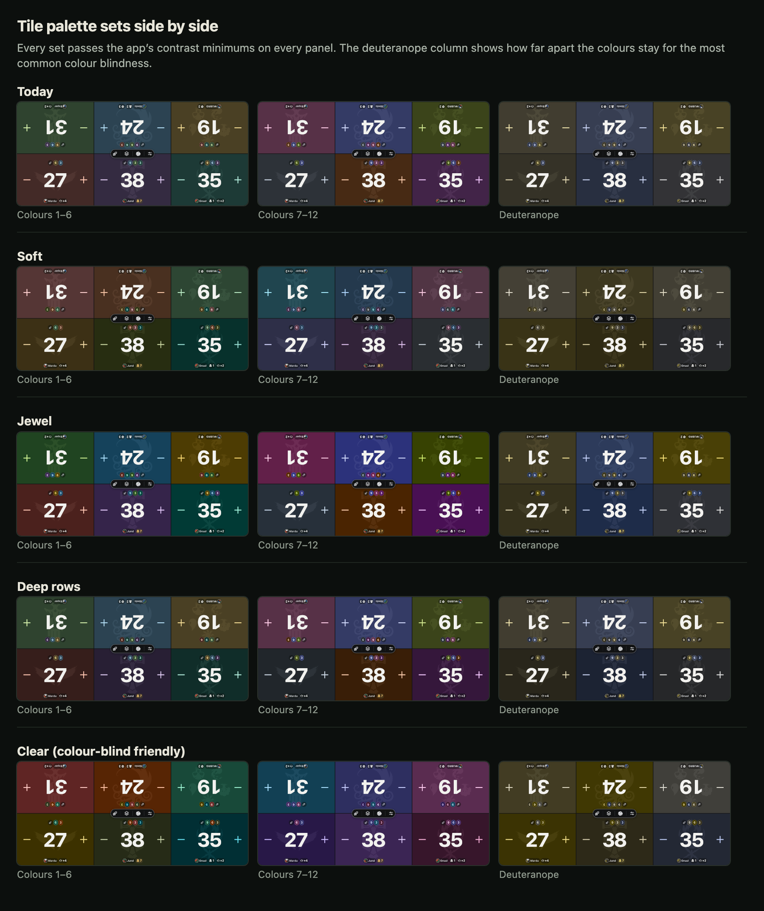

# Tile colour schemes

**Status:** options for the owner, 22 November 2026. Nothing in `web/` has changed. The owner kept today's twelve tile palettes (STYLE Q3) and asked for alternatives to choose from.

**How the sets are made and checked:**

- Every set is generated and checked by [tiles7.mjs](tiles7.mjs) (`node design/polish/tiles7.mjs`). It uses the same OKLCH maths as `design/counters/palette.mjs` (it imports `design/counters/oklch.mjs`).
- Each set is twelve palettes (panel, rim, seat and button, in a top-row and a bottom-row version).
- Colour-vision simulation: Machado, Oliveira and Fernandes (2009), at full severity, in linear RGB.

**About the mock-ups:**

- Drawn by [tiles-render.mjs](tiles-render.mjs) on the committed app (ff0cbf0) with the Graphite chrome.
- Six players at 952 × 427 with watermarks, identity chips, commander damage and counters, in colours 1–6 and 7–12.
- Colours mode with all twelve swatches.
- The same board through a deuteranope simulation.

**The commander colours rule needs no change:** map seats and damage chips draw from each player's own `--panel`, `--seat` and `--rim`, so every set carries through.

---

## The sets

| Set | Idea | Image |
|---|---|---|
| **Today** | The shipped twelve | [tiles-today.png](renders/tiles-today.png) |
| **Soft** | Muted: low chroma (0.045), so the board recedes and the numbers carry it. Because low chroma pulls colours together, the eleven hues are re-spaced evenly round the circle and alternate between two lightness steps, plus a neutral Slate. | [tiles-soft.png](renders/tiles-soft.png) |
| **Jewel** | Rich: panel chroma ×1.7 and seat chroma ×1.35, panels 0.01 darker so the life-out red stays readable. Colours read as colours from across the table. | [tiles-jewel.png](renders/tiles-jewel.png) |
| **Deep rows** | Today's hues, with the bottom row 0.05 darker. The two sides of the table differ by lightness as well as hue, which colour-blind players can see. | [tiles-deep.png](renders/tiles-deep.png) |
| **Clear** (colour-blind friendly) | Chosen by search: twelve hue, lightness and chroma combinations that keep every pair of tiles as far apart as possible under normal, deuteranope and protanope vision at once, in the same row and across rows. It has more spread in lightness and fewer near-identical greens. | [tiles-clear.png](renders/tiles-clear.png) |

**Clear's colours, in hue order:** Coral, Copper, Olive, Lime, Jade, Cyan, Sky, Indigo, Violet, Orchid, Pale plum, Deep plum. The names are working names.

**Swatch ids by family (DESIGN-AUDIT M1, after the build).** Soft and Clear were first placed on the swatch ids in hue order, so the default seats (ids 0–5, players 1–6) were six neighbours: a fresh install showed four dark, warm tiles. `tiles7.mjs` now makes them in hue order and then places each on the id whose Classic colour is in the same family, so every id keeps its family in all four sets and the default seats are spread:

| id | 0 | 1 | 2 | 3 | 4 | 5 | 6 | 7 | 8 | 9 | 10 | 11 |
|---|---|---|---|---|---|---|---|---|---|---|---|---|
| Classic, Jewel | Sage | Sky | Coral | Violet | Amber | Teal | Rose | Indigo | Slate | Copper | Olive | Orchid |
| Soft | Jade | Sky | Coral | Violet | Olive | Teal | Plum | Azure | Slate | Copper | Lime | Orchid |
| Clear | Jade | Sky | Coral | Violet | Olive | Cyan | Pale plum | Indigo | Deep plum | Copper | Lime | Orchid |

- Clear has no neutral, so its slate is the deep plum. The audit's table put Orchid on 6 and Deep plum on 11; this one keeps Orchid on Classic's orchid (11) and the pale plum on rose (6), which are nearer in hue. Ids 0–5 are the audit's.
- The palettes themselves, and so every check below, are unchanged. Saved games keep their ids, so a player on Soft or Clear may see their colour change family once.
- `tests/palette.test.mjs` checks that at every player count from 2 to 6, the closest two default seats in every set are at least as far apart as Classic's closest default pair (0.051): Clear's are 0.079 and Soft's 0.063 (they were 0.046 and 0.039).
- **Families.** For Settings → Table → *Shuffle tile colours each game*, `tiles7.mjs` also splits each set into six look-alike families, by search: the grouping whose closest two swatches in different families are furthest apart. A shuffled game gives each seat a different family while it can, so six players get one of each. They're in `tiles7.json` and `tileSets` in `web/js/logic/data.js`.

## Checks

The text colours are the Graphite chrome's: text `#f2f2ef` and soft text `#dedfe2`.

| Set | Life total ≥ 9 | Small text ≥ 7.6 | Life-out red ≥ 4.79 | Seat colour on panel ≥ 7.35 | Warning chip ≥ 4.5 |
|---|---|---|---|---|---|
| Today | 9.13 | 7.69 | 4.79 | 7.38 | 6.01 |
| Soft | 9.20 | 7.74 | 4.83 | 7.78 | 6.12 |
| Jewel | 9.45 | 7.95 | 4.96 | 7.69 | 6.14 |
| Deep rows | 9.13 | 7.69 | 4.79 | 7.38 | 6.01 |
| Clear | 9.13 | 7.68 | 4.79 | 7.87 | 6.12 |

- Every set passes every contrast minimum on every panel, in both rows.
- **The seat-colour minimum is 7.35:1 rather than the 7.4 quoted earlier.** Today's own worst panel measures 7.38, so 7.35 is the honest floor that today already meets.

**How far apart the tiles stay**

- The distance is the OKLab difference between two different swatches as tiles: panel, plus half the seat colour, since the seat colour draws the − + glyphs and rings.
- Today's closest pair in normal vision (0.031) is the reference for "clearly different".

| Set | Normal | Deuteranope | Protanope | Tritanope | Across rows (deuteranope) |
|---|---|---|---|---|---|
| Today | 0.031 (Coral–Copper) | **0.005** (Rose–Slate) | 0.018 (Amber–Copper) | 0.013 (Coral–Rose) | 0.046 |
| Soft | 0.032 | **0.002** | 0.010 | 0.014 | 0.020 |
| Jewel | 0.038 | 0.006 | 0.016 | 0.010 | 0.048 |
| Deep rows | 0.031 | 0.005 | 0.019 | 0.013 | **0.093** |
| Clear | 0.036 | **0.024** | **0.028** | 0.021 | 0.025 |

**What the numbers say:**

- **Today has a real colour-blind problem.** To a deuteranope, Rose and Slate are nearly the same tile (0.005, about a sixth of the normal-vision gap). The deuteranope column of [tiles-today.png](renders/tiles-today.png) shows it.
- **Clear raises the colour-blind worst case about five times** (deuteranope 0.005 → 0.024, protanope 0.018 → 0.028), and is slightly better than today in normal vision. The cost: rows are less distinct across the table (0.025 against today's 0.046), because lightness now varies per colour rather than per row.
- **Deep rows** doubles the difference between the two sides of the table, but leaves same-row pairs as they are.
- **Jewel** is the most vivid and the best in normal vision, with no colour-blind gain.
- **Soft** is the calmest look, and the weakest for colour-blind players.
- **No set makes colour alone fully reliable for colour-blind players.** Seat position, the P1–P6 owner tags on taken swatches, and identity names still matter.

---

## Recommendation

**Clear as the default, with Today available as "Classic".**

- Clear is the only set that fixes today's near-identical pair for the most common colour blindness. Red-green colour blindness affects roughly 1 in 12 men, and the deutan forms are the most common. Most of those are the milder deuteranomaly, so the full-severity simulation here is the worst case.
- It passes every contrast check.
- It looks as good as today.

If the owner prefers today's look as the default, keep Today and use **Deep rows** as the free improvement: same hues, and the two sides of the table separate more.

## A one-time pick, or a setting?

| | One-time design pick | "Tile colours" setting |
|---|---|---|
| What it is | The owner picks one set; it ships for everyone | Settings → Table gets a segmented **Tile colours**: for example Clear · Classic · Jewel · Soft |
| Cost | None | One saved field (`tileScheme`), one CSS class on `.app` swapping the 96 tokens, a test per set. Swatch ids stay the same, so saved colour choices carry over. |
| For | One look to maintain and test; no clutter | A colour-blind player can choose for the table; taste differs between groups |
| Against | One set can't suit everyone | One more setting; four sets to keep passing contrast |

**Recommendation: a setting, with two to three sets at most** (Clear default, Classic, and Jewel or Soft). Colour vision is exactly the kind of difference a setting should serve, and it costs little because the token structure already supports swapping. More than three sets is choice for its own sake.

---

## Questions for review

**T1. Which tile colours should be the default?** (`tile-default`)

- Today · The shipped twelve ("Classic") · `renders/tiles-today.png`
- Soft · Muted, re-spaced hues · `renders/tiles-soft.png`
- Jewel · Rich, saturated · `renders/tiles-jewel.png`
- Deep rows · Today's hues, darker bottom row · `renders/tiles-deep.png`
- Clear · Colour-blind friendly · `renders/tiles-clear.png`
- **Recommended: Clear.**

**T2. A one-time pick, or a setting?** (`tile-setting`)

- Pick · One set ships for everyone · `renders/tiles-overview.png`
- Setting · Settings → Table → Tile colours, two to three sets · `renders/tiles-overview.png`
- **Recommended: Setting**, with Clear, Classic and one of Jewel or Soft.
