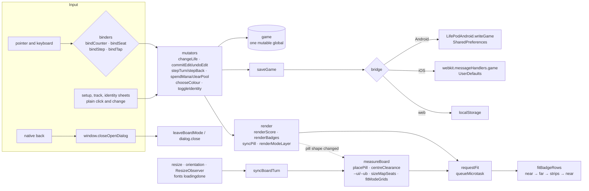

# LifePod: architecture overview and code review

Reviewed on 2026-11-22 against `main` at `0629ddf`. This covers `web/` (app.js, styles.css, index.html, dice.js), `android/` and `ios/`, with `design/polish/SPEC.md` and README.md as the statement of intent.

**How the findings were checked.** I read every line of `web/`, `MainActivity.kt` and `LifePodApp.swift`. I checked each bug in this document by running the app in Chromium and WebKit with playwright-core 1.65, using small scripts that seed a saved game, drive the page and read `game` back. Those scripts were scratch files and are not in the repo. The timings come from an Apple-silicon Mac, so a phone will be slower. Where something could only be reasoned about or simulated, the text says so.

**Short version.** The app is in good shape for its size. Saved data is checked field by field on load. The native shells are locked down well. Layout follows one clear rule: every tile is drawn at the size of the smallest one. I found no crash and no way to lose data. I did find five real bugs, all in input handling and mode transitions, and the cause of most of them is the same: state changes are spread over about 40 call sites, and every render throws away the DOM and rebuilds it. `app.js` can be split into modules, but **ES modules do not load over `file://`**. I checked that in both engines. The iOS app, the tests and the browser preview all load the page from `file://`, so a module split needs some plumbing first. Section 3 gives an order of steps where each one can ship.

---

## 1. Architecture overview

### 1.1 Files and runtime

| File | Lines | Role |
|---|---|---|
| `web/index.html` | 261 | The markup: board shell, centre pill, a `<template>` for one player tile, seven `<dialog>`s (dice, setup, track, identity, discard, about, restart). Inline Phosphor SVGs. CSP `default-src 'none'; script-src 'self' file:; …`. |
| `web/app.js` | 2,474 | Everything else: constants, saved-game format, state, rendering, layout and measurement, input, sheets and the native bridges. Classic script (`'use strict'`, `defer`), so every top-level `function` and `let` is a global. |
| `web/dice.js` | 227 | Dice shapes, drawing, crypto rolls and the animation. Already a separate unit, exposed as `window.lifePodDice`. |
| `web/styles.css` | 1,399 | Tokens, the twelve tile palettes, the board, tiles, modes, badges, identity symbols, sheets and dice. |
| `android/.../MainActivity.kt` | 182 | A WebView shell that serves `web/` from an asset allowlist and exposes the `LifePodAndroid` bridge. |
| `ios/LifePodApp.swift` | 121 | A SwiftUI and WKWebView shell that loads `web/index.html` from the bundle with `loadFileURL` and adds three message handlers. |

There is no build step. Android packs `web/` as assets (`aapt2 link -A ../web`). iOS copies `web/` as a folder reference. CI zips an explicit list of files.

### 1.2 Diagram



### 1.3 State and saving

- **One object.** `game` (`app.js:185`) holds everything that is saved: `scores`, `startingLife`, `rotations`, `colors`, `landscapeAngle`, `keepAwake`, the tracker switches in `counters`, one array per count kind (`poison`, `casts`, `energy`, `experience`, `rad`), `identities`, `identity` (the display settings), `commanderDamage[defender][attacker]`, `manaPool`, `autoEmpty`, `pools[player][WUBRGC]`, `turns` and `turn {first, active, round}`.
- **Loading** (`loadGame`, `app.js:692`) reads the saved snapshot from the right backend and checks it one field at a time with `fit*` helpers (`fitColors`, `fitCounts`, `fitDamage`, `fitPools`, `fitTurn`, `fitTrackers`, `fitIdentitySettings`). Any bad field falls back to its default, and bad core fields (`scores`, `startingLife`) fall back to a whole new game. This is robust. The saved JSON has no version field, though; section 2.2 R9 covers that.
- **Saving** (`saveGame`, `app.js:731`) stringifies the whole `game` on every change and sends it to the bridge. There is no batching. A held life button saves 10 times a second, which every backend handles easily.
- **State that is not saved** lives in about 20 more module-level `let`s and `const` collections: `boardMode`, `edits`, `editStartScores`, `turnSteps`, `askFirst`, `clearedPools`, `dropLevels`, `pillShape`, `fitQueued`, `ignoreClicksUntil`, `activePresses`, `selectedPlayerCount`, `selectedLife`, `customLife`, the dice state, the wake lock and the timers. The design is deliberate (SPEC §10.1): undo stacks, "Undo clear" and the hold-back buffer for turn steps are lost on relaunch.
- **Editing modes** (damage, counters, mana) apply each change to `game` straight away and save it, and they push an `{kind, index, delta, …}` record onto `edits`. Undo pops and reverses one record. ✕ reverses them all (`applyEdit`, `app.js:1319`). Nothing is lost if the app is killed in the middle of a mode.

### 1.4 Rendering

Rendering is imperative and keyed by player index. There is no virtual DOM and no central render loop.

- `renderBoard()` (`app.js:2020`) clones the template once per player, binds the life buttons and calls `layoutBoard`, `paintColours`, `renderScore` and `renderBadges`. It runs at startup and on each new game.
- `renderScore(i)` updates one total in place.
- `renderBadges(i)` (`app.js:1855`) **rebuilds** the watermark, the far row (commander damage), the mana strip and the near row (turn chips, identity chip, counters, folded strip chip) from new elements with new listeners, then calls `requestFit()`.
- `renderModeLayer(player, i)` (`app.js:1422`) rebuilds the open mode's layer. The `sync*` helpers (`syncSeatMap`, `syncCounterCells`, `syncManaCells`, `syncIdentity`, `syncSwatches`) then update those layers in place on each edit.
- `syncPill()` (`app.js:1914`) shows and hides the pill buttons, and it calls `measureBoard()` again when the number of buttons changes.

Each mutator decides for itself what to re-render. `changeLife` re-renders badges only when the player's out status changes. `showEdit` re-renders the cells, score, badges and pill. Turn steps re-render every tile's badges. The tracker switches have their own copy of `renderAllBadges`.

### 1.5 Board modes

`boardMode` is one of `null`, `rotate`, `colours`, `identity`, `damage`, `counters`, `mana` or `first`. `setBoardMode(mode)` (`app.js:1947`) is the only place that changes it. It cancels any active presses, makes the life controls inert, rebuilds every mode layer and every badge row, sets `data-mode` on `#board` and the pill (CSS hides the badges and controls), relabels the setup button as Done, moves focus and updates Android back handling.

- `rotate`, `colours` and `identity` save each change at once and end with the check mark.
- `damage`, `counters` and `mana` are editing modes with Undo, Save and ✕. ✕ asks for confirmation through `#discard` when there are edits.
- `first` ("Who goes first?") opens automatically through `maybeAskFirst()` (`app.js:1600`) once no dialog is open. It ends when someone picks, after a short pause, or when someone skips.

### 1.6 Layout and measurement

**Orientation.** `syncBoardTurn()` (`app.js:256`) sets `data-board-turn` on `.app`. CSS turns the whole app by 0/90/180/270° so the seats stay fixed to the device. The landscape that counts as upright is stored per game in `landscapeAngle`. Dialogs live in the top layer and turn with the phone, not with the board.

**Seats.** `seatLayouts` (`app.js:58`) is a CSS `grid-template-areas` string for each player count. `layoutBoard()` gives each tile its grid area and a facing edge (`data-edge`), adding its rotation. `.player-face` is turned by `--angle`, and sideways faces swap width and height with `100cqh`/`100cqw`.

**One size per board** (`measureBoard`, `app.js:272`, SPEC §3.1):

1. It measures the pill button size, then `placePill()` (`app.js:316`). The pill sits on the horizontal seam, limited to the columns whose seats are split into two rows, and it is sized for its widest state, so it doesn't move when a mode opens. With 2 players it stands upright on the middle seam.
2. `centreClearance()` (`app.js:344`) works out, for each tile, which face edge the pill reaches past and how far, and keeps the cheapest one as `--clear-far|end|near|start`.
3. `--ui` and `--ub` are set to the smallest face width and height left after those clearances. CSS sizes all tile content from `--u = --ui / 100`. The flags `data-narrow` (ui < 240), `data-short` (ub < 200) and `data-wide` (ui ≥ 264) switch board-wide layouts.
4. `sizeMapSeats()` and `fitModeGrids()` pick the commander map seat size and the column counts for swatches, counter cells and identity toggles for each face.
5. `syncBoardDigits()` sets `--board-digits`, so a three-digit total shrinks every total together.
6. It ends with `requestFit()`.

**Auto-drop** (`fitBadgeRows`, `app.js:437`, SPEC §3.2). Fitting is batched into one microtask. It fits the near rows, then the far rows, then the mana strips, and then the near rows again if a strip folded into the near row. `fitBadgeSide()` steps through `dropSteps[side]`. Hide steps set a token in `#board[data-drop]`, floor steps shrink `--near/far-badge-size`, and wrap steps let a row take two lines. It stops at the first level where every row fits. The level is board-wide, and it only goes back down when every row fits with 15% to spare (`dropSlack`). `fitStrips()` (`app.js:534`) tries four places for each strip: `above`, `inline`, `fold` and `fold-inline`. It checks each place by measuring with `getBoundingClientRect` against the total, the glyphs, the far row and the pill, and picks the type level that folds the fewest strips.

**What triggers measuring:** `resize`, `orientationchange`, `screen.orientation` `change`, the portrait media query, a `ResizeObserver` on `#board`, the font set's `loadingdone` (which also resets `dropLevels`), a seat rotation, a change in pill shape, and each new board.

### 1.7 Input handling

Each tile's controls respond the moment a finger lands, and several players can press at once. Four binders share one rule: a press is counted on `pointerdown` or `pointerup`, so the `click` that follows is skipped through a global `ignoreClicksUntil` window (`app.js:779`). Keyboard clicks (`detail === 0`) always count.

| Binder | Used by | Tap | Hold |
|---|---|---|---|
| `bindCounter` (`:785`) | life − and +, starting-life stepper | counts on down | repeats every 100ms after 500ms |
| `bindSeat` (`:983`) | commander map seats, counter cells, mana cells | counts on up, or whenever the press ends | −1 after 500ms, then repeats |
| `bindStep` (`:1045`) | turn chip, round chip, pill round button | forward on up | back once after 500ms |
| `bindTap` (`:911`) | swatches, identity toggles, Me first, shuffle, strip spend, eraser, Undo clear, strip chip, Start chip | once on down | — |

Each binder keeps its own `press` object with pointer capture, and holds are tracked in `activePresses` so `setBoardMode`, `renderBoard` and hiding the page can cancel them. Hold-only actions have keyboard and screen-reader equivalents through visually hidden "remove one" buttons (`.counter-remove`, `.map-remove`, `#round-back`).

### 1.8 Native bridges

| Concern | Android (`LifePodAndroid`) | iOS (`webkit.messageHandlers`) | Browser |
|---|---|---|---|
| Detect | `window.LifePodAndroid` | `window.webkit?.messageHandlers` | neither |
| Read game | `readGame()`, synchronous | `window.initialGame`, a JSON string injected at document start by a `WKUserScript` | `localStorage` |
| Write game | `writeGame(json)` → `SharedPreferences.apply()` | `game.postMessage(json)` → `UserDefaults` | `localStorage.setItem` |
| Keep awake | `keepAwake(bool)` → `FLAG_KEEP_SCREEN_ON` | `keepAwake.postMessage(bool)` → `isIdleTimerDisabled`, combined with scene phase | Screen Wake Lock API |
| Haptic | `haptic()` → `CLOCK_TICK` | `haptic.postMessage` → `UISelectionFeedbackGenerator` | `navigator.vibrate(8)` |
| Back | `setBackHandling(bool)` registers an `OnBackInvokedCallback` (API 33+). Native calls `window.closeOpenDialog()`. API ≤ 32 uses `onBackPressed`. | none | Escape key |

---

## 2. Findings

Severity: **High** means data loss, a crash or a security problem. I found none. **Medium** means a wrong game state or an action that silently goes missing in normal play. **Low** means an edge case, a cosmetic problem or something that only shows on desktop.

### 2.1 Correctness bugs (all checked in Chromium and WebKit)

#### B1 — Medium: map seats, counter cells and mana cells throw on every pointer move, and a hold doesn't stop when the finger leaves the tile

- **Where.** `bindSeat`, `app.js:984`: `const tile = button.closest('.player');` runs when the button is bound. `buildCounterCell` (`:1395–1402`), `buildManaCell` (`:1719–1726`) and `buildSeatMap` (`:1112–1119`) bind each cell before it is attached to the tile, so `tile` is `null`. The `pointermove` handler (`:1022–1029`) then calls `tile.getBoundingClientRect()`.
- **Failure.** In counters, mana or commander damage mode, any pointer movement during a press throws `TypeError: Cannot read properties of null (reading 'getBoundingClientRect')`. A real finger always jitters, so this happens on nearly every press. The documented rule "a hold stops when the finger leaves the player's tile" never fires. A hold that drifts off the tile keeps removing. In commander damage mode, each removal also gives back life. In my test, a hold dragged 200px off the tile went from 3 edits to 9 over the next 600ms, in both engines.
- **Fix.** Look up the tile when it's needed: `const bounds = button.closest('.player').getBoundingClientRect();` inside the handler. Another option is to pass the tile into `bindSeat`. Add a test that drags a held cell off its tile and checks that no page error occurs and the count stops.

#### B2 — Medium: a turn chip press that outlives a re-render fires a step back, which undoes someone else's turn pass

- **Where.** `bindStep`, `app.js:1070–1074`, sets a 500ms hold timer that calls `back()`. The turn and round chips are rebuilt on every `renderBadges` (`turnChips`, `:1666`, inserted by `near.replaceChildren`, `:1907`). When the pressed chip is removed, its `pointerup` and `lostpointercapture` never reach the listener, so the timer is never cleared.
- **Failure.** Turn by turn, with P1 active. P1 starts tapping their Turn chip. Before P1 lifts their finger, another player taps the pill's round button to pass the turn. `showTurn` rebuilds every near row, which removes P1's chip. 500ms after P1's touch, the orphaned timer calls `stepBack()`, which pops the step that was just recorded. The result is that P1 is active again, both taps are lost, and the pools that were emptied by auto-empty come back. I reproduced this in both engines: active went from P1 to P2 and back to P1. Anyone at the table can press the pill, so near-simultaneous passes are a realistic case. The orphaned press also stays in `activePresses` until the next `cancelPresses()`.
- **Fix.** In the timer, `if (!button.isConnected) { current.end(); return; }`, and the same check in `finish()`. The better fix is to stop rebuilding the chips: keep each tile's chip node and update its text and attributes in place (see R2), so a press survives re-renders.

#### B3 — Medium: "Who goes first?" is lost after Rotate seats, Colours or Choose identities, and then appears at a random later moment

- **Where.** Turning Turns on from Off sets `askFirst = true` (`app.js:2253`). It is only consumed by `maybeAskFirst()`, which runs on dialog `close` events (`:2452`) and from `stepTurn`/`startGame`. Rotate seats (`:2317`), Colours (`:2321`) and Choose identities (`:2313`) close the sheet and call `setBoardMode(...)` in the same task. The asynchronous `close` event then sees `boardMode !== null` and waits. `setBoardMode(null)` never calls `maybeAskFirst()`.
- **Failure.** Setup → Track → Turns: Rounds → back → Rotate seats → Done. "Who goes first?" doesn't open. Later, the moment anyone closes any dialog (I used the dice), the board drops into "Who goes first?" without warning. I reproduced this in both engines for Rotate seats and for Colours.
- **Fix.** Call `maybeAskFirst()` at the end of `setBoardMode` when `mode === null`. It already checks for open dialogs and modes, so this is safe.

#### B4 — Low: holding a tap-once button for more than 800ms runs its action twice

- **Where.** `bindTap`, `app.js:911–921`, runs the action on `pointerdown` and extends `ignoreClicksUntil` by 800ms. Unlike the other three binders (for example `:830–836`), it doesn't extend the window again on `pointerup`. After a long press, the `click` falls outside the window and runs the action again.
- **Failure.** In identity mode, a 1s hold on a colour toggle turns it on and then off, so nothing changes. I saw this with a mouse in Chromium and WebKit, and with CDP touch events in Chromium. Other `bindTap` users are safe by luck: swatches and Me first ignore the repeat, and the strip buttons and the Start chip are rebuilt, so the click lands on nothing. On real phones, a long press may be taken as a context-menu gesture so that no click arrives. I couldn't check that on a device. The bug certainly affects the browser preview, mice, trackpads and styluses.
- **Fix.** Add the same `pointerup` and `pointercancel` handler that the other binders have: `ignoreClicksUntil = performance.now() + 800`. Better still, record that this button counted a press and swallow the next click on that button, whatever the timing (see R6).

#### B5 — Low (accessibility): keyboard focus is lost after passing the turn from a chip

- **Where.** `renderBadges`, `app.js:1890–1907`. Focus is restored only for the mana strip (`:1879–1889`). The turn chip that had focus is replaced.
- **Failure.** Tab to the active Turn chip and press Enter. The turn passes and `document.activeElement` becomes `<body>`, so a keyboard or switch user has to tab back from the start each turn. I reproduced this in both engines. The same thing happens on the Rounds flag chip and the Start chips.
- **Fix.** Before rebuilding, note which chip had focus (by role: `turn`, `start` or `strip-chip`) and restore focus to the equivalent chip, or to the next active player's chip. Updating in place (R2) fixes this too.

### 2.2 Risky areas

**R1. State changes are spread out, so the rendered board can drift from `game`.** About 40 places change `game` directly. Each one has to remember to save and to call the right mix of `renderScore`, `renderBadges(i)`, `renderAllBadges`, `syncPill`, `syncSeatMap` and the `sync*Cells` helpers. B3 is one example of this drift, and B2 is a lifecycle cousin. More examples:
- `changeLife` re-renders badges only when the out status changes (`:2037`). Today nothing else on a tile depends on the total, but the next badge that does will go stale quietly.
- The tracker switch handler (`:2443–2447`) copies `renderAllBadges` (`:2119`) by hand.
- `askFirst` is a flag consumed from three places, with no owner.

A single `commit(change)` that mutates, saves, marks which tiles are dirty and schedules one render would remove this whole class of bug.

**R2. Badge rows are rebuilt on every change.** `renderBadges` builds the far row, the strip and the near row from new elements and new listeners each time. That causes B2 and B5. It also means a fit after every badge change. The DOM did not leak: after cycling all six modes and a turn step 50 times, the DOM node count and the listener count returned to the baseline, and `activePresses` was empty. The cost is still worth fixing, though; see R3.

**R3. Badge fitting is the performance hot spot.** On a busy six-player board (every tracker on, the full identity chip, commander damage from everyone and a mana strip on every tile), one `fitBadgeRows()` forced **78 layouts and 114 style recalcs** in Chromium. It took **16ms in Chromium and 47–59ms in WebKit** on an Apple-silicon Mac. A mid-range phone is several times slower. The same fit on the default 4-player board forced 0 layouts. Most of the cost is in `fitStrips`, which writes `data-strip` and `data-drop` and then reads boxes once per candidate place, per strip and per level. That cost is paid on every strip spend, every eraser tap and every change in out status at rest. Possible remedies:
- measure each strip's natural widths once per fit and work out the places arithmetically;
- skip the fit when the change doesn't affect width (for example, a count going from 3 to 2);
- run the fit in `requestAnimationFrame`.

**R4. Repeated measuring.** One viewport resize ran `measureBoard` twice: once from `ResizeObserver` and once from `resize`. A real rotation can also fire `orientationchange`, `screen.orientation` `change` and the portrait media query, so up to five full measure-and-fit passes for one rotation. Inside `measureBoard`, the loop at `:280–288` writes `--clear-*` on one tile and then reads `offsetWidth` on the next, which forces a layout per tile. The fix is to coalesce all triggers into one `requestAnimationFrame` and, inside it, read everything first and write after.

**R5. Ordering assumptions in layout. These hold today, but nothing enforces them.**
- `measureBoard` needs the tiles drawn and the pill buttons' `hidden` state up to date. During `renderBoard`, `layoutBoard()` measures before `syncPill()` has run for the new state. It only comes right because `syncPill` measures again when the `pillShape` string changes. A change that keeps the button count but changes a button's width would be measured wrong.
- `fitBadgeRows` fits near, then far, then strips, then near again only for `fold-inline`. When a near row's level changes in the second near pass, the strips are not placed again.
- `fitStrips` compares `getBoundingClientRect` boxes (screen space, after the `.app` rotation and any running animation), while `measureBoard` uses `offset*` (board space). The total's 160ms pop (`scale(1.08)`) inflates its box. A fit that runs during the pop measures an 8% larger total. I couldn't make this change a placement in 96 combinations of size, player count and pool, but it's fragile.
- The font set's `loadingdone` resets `dropLevels`. If the Mana font is cached and the event never fires, the first fit's result stands. That's fine today only because `font-display: block` keeps the metrics stable.
- `placePill` and `seatGrid` assume `board.children[i]` is player `i`.

**R6. One click-suppression window for everyone.** `ignoreClicksUntil` is global by design (a press can redraw what's under the finger). B4 shows how easy it is to forget a step. A per-press "swallow the next click on this element" token, kept inside one shared press helper, would be both simpler and safer.

**R7. Accessibility gaps** (besides B5).
- The near row is `role="list"` (`index.html:58`), but turn chips and the folded strip chip are direct `<button>` children with no `listitem` role (`app.js:1692–1695`, `:1906`). That's an ARIA required-children violation. The row also mixes controls with status. Use `role="group"` and a better name than "Counters", or wrap each button in a `listitem`.
- `user-scalable=no, maximum-scale=1` (`index.html:6`) blocks pinch zoom, which fails WCAG 1.4.4. It's a conscious trade-off for multi-touch, so record the decision in the spec.
- "Me first" is offered on tiles whose player is out (`buildFirstPicker`), while the shuffle skips them.
- Things that work well: inert controls in modes, the hidden "remove one" buttons for hold-only actions, focus rings drawn on the visible cell when a hidden button has focus, announcements batched per player, and support for reduced motion.

**R8. Platform detection is loose.** `ios = window.webkit?.messageHandlers` (`app.js:5`) is truthy in any WKWebView that registers any handler, such as an in-app browser opening the web build. Every `saveGame` then throws `Cannot read properties of undefined (reading 'postMessage')`, and nothing persists. I simulated this in Chromium. Detect on the specific handler: `window.webkit?.messageHandlers?.game`.

**R9. The saved format has no version.** Changes to the format are handled implicitly by each `fit*` validator; for example, the legacy colourless `'C'` is dropped in `normalizeIdentity`. That works for adding fields. It won't work for renaming or re-meaning one (for example, `counters` changing from booleans to something else). Add `version: 1` now, while every save can still be read.

**R10. No safe-area handling.** Nothing in `styles.css` uses `env(safe-area-inset-*)`. Android sets `LAYOUT_IN_DISPLAY_CUTOUT_MODE_ALWAYS` with `viewport-fit=cover`, and iOS uses `.ignoresSafeArea(.container)`. So the board draws under punch-holes, notches, the Dynamic Island and rounded corners. In landscape, the end seat of a 3- or 5-player board and the outer chips of each row are the content most at risk. I didn't check this on a device. Check it on a Dynamic Island iPhone and a punch-hole Android phone before deciding whether to pad the outer tiles.

**R11. The spec has drifted.** SPEC §3.1 says `layoutBoard()` sets `--ui`, `--ub` and `--board-digits`. The code moved that into `measureBoard()` along with pill clearances that the spec doesn't describe. FINAL-REVIEW.md describes the clearances, so the spec's "How" section is stale.

### 2.3 Native wrappers

**Android (`MainActivity.kt`).** The security is solid.
- The manifest has **no `INTERNET` permission**, which is the strongest guarantee of "no network". With CSP `default-src 'none'` on top, a stray request can't leave the device.
- `shouldOverrideUrlLoading` refuses all navigation. `shouldInterceptRequest` answers every request: assets come from an exact path allowlist (`:171–180`), and everything else gets an empty 404. Exact matching rules out path traversal.
- `allowFileAccess` and `allowContentAccess` are off, and DOM storage stays at its default of off, which is fine because storage goes through the bridge.
- The APK is not built debuggable, so WebView remote debugging is off.
- The bridge is exposed to every frame. That's harmless because no other frame can load, but it's worth a comment.

Watch for:
1. **The allowlist is also a trap.** Any new file under `web/` (a module, a split stylesheet, a second font) gets a silent 404 on Android only. Section 3 proposes serving by file extension under `web/`, with a check that rejects `..`.
2. `writeGame` uses `apply()`. Pending writes are flushed when the activity stops, so only a process crash loses the last change. That's acceptable.
3. `configChanges` covers rotation and resizing but not `uiMode`, `density`, `fontScale`, `keyboard` or `keyboardHidden`. Switching dark mode or attaching a keyboard recreates the activity and reloads the WebView. The game survives, because it's saved, but an open mode's Undo history and the turn hold-back buffer are lost.
4. Back handling is correct only while every dialog and mode change calls `syncBackHandling()`, which they do today. If a new dialog skips it, back is swallowed on API 33+ until the next sync.

**iOS (`LifePodApp.swift`).** Also solid.
- The navigation policy allows only the bundled `index.html` in the main frame.
- `loadFileURL(..., allowingReadAccessTo: web/)` limits file reads to the bundle's `web/` folder.
- The message handlers ignore any frame other than the main frame.
- The injected `initialGame` is main-frame only and JSON-encoded, so a saved string can't break out of the script literal.
- When the WebContent process dies, the page reloads from the latest `UserDefaults`.
- Handlers are removed in `dismantleUIView`, which breaks the retain cycle between the user-content controller and the coordinator.

Watch for:
1. The CSP needs `file:` in `script-src` and its siblings because a `file://` page has a null origin. This is also why ES modules won't load (section 3.2).
2. `UISelectionFeedbackGenerator` is never `prepare()`d, so the first tick of a burst can lag.
3. There's no `version` in the saved data (R9).

**Storage, all backends.** The same JSON string goes to every backend, and native storage isn't tied to the web origin. That matters for section 3: changing how iOS loads the page, for example to a custom URL scheme, doesn't touch saved games.

---

## 3. Maintainability

### 3.1 Seams, duplication and naming

**Dead code.**
- `iconPaths.minus` and `iconPaths.plus` (`app.js:171–172`) are never used. The tile template draws its own SVGs.
- `styles.css:606` has a comment ("Short tiles … drop the hint") left behind, stacked on top of the next block's comment.
- No other functions, constants or CSS classes are unused. I checked every top-level function and constant in `app.js` and every class in `styles.css` against the markup and scripts.

**Duplication.**
- **Press handling.** `bindCounter`, `bindSeat` and `bindStep` (`:785–1094`) repeat the same press object, pointer capture, `activePresses` handling, `end()`/`finish()` and click suppression, with small differences. `bindTap` repeats a cut-down copy and dropped one step, which is B4. One `press(button, { onDown, onTap, onHold, repeat })` helper would replace all four.
- **Icons.** `index.html` has 34 inline SVGs. The close ✕ path appears 7 times, the check 5 times and the caret 4 times. Seven icon paths (sword, flag, check, undo, caret, eraser, graduation cap) appear both in `index.html` and in `app.js`'s `iconPaths`. Use one sprite of `<symbol>`s at the top of `index.html`, `<svg><use href="#i-close">` everywhere, and `icon(name)` emitting `<use>`. That's same-document, so the CSP allows it.
- **Rendering helpers.**
  - Building a mana pip appears three times (`:1716`, `:1807`, `:1835`).
  - The "held colours" list is computed twice (`poolText` `:1706`, `stripChip` `:1834`).
  - Each branch of `renderModeLayer` builds its own `aria-hidden` hint (`:1426–1446`).
  - `game.scores.forEach((_, i) => renderBadges(i))` is written out at `:1510`, `:2296` and inside the tracker handler.
- **Randomness.** `randomBelow` (`app.js:1480`) and `lifePodDice.randomFace` (`dice.js`) are the same rejection sampler.
- **CSS.**
  - `.board` is declared at `:176` and again at `:358`, `.swatches` at `:581` and `:610`, `.controls .subtract/.add` at `:511` and `:530`, and `.segmented > button` at `:1103` and `:1200`.
  - `#round-back:focus-visible` (`:252`) restates the whole `.pill-button` rule.
  - The 24 palette rules (`:304–327`) and their 48 tokens are generated output. They belong in their own file marked as generated by `design/counters/palette.mjs`.

**Naming seams.**
- `game.counters` holds the tracker *switches*, while the counts live in `game.poison`, `game.casts` and so on, alongside `counterKinds`, `countKinds` and `trackers`. Rename to `game.tracking` and leave `counters` for counts.
- `game.colors` is the only US spelling in a codebase that says "colour" everywhere else (`chooseColour`, `paintColours`, `data-colour`). Keep the saved key and map it in the save layer.
- `scores` means life totals, `casts` means commander tax casts, and `data-edge` means facing direction.
- The `fit` prefix means two different things: checking a saved value (`fitColors`, `fitCounts`, `fitTurn` and the rest) and fitting a layout (`fitBadgeRows`, `fitStrips`, `fitModeGrids`). Rename the first group `parse*` or `sanitize*`.
- `player` is used both for a tile element and, in places, for a player index.

### 3.2 Will modules load on every platform?

I checked the loading itself. A two-file ES module test page with LifePod's exact CSP gave these results:

| How the page is loaded | Classic scripts (today) | ES modules |
|---|---|---|
| Chromium, `file://` (tests, design scripts, browser preview) | works | **blocked**: CORS, origin null |
| WebKit, `file://` (the closest stand-in for iOS `loadFileURL`) | works | **blocked**: "Origin null is not allowed by Access-Control-Allow-Origin" |
| Chromium and WebKit over `http://` | works | works |
| Android: `https://appassets.androidplatform.net` through the interceptor | works | should work: same origin, and the interceptor sends `application/javascript`. **Each file must be added to `MIME_TYPES`, or it 404s.** |
| iOS app: `loadFileURL` | works | expect it to be **blocked**, as in WebKit above. Confirm on a device. |

Other things that depend on today's classic-script globals:
- `design/polish/render.mjs:78` overwrites the global `renderBadges`.
- `tests/dice.test.mjs` reads `window.lifePodDice`.
- `window.closeOpenDialog` must stay an explicit global, because native code calls it.
- `eslint.config.mjs:9` uses `sourceType: 'script'`.
- The CI zip step (`ci.yml:57`) lists every file. It's a second allowlist, along with Android's.

**The fix for iOS** is a `WKURLSchemeHandler` for a custom scheme (for example `lifepod://app/index.html`) that serves files from `web/` in the bundle with the right MIME types. This is the same approach Android already takes, and the one hybrid frameworks such as Capacitor use. The page then gets a real origin: `'self'` works, `file:` can come out of the CSP (add a `lifepod:` source if WebKit doesn't match it with `'self'`), and modules load. Saved games are unaffected because `UserDefaults` isn't tied to the origin.

**The fallback with no native change** is to split into several classic `defer` scripts that share one `window.LifePod` namespace. This works on `file://` everywhere, but it gives no import graph and keeps global coupling. Use it only if the iOS scheme handler is out of scope.

### 3.3 Target structure

```
web/
  index.html            shell, icon sprite, <template>, dialogs; <script type="module" src="src/main.js">
  src/
    main.js             wiring only: builds the board, binds sheets, starts listeners
    data.js             seatLayouts, playOrders, swatches, counterKinds, trackers, identityNames, limits
    save.js             parseGame (today's fit* helpers), serialize, version   — pure, unit-testable in node
    store.js            game, commit(change) → save + mark dirty + schedule render; edits/undo; askFirst
    rules/turns.js      stepTurn, stepBack, startTurn, chooseFirst, play order, isOut/outReason — pure
    rules/mana.js       spend, clear/undo clear, autoEmpty — pure
    platform.js         android | ios | web: read, write, keepAwake, haptic, backHandling; window.closeOpenDialog
    input/press.js      one press helper (tap-on-down, tap-on-up, hold-repeat, hold-once) + click swallowing
    view/dom.js         element, visuallyHidden, icon (<use>), manaIcon
    view/tile.js        renderScore, badge rows updated in place, turn chips, strip
    view/pill.js        syncPill
    view/modes/         colours.js, identity.js, damage-map.js, counters.js, mana.js, first.js, rotate.js
    layout/orientation.js  readScreen, boardTurn, syncBoardTurn
    layout/measure.js   measureBoard, placePill, centreClearance, sizeMapSeats, fitModeGrids (one rAF, reads then writes)
    layout/autodrop.js  fitBadgeRows, fitBadgeSide, fitStrips, dropSteps
    sheets/             setup.js, track.js, identity.js, dice-sheet.js, about.js, discard.js, restart.js
    dice.js             today's dice.js as a module
  styles/
    tokens.css          :root tokens
    palette.css         generated tile palettes (from design/counters/palette.mjs)
    base.css            reset, icons, visually-hidden, focus
    board.css           .app turning, board grid, pill
    tile.css            face, rings/watermark, score, controls, rotate badge, out tag
    symbols.css         Mana glyphs, .id-symbol, .ci, .pip
    badges.css          badge rows, chips, turn chips, mana strip, data-drop rules
    modes.css           mode layer, swatches, identity toggles, seat map, cells, first picker
    sheets.css          dialogs, setup controls, segmented, switch, stepper
    dice.css            dice sheet and die colours
```

Load the stylesheets as separate `<link>`s in this order. There's no need for `@import` chains: they're local files and the order is explicit. Each file's hover and media rules stay next to the rules they change. Today's trailing `@media (hover: hover)` block gets split up among the files.

### 3.4 Migration order (every step ships on its own)

1. **Fix B1–B5 first**, with a regression test each. They're small, they don't depend on each other, and they're easier to review before code moves.
2. **Plumbing for more files.** Nothing under `web/` changes yet.
   - Android: serve any file under the asset root whose extension is in a MIME map, after rejecting paths that contain `..` or a leading `//`.
   - CI: `zip -r` the whole `web/` folder, minus anything you exclude by name.
   - Tests: add a tiny `node:http` static server to `tests/helpers.mjs` and point `app` at it. Keep `file://` working until step 5.
   - Add `npm run preview` with the same server and update the README's "Open `web/index.html`".
3. **Split `styles.css`** into the files in section 3.3, as plain `<link>`s. This has no JS change and the lowest risk. Run the full suite in both engines, because cascade order is the only thing that can break.
4. **iOS custom scheme.** Add the `WKURLSchemeHandler`, load `lifepod://app/index.html`, keep the navigation-policy check on the new URL, and tighten the CSP. Ship this with classic scripts still in place, so the loading change is proven on devices by itself.
5. **Turn `app.js` into one module** with almost no code changes:
   - make it `type="module"` and drop `'use strict'`;
   - set `window.closeOpenDialog` explicitly;
   - make `dice.js` a module that `app.js` imports;
   - switch ESLint to `sourceType: 'module'`;
   - give the design scripts an explicit hook (for example `window.__lifepodDebug = { renderBadges, game }`, only when `?debug` is in the URL) in place of the globals they patch.
6. **Pull out leaf modules one per PR**, in dependency order. Each PR is a move with no behaviour change, and it passes the full suite in both engines:
   - `data.js` and `save.js`, plus fast `node:test` unit tests for parsing, which need no browser;
   - `platform.js`;
   - `view/dom.js` and the icon sprite;
   - `input/press.js`, merging the four binders here;
   - `rules/turns.js` and `rules/mana.js`, with unit tests;
   - `layout/*`;
   - `view/tile.js` and `view/pill.js`;
   - `view/modes/*`;
   - `sheets/*`;
   - what's left becomes `main.js`.
7. **Then change behaviour:**
   - add `store.commit()` and move mutators onto it (R1);
   - update badge rows in place rather than rebuilding them (R2, and the root causes of B2 and B5);
   - coalesce measuring into one `requestAnimationFrame` (R4);
   - make strip fitting cheaper (R3);
   - add `version` to the saved format (R9).

If step 4 is out of scope, do steps 1–3, then step 6 with classic scripts on a `window.LifePod` namespace in place of imports, and leave step 5 for later.
